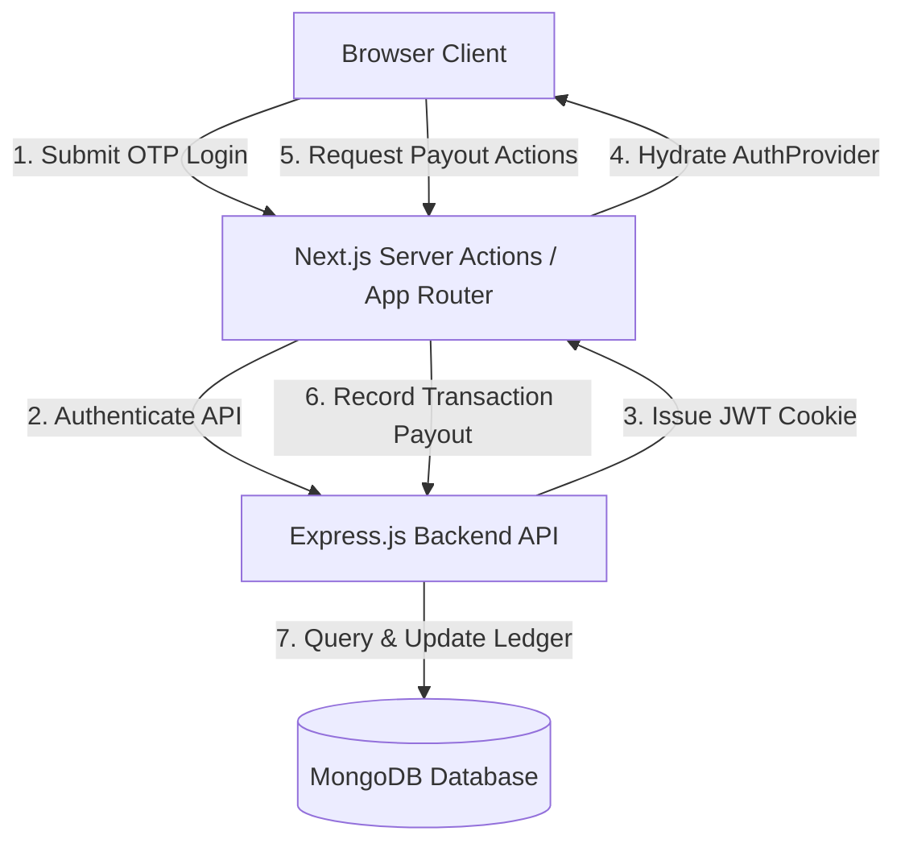

# EverCut Admin Panel

The **EverCut Admin Panel** is a Next.js operational dashboard that enables salon administrators to track day-to-day business metrics and manage manual payout settlements for barbers. It is completely decoupled from the main backend service, communicating securely with the Express.js API.

---

## 🚀 Getting Started

### 1. Environment Setup
Copy the example environment template and configure your base API URL:
```bash
cp .env.example .env
```
Ensure `.env` contains the correct address for the backend:
```ini
NEXT_PUBLIC_API_URL=http://localhost:5000/api/v1
```

### 2. Development Run
Install dependencies and launch the hot-reloading Next.js development server:
```bash
npm install
npm run dev
```
Open [http://localhost:3000](http://localhost:3000) to view the application.

### 3. Production Build & Start
Create an optimized production bundle and start the Node server:
```bash
npm run build
npm run start
```

---

## 🏛️ System Architecture

The admin frontend operates as a decoupled presentation layer. Authentication state, server-side route security, and backend API requests are organized through standard Next.js App Router patterns:



### Folder Structure
*   `src/app/` — Next.js routing hierarchy (using Route Groups to separate authentication pages from operational panels).
    *   `(admin)/` — Authenticated operations area (Overview and Payouts).
    *   `(auth)/` — Guest login and verification entry portal.
*   `src/components/` — Reusable visual controls:
    *   `forms/` — Standardized form fields (Inputs, Select, Textareas) bound to validations.
    *   `layout/` — Shell layout blocks: `Header`, `Sidebar`, and mobile `MobileNavigationDrawer`.
    *   `ui/` — Low-level display UI utilities (such as `TableSearchBar`).
*   `src/hooks/` — Custom React hooks (Zustand state store, context providers).
*   `src/lib/` — Base modules: fetch HTTP API client, data schemas, and service layers.

---

## 🧭 Routes & Features

The panel is strictly restricted to authorized pages matching the active backend deployment:

### 1. Verification Portal (`/login`)
*   **Security Access Control**: OTP-based entry locked to verified administrator phone numbers.
*   **JWT Session Lifecycle**: Authorizations are decoded from secure, HttpOnly cookies (`evercut_admin_session`) to validate role assertions.

### 2. Operations Overview (`/overview`)
*   **Performance Metrics**: Consolidates business performance stats including booking volumes, total revenues, and general earnings trackers.

### 3. Payout Ledger System (`/payouts`)
An end-to-end dashboard interface facilitating EOD financial settlements split into a tabbed layout:
*   **Pending Tab**: Retrieves outstanding barber balances from the database.
    *   **UPI QR Code**: Dynamic generation of payment QR codes directly inside the client using `qrcode` based on the backend `upiDeepLink`.
    *   **Mobile Optimizations**: Supports direct payment deep links and icon-only touch controls to eliminate screen wrapping on smaller viewports.
*   **History Tab**: Logs completed payout audits (populated with shop, barber profiles, and active records) to track transaction history.
*   **Settlement Modal**: Next.js server actions process manual transaction submissions, locking UTR / Ref IDs and logging audit trail notes.

---

## 📦 Key Dependencies

*   **Core Framework**: Next.js 16 / React 19
*   **State Management**: Zustand (manages sidebar layout collapse/expand states)
*   **Styling Theme**: Tailwind CSS v4 (mapped to the `#06C270` Emerald Green theme config)
*   **Data Validation**: Zod (client-side form inputs validation schemas)
*   **Table Layout**: TanStack Table v8 (handles server-side pagination, searching, and filters)
*   **Form Controller**: React Hook Form
*   **Media Assets**: Lucide React (vector UI icons) & QRCode (base64 image outputs builder)
