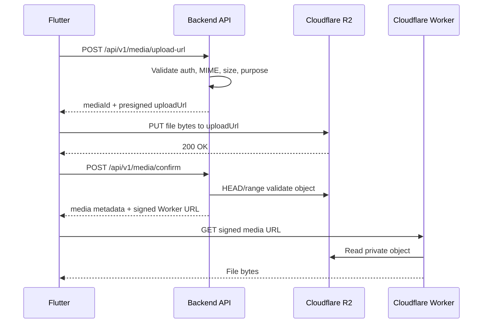

# Flutter Backend R2 Media Flow Guide

This guide explains how the Flutter app should interact with the EverCut backend after the Cloudflare R2 media migration.

## Environments

| Environment | Backend bucket | Recommended media delivery host | Current fallback |
|---|---|---|---|
| dev | `evercut-media-dev` | `https://media-dev.evercut.in` | `https://evercut-media-worker-dev.quantneural-evercut.workers.dev` |
| prod | `evercut-media-prod` | `https://media.evercut.in` | `https://evercut-media-worker.quantneural-evercut.workers.dev` |

Flutter should not hard-code bucket names or R2 endpoints. It should use URLs returned by the backend.

## Core Upload Pattern

All uploads use the same three-step flow:

1. Flutter asks the backend for a presigned upload URL.
2. Flutter uploads the file directly to Cloudflare R2 with `PUT`.
3. Flutter asks the backend to confirm the upload.

The backend stores R2 metadata and returns a signed media URL. Media files are private in R2 and are served only through the Cloudflare Worker.



## Authentication

| Flow | Token |
|---|---|
| Normal logged-in media routes | `Authorization: Bearer <accessToken>` |
| Onboarding media routes | `Authorization: Bearer <onboardingToken>` |
| Direct R2 `PUT` | No backend bearer token. Use the presigned URL exactly as returned. |
| Loading returned media URLs | No bearer token. The URL already contains short-lived `exp` and `token` query parameters. |

Do not strip query parameters from media URLs. The Worker needs them to authorize the request.

## Upload URL Route

### `POST /api/v1/media/upload-url`

Use after login for customer/barber media uploads.

Headers:

```http
Authorization: Bearer <accessToken>
Content-Type: application/json
```

Request:

```json
{
  "contentType": "image/png",
  "sizeBytes": 68422,
  "purpose": "gallery",
  "entityId": "optionalEntityObjectId",
  "originalName": "front-chair.png"
}
```

Allowed `purpose` values include avatar/profile/cover/gallery/employee/onboarding/service/video-specific purposes supported by the backend constants. Use the purpose that matches the next API action.

Success response, status `201`:

```json
{
  "success": true,
  "message": "Upload URL generated",
  "data": {
    "mediaId": "6808052d-604d-4bed-abd7-6a3a86ee3c2a",
    "uploadUrl": "https://...presigned-r2-url...",
    "requiredHeaders": {
      "Content-Type": "image/png"
    },
    "r2Key": "images/gallery/user-id/media-id.png",
    "expiresAt": "2026-05-12T12:00:00.000Z"
  }
}
```

Flutter action:

```http
PUT <data.uploadUrl>
Content-Type: image/png

<raw file bytes>
```

The direct upload is successful when R2 returns a 2xx status. Send only the client headers from `data.requiredHeaders`, preserve the full query string in `data.uploadUrl`, and do not send the EverCut bearer token or any other `Authorization` header to R2. The backend still validates the final object size during confirm, so if the file changes after requesting the URL, request a new upload URL.

## Confirm Upload Route

### `POST /api/v1/media/confirm`

Call only after direct R2 upload succeeds.

Headers:

```http
Authorization: Bearer <accessToken>
Content-Type: application/json
```

Request:

```json
{
  "mediaId": "6808052d-604d-4bed-abd7-6a3a86ee3c2a"
}
```

Success response, status `200`:

```json
{
  "success": true,
  "message": "Upload confirmed",
  "data": {
    "mediaId": "6808052d-604d-4bed-abd7-6a3a86ee3c2a",
    "cdnUrl": "https://media-dev.evercut.in/images/gallery/user/media.png?exp=...&token=...",
    "r2Key": "images/gallery/user/media.png",
    "contentType": "image/png",
    "fileSize": 68422
  }
}
```

The backend validates object existence, content type, size, and image magic bytes where applicable. If validation fails, the backend marks the media as failed and deletes the R2 object.

## Fetch and Delete Media

### `GET /api/v1/media/:id`

Returns one media record owned by the authenticated user.

Response:

```json
{
  "success": true,
  "message": "Media fetched",
  "data": {
    "id": "6808052d-604d-4bed-abd7-6a3a86ee3c2a",
    "type": "image",
    "status": "ready",
    "purpose": "gallery",
    "url": "https://...worker-url...?exp=...&token=...",
    "contentType": "image/png",
    "fileSize": 68422,
    "category": "interior",
    "description": "Front chair",
    "originalName": "front-chair.png",
    "entityId": "shopObjectId",
    "entityType": "Shop",
    "createdAt": "2026-05-12T11:43:29.000Z",
    "updatedAt": "2026-05-12T11:43:38.000Z"
  }
}
```

### `DELETE /api/v1/media/:id`

Soft-deletes the media record and schedules/delegates R2 deletion.

Response:

```json
{
  "success": true,
  "message": "Media deleted",
  "data": {}
}
```

## Gallery Routes

### `POST /api/v1/media/gallery`

Barber-only route. Attach confirmed media records to the barber's shop gallery.

Request:

```json
{
  "mediaIds": ["media-id-1", "media-id-2"],
  "category": "interior",
  "description": "Main shop gallery"
}
```

Success response, status `201`:

```json
{
  "success": true,
  "message": "Gallery media attached",
  "data": [
    {
      "id": "media-id-1",
      "type": "image",
      "status": "ready",
      "purpose": "gallery",
      "url": "https://...worker-url...?exp=...&token=...",
      "category": "interior",
      "description": "Main shop gallery"
    }
  ]
}
```

### `GET /api/v1/media/gallery`

Barber-only route.

Query parameters:

- `page`
- `limit`
- `category`, where `all` returns every category

Response:

```json
{
  "success": true,
  "message": "Gallery fetched",
  "data": [
    {
      "id": "media-id-1",
      "url": "https://...worker-url...?exp=...&token=...",
      "category": "interior"
    }
  ],
  "meta": {
    "pagination": {
      "page": 1,
      "limit": 20,
      "total": 1,
      "totalPages": 1
    }
  }
}
```

### `GET /api/v1/media/gallery/stats`

Barber-only route. Returns gallery usage/count information for the authenticated barber's shop.

## Onboarding Media Routes

Onboarding uses the same upload/confirm pattern but authenticates with an onboarding token from OTP verification.

### `POST /api/v1/media/onboarding/upload-url`

Headers:

```http
Authorization: Bearer <onboardingToken>
Content-Type: application/json
```

Request body is the same as `/api/v1/media/upload-url`. The backend associates the pending media with the onboarding phone number until the profile is created.

### `POST /api/v1/media/onboarding/confirm`

Headers:

```http
Authorization: Bearer <onboardingToken>
Content-Type: application/json
```

Request:

```json
{
  "mediaId": "onboarding-media-id"
}
```

Use the confirmed `mediaId` as `photoMediaId` in the onboarding create route.

## Routes That Consume `mediaId`

These routes do not upload files directly. Flutter should upload and confirm media first, then pass the returned media ID.

| Route | Auth | Field |
|---|---|---|
| `POST /api/v1/onboarding/customers` | onboarding token | `photoMediaId` |
| `POST /api/v1/onboarding/barbers` | onboarding token | `photoMediaId` |
| `PATCH /api/v1/customers/me` | customer access token | `photoMediaId` |
| `POST /api/v1/employees` | barber access token | `photoMediaId` |
| `PATCH /api/v1/employees/:id` | barber access token | `photoMediaId` |
| `PATCH /api/v1/shops/me/media/picture` | barber access token | `mediaId` |
| `PATCH /api/v1/shops/me/media/cover` | barber access token | `mediaId` |

Example profile update:

```json
{
  "firstName": "Asha",
  "photoMediaId": "confirmed-media-id"
}
```

Example shop picture update:

```json
{
  "mediaId": "confirmed-media-id"
}
```

## Loading Media in Flutter

Backend responses may include fields such as:

- `url` for generic media resources such as gallery media
- `photoUrl` for customer, employee, and barber-owner profile photos
- `coverUrl`
- `ownerPhotoUrl`

These are signed Worker URLs. Flutter should pass the full URL directly to the image/video loader. Do not rebuild the URL client-side.

Signed URLs expire. If image loading returns `401`, refetch the parent API resource to receive a fresh signed URL.

## Error Handling

Backend errors use this envelope:

```json
{
  "success": false,
  "message": "Validation failed",
  "data": {
    "errors": ["\"contentType\" must be one of ..."]
  }
}
```

Common cases:

| Step | Status | Cause | Flutter action |
|---|---:|---|---|
| Upload URL request | `400` | Unsupported MIME, invalid size, invalid purpose | Show validation error; do not upload |
| Upload URL request | `401` | Missing/expired token | Refresh login/onboarding flow |
| Upload URL request | `403` | Role not allowed for route | Hide/disable feature for role |
| Direct R2 PUT | non-2xx | Expired URL, network failure, header mismatch | Request a new upload URL and retry |
| Confirm upload | `400` | Object missing, MIME mismatch, invalid image bytes | Re-upload file |
| Fetch media | `404` | Media not found or deleted | Remove stale local reference |
| Worker media GET | `401` | Signed URL missing, invalid, or expired | Refetch backend resource for new URL |
| Worker media GET | `404` | Object missing from R2 | Show placeholder and report issue |

## Environment Behavior

Dev and prod use the same API contract. Differences are infrastructure-only:

- Dev media is stored in `evercut-media-dev`.
- Prod media is stored in `evercut-media-prod`.
- Dev signed media URLs should use `media-dev.evercut.in` after custom domain setup.
- Prod signed media URLs should use `media.evercut.in` after custom domain setup.
- Dev Worker allows localhost origins for web testing.
- Prod Worker allows only production web origins.
- Native Flutter requests normally do not send browser CORS origins, so CORS primarily affects Flutter web and browser-based QA tools.

## Implementation Checklist for Flutter

- Request upload URL from backend before uploading bytes.
- Upload directly to `uploadUrl` using the returned `requiredHeaders`; do not attach API authorization headers to the R2 request.
- Confirm upload with `mediaId` only after R2 returns success.
- Store/use backend resource IDs, not R2 keys.
- Display returned signed URLs as-is.
- Refetch API resources when signed media URLs expire.
- Use onboarding media routes before account creation.
- Use normal media routes after login.