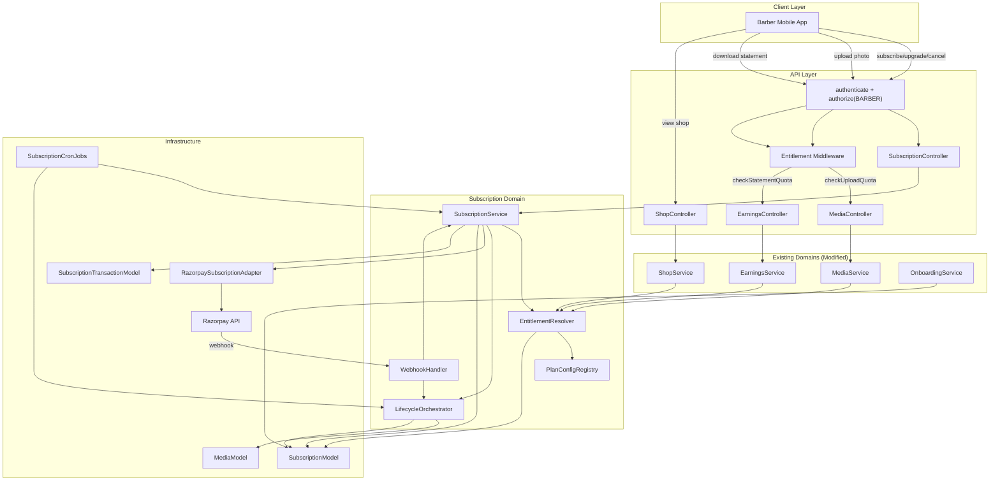
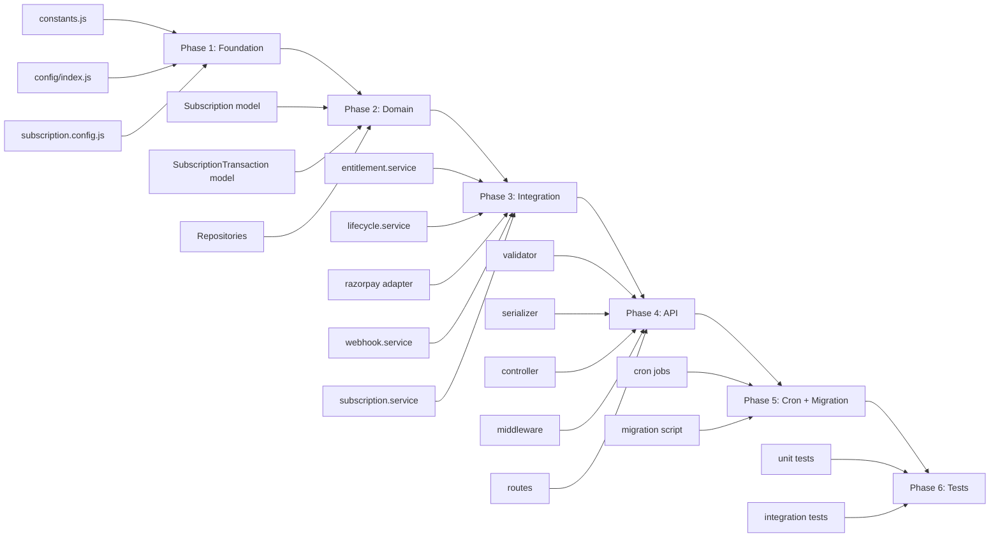

# EverCut — Subscription Internal Implementation Documentation

**Document Type:** Technical Architecture & Implementation Reference
**Audience:** Backend Engineers, Architects, Code Reviewers
**Scope:** Complete subscription system design for the EverCut `server/` codebase
**Status:** Production-Ready Architecture Blueprint
**Last Updated:** 2026-05-21

---

## 1. Executive Summary

### 1.1 Purpose

This document defines the **complete technical architecture** for EverCut's barber subscription system. It serves as the authoritative implementation reference — every model, service, adapter, route, middleware, validator, serializer, cron job, and enforcement flow is specified here with code-level precision.

### 1.2 Scope

| In Scope | Out of Scope |
|---|---|
| Subscription domain architecture | External gateway setup (see SUBSCRIPTION-EXTERNAL-SETUP-DOCUMENTATION.md) |
| Data models and schemas | Mobile app UI implementation |
| Entitlement resolution system | Admin dashboard implementation |
| Lifecycle orchestration | Customer-facing subscription features |
| Webhook processing | Analytics/reporting dashboards |
| Upload and statement enforcement | A/B testing of plans |
| Hidden media system | Multi-currency support |
| Verification badge and visibility | International expansion |
| Background jobs | |
| Migration strategy | |
| Testing strategy | |

### 1.3 Confirmed Business Decisions

| Decision | Confirmation |
|---|---|
| Plans | Basic (free), Popular (₹299/mo), Advanced (₹499/mo) |
| Billing cycle | 30-day fixed, auto-renew via UPI AutoPay |
| Payment gateway | Razorpay Subscriptions |
| Cancellation policy | End-of-cycle (retain access until period end) |
| Grace period | None — expire immediately on failed renewal |
| Hidden media ordering | Newest hidden first (LIFO); oldest remain visible |
| Upload counters | Cumulative lifetime; never decrement |
| Verification badge | Derived at read-time from active plan; not stored |
| Visibility tier | Derived at read-time from active plan; not stored |

### 1.4 Architecture Philosophy

The subscription system is built on four non-negotiable principles:

1. **Centralized Entitlement Resolution** — Every feature gate queries a single entitlement resolver. No scattered `if (plan === 'advanced')` checks. Adding a new feature limit means adding one line to plan config and one call to the resolver.

2. **Plan Configuration as Code** — Plan definitions, feature limits, and pricing live in a versioned config file — not in the database. Changes are reviewed via code review, deployed atomically, and rolled back via git. Future migration to DB-driven plans is possible without architectural changes.

3. **Separation of Subscription from Identity** — The Subscription model is a separate entity from the Barber model. They have a 1:1 relationship but different lifecycles. This prevents subscription state from contaminating the barber identity model and enables clean audit history.

4. **Idempotent Event Processing** — Every webhook handler and lifecycle transition is idempotent. Processing the same event twice produces no additional side effects. This is critical for webhook retry scenarios and reconciliation operations.

---

## 2. Architecture Overview

### 2.1 High-Level Domain Architecture



### 2.2 How the Subscription Domain Fits Into the Existing Architecture

The existing EverCut architecture follows a clean **Controller → Service → Repository → Model** pattern with horizontal middleware (authenticate, authorize, validate). The subscription system integrates at **three precise points**:

#### Integration Point 1: New Domain (Subscription CRUD + Billing)
A completely new vertical slice: `subscription.routes.js` → `subscription.controller.js` → `subscription.service.js` → `subscription.repository.js` → `Subscription` model. This follows the exact same pattern as existing domains (booking, payment, media, etc.).

#### Integration Point 2: Enforcement Injection (Existing Services)
The `EntitlementResolver` is injected into existing services where feature gates are needed:
- **`media.service.js`** — Upload quota enforcement (photos and videos)
- **`earnings.service.js`** — Statement download limit enforcement
- **`shop.service.js`** — Badge and visibility tier derivation

These are **surgical injections**, not rewrites. The existing logic remains intact — entitlement checks are added as guard clauses before existing operations.

#### Integration Point 3: Lifecycle Hook (Onboarding)
The `onboarding.service.js` gains a single addition: creating a default `Subscription` record with `planId = PLAN_BASIC` and `status = ACTIVE` when a new barber registers. This ensures every barber always has a subscription record.

### 2.3 Component Interaction Patterns

#### Pattern A: Subscription Purchase Flow
```
Barber taps "Subscribe to Popular"
  → POST /api/v1/subscriptions/subscribe { planId: "PLAN_POPULAR" }
  → authenticate → authorize(BARBER) → validate
  → SubscriptionController.subscribe()
  → SubscriptionService.createSubscription(barberId, planId)
    → Validate no active paid subscription exists
    → RazorpayAdapter.createSubscription({ planId, customerId })
    → Create Subscription record (status: PENDING_PAYMENT)
    → Create SubscriptionTransaction (type: CREATION)
    → Return Razorpay checkout URL
  → Barber completes payment in Razorpay checkout
  → Razorpay sends webhook: subscription.activated
  → POST /api/v1/subscriptions/webhook
  → WebhookHandler.handleSubscriptionActivated(payload)
    → Verify signature
    → Check idempotency (webhookEventId)
    → Update Subscription: status=ACTIVE, plan=PLAN_POPULAR, dates set
    → Create SubscriptionTransaction (type: ACTIVATION)
    → LifecycleOrchestrator.onSubscriptionActivated()
      → reactivateHiddenMedia() (if any hidden from previous plan)
```

#### Pattern B: Entitlement-Gated Operation (Upload)
```
Barber uploads a photo
  → POST /api/v1/media/upload-url
  → authenticate → authorize(BARBER) → checkUploadQuota('image')
    → EntitlementResolver.canUploadPhoto(barberId)
      → Load Subscription for barberId
      → Get planId from subscription
      → Get photoLimit from PlanConfig[planId]
      → Get totalPhotosUploaded from subscription
      → Return totalPhotosUploaded < photoLimit
    → If false: throw ForbiddenError("Upload limit reached. Upgrade your plan.")
  → MediaController.requestUploadUrl() proceeds normally
  → On confirmUpload success:
    → Subscription.totalPhotosUploaded += 1 (atomic increment)
```

#### Pattern C: Webhook-Driven Lifecycle Transition
```
Razorpay charges renewal payment
  → POST /api/v1/subscriptions/webhook (subscription.charged)
  → WebhookHandler.handleWebhook(headers, rawBody)
    → Verify HMAC-SHA256 signature
    → Parse payload → extract event type
    → Check idempotency: has webhookEventId been processed?
    → Route to handleSubscriptionCharged(payload)
      → Find Subscription by razorpaySubscriptionId
      → Guard: subscription must be ACTIVE
      → Update currentPeriodStart, currentPeriodEnd
      → Reset statementsDownloadedThisPeriod = 0
      → Create SubscriptionTransaction (type: RENEWAL)
      → LifecycleOrchestrator.onSubscriptionRenewed()
```

### 2.4 Key Design Decisions — Rationale

#### Why a Separate Subscription Model (Not Embedded in Barber)

| Consideration | Embedded (rejected) | Separate Model (chosen) |
|---|---|---|
| Schema clarity | Barber model grows with subscription fields | Clean separation of concerns |
| Audit trail | Difficult to track subscription changes | Full lifecycle history via SubscriptionTransaction |
| Query performance | Extra fields on every barber query | Subscription loaded only when needed |
| Future flexibility | Tightly coupled | Easy to add multi-subscription, family plans, etc. |
| Migration | Alters existing Barber documents | New collection; no existing data modified |
| Testing | Must mock barber + subscription together | Test subscription domain independently |

#### Why Plan Config in Code (Not Database)

| Consideration | Database (deferred) | Code Config (chosen for Phase 1) |
|---|---|---|
| Change frequency | Plans change rarely (quarterly at most) | Config changes are version-controlled and reviewed |
| Deployment | Requires migration or admin panel | Deploy with code; rollback with git |
| Complexity | Needs admin CRUD, validation, caching | Simple JS object; zero infrastructure |
| Type safety | Schema validation at runtime | IDE autocomplete, linting at development time |
| Future migration | N/A | Architecture supports seamless migration to DB-driven plans |

#### Why Centralized Entitlement Resolver (Not Scattered Checks)

The alternative is checking plan capabilities inline wherever they're needed:
```javascript
// ❌ BAD: Scattered plan logic
if (barber.subscription.planId === 'PLAN_ADVANCED') {
  maxPhotos = 50;
} else if (barber.subscription.planId === 'PLAN_POPULAR') {
  maxPhotos = 30;
} else {
  maxPhotos = 10;
}
```

This violates DRY, is fragile (adding a new plan requires touching every enforcement point), and makes testing difficult. The entitlement resolver centralizes this:

```javascript
// ✅ GOOD: Centralized resolution
const { photoLimit } = await entitlementResolver.resolveEntitlements(barberId);
if (subscription.totalPhotosUploaded >= photoLimit) {
  throw new ForbiddenError('Upload limit reached');
}
```

---

## 3. Plan Configuration Architecture

### 3.1 Config File: `config/subscription.config.js`

This is the **single source of truth** for all plan definitions, feature limits, and pricing. Every component in the subscription domain reads from this config — nothing is hardcoded elsewhere.

```javascript
// server/src/config/subscription.config.js

/**
 * EverCut Subscription Plan Configuration
 * ────────────────────────────────────────
 * SINGLE SOURCE OF TRUTH for all plan definitions.
 * 
 * To add a new plan:
 *   1. Add a new entry to PLANS
 *   2. Add the plan ID to PLAN_IDS enum
 *   3. Add Razorpay plan ID to environment variables
 *   4. Update constants.js with the new PLAN_ID enum value
 *   5. Deploy — no database migration needed
 * 
 * To change a limit:
 *   1. Update the value in the relevant plan's `capabilities` object
 *   2. Deploy — existing subscribers get the new limit immediately
 */

import config from './index.js';

export const PLAN_IDS = Object.freeze({
  BASIC: 'PLAN_BASIC',
  POPULAR: 'PLAN_POPULAR',
  ADVANCED: 'PLAN_ADVANCED',
});

export const BADGE_TYPES = Object.freeze({
  NONE: 'NONE',
  BLUE: 'BLUE',
  YELLOW: 'YELLOW',
});

export const VISIBILITY_TIERS = Object.freeze({
  NONE: 'NONE',
  LOCAL: 'LOCAL',
  PRIORITY: 'PRIORITY',
});

export const SUPPORT_TIERS = Object.freeze({
  STANDARD: 'STANDARD',
  PREMIUM_BASIC: 'PREMIUM_BASIC',
  PREMIUM_PRIORITY: 'PREMIUM_PRIORITY',
});

/**
 * Plan definitions.
 * 
 * `razorpayPlanId` is null for the Basic plan (free, no billing).
 * `capabilities` defines all feature limits and derived properties.
 * `pricing` defines display information (actual billing is via Razorpay).
 */
export const PLANS = Object.freeze({
  [PLAN_IDS.BASIC]: {
    id: PLAN_IDS.BASIC,
    name: 'Basic',
    label: 'Starter Plan',
    description: 'Get started with essential features.',
    isFree: true,
    razorpayPlanId: null,
    pricing: {
      amount: 0,
      currency: 'INR',
      period: 'monthly',
      displayPrice: 'Free',
    },
    capabilities: {
      maxPhotos: 10,
      maxVideos: 2,
      maxStatementsPerCycle: 1,
      badge: BADGE_TYPES.NONE,
      visibilityTier: VISIBILITY_TIERS.NONE,
      supportTier: SUPPORT_TIERS.STANDARD,
      priorityListingBoost: 0,
      analyticsAccess: false,
      promotionalTools: false,
    },
    sortOrder: 0,
  },

  [PLAN_IDS.POPULAR]: {
    id: PLAN_IDS.POPULAR,
    name: 'Popular',
    label: 'Most Recommended',
    description: 'Enhanced reach & local visibility for growing salons.',
    isFree: false,
    razorpayPlanId: config.razorpay?.planIdPopular || null,
    pricing: {
      amount: 29900, // paise (₹299)
      currency: 'INR',
      period: 'monthly',
      displayPrice: '₹299/month',
    },
    capabilities: {
      maxPhotos: 30,
      maxVideos: 10,
      maxStatementsPerCycle: 5,
      badge: BADGE_TYPES.BLUE,
      visibilityTier: VISIBILITY_TIERS.LOCAL,
      supportTier: SUPPORT_TIERS.PREMIUM_BASIC,
      priorityListingBoost: 1,
      analyticsAccess: false,
      promotionalTools: false,
    },
    sortOrder: 1,
  },

  [PLAN_IDS.ADVANCED]: {
    id: PLAN_IDS.ADVANCED,
    name: 'Advanced',
    label: 'Premium Growth',
    description: 'Maximum exposure & priority reach for top salons.',
    isFree: false,
    razorpayPlanId: config.razorpay?.planIdAdvanced || null,
    pricing: {
      amount: 49900, // paise (₹499)
      currency: 'INR',
      period: 'monthly',
      displayPrice: '₹499/month',
    },
    capabilities: {
      maxPhotos: 50,
      maxVideos: 15,
      maxStatementsPerCycle: 10,
      badge: BADGE_TYPES.YELLOW,
      visibilityTier: VISIBILITY_TIERS.PRIORITY,
      supportTier: SUPPORT_TIERS.PREMIUM_PRIORITY,
      priorityListingBoost: 2,
      analyticsAccess: true,
      promotionalTools: true,
    },
    sortOrder: 2,
  },
});

/**
 * Retrieve a plan by ID. Returns the Basic plan as fallback for unknown IDs.
 * @param {string} planId - One of PLAN_IDS values
 * @returns {object} Plan definition
 */
export function getPlan(planId) {
  return PLANS[planId] || PLANS[PLAN_IDS.BASIC];
}

/**
 * Retrieve capabilities for a plan.
 * @param {string} planId - One of PLAN_IDS values
 * @returns {object} Capabilities object
 */
export function getPlanCapabilities(planId) {
  return getPlan(planId).capabilities;
}

/**
 * Get all plans sorted by sortOrder (for display to barbers).
 * @returns {object[]} Array of plan definitions
 */
export function getAllPlans() {
  return Object.values(PLANS).sort((a, b) => a.sortOrder - b.sortOrder);
}

/**
 * Resolve a Razorpay plan ID to an internal plan ID.
 * @param {string} razorpayPlanId - Razorpay's plan identifier
 * @returns {string|null} Internal plan ID or null if not found
 */
export function resolveRazorpayPlanId(razorpayPlanId) {
  const plan = Object.values(PLANS).find((p) => p.razorpayPlanId === razorpayPlanId);
  return plan?.id || null;
}

/**
 * Check if a plan transition is valid.
 * @param {string} fromPlanId - Current plan ID
 * @param {string} toPlanId - Target plan ID
 * @returns {{ valid: boolean, type: string|null }} Transition validity and type
 */
export function validatePlanTransition(fromPlanId, toPlanId) {
  if (fromPlanId === toPlanId) {
    return { valid: false, type: null, reason: 'Already on this plan' };
  }

  const fromPlan = getPlan(fromPlanId);
  const toPlan = getPlan(toPlanId);

  if (toPlan.sortOrder > fromPlan.sortOrder) {
    return { valid: true, type: 'UPGRADE' };
  }

  if (toPlan.sortOrder < fromPlan.sortOrder) {
    return { valid: true, type: 'DOWNGRADE' };
  }

  return { valid: false, type: null, reason: 'Invalid transition' };
}
```

### 3.2 How to Extend Plan Configuration

#### Adding a New Plan (e.g., "Enterprise")
1. Add `ENTERPRISE: 'PLAN_ENTERPRISE'` to `PLAN_IDS`
2. Add the plan object to `PLANS` with all capabilities defined
3. Add `RAZORPAY_PLAN_ID_ENTERPRISE` environment variable
4. Add `PLAN_ENTERPRISE` to the `SUBSCRIPTION_PLANS` enum in `constants.js`
5. Deploy — no database migration, no model changes

#### Adding a New Feature Limit (e.g., "maxEmployees")
1. Add `maxEmployees: <value>` to each plan's `capabilities` object
2. Add corresponding enforcement in the relevant service
3. Deploy — existing subscribers get the new limit immediately

#### Changing an Existing Limit
1. Update the value in the plan's `capabilities` object
2. Deploy — takes effect immediately for all subscribers on that plan
3. If the limit is being **reduced**, the hidden media reconciliation job will handle excess media

---

## 4. Entitlement System Architecture

### 4.1 Entitlement Resolver: `services/subscription/entitlement.service.js`

The `EntitlementResolver` is the **central brain** of the subscription system. Every component that needs to check a barber's capabilities calls this service. It never exposes plan internals — only resolved capabilities.

```javascript
// server/src/services/subscription/entitlement.service.js

import { getPlanCapabilities, getPlan, PLAN_IDS } from '../../config/subscription.config.js';
import subscriptionRepository from '../../repositories/subscription.repository.js';
import logger from '../../utils/logger.js';

const LOG_PREFIX = '[EntitlementResolver]';

/**
 * Subscription statuses that grant active plan entitlements.
 * CANCELLED subscriptions retain access until currentPeriodEnd.
 */
const ACTIVE_ENTITLEMENT_STATUSES = ['ACTIVE', 'CANCELLED', 'PAST_DUE'];

/**
 * Resolves a barber's active subscription into a concrete capability set.
 * 
 * Resolution logic:
 *   1. Load the barber's subscription record
 *   2. If no record exists → Basic capabilities
 *   3. If subscription status is not in ACTIVE_ENTITLEMENT_STATUSES → Basic
 *   4. If subscription is CANCELLED but currentPeriodEnd has passed → Basic
 *   5. Otherwise → plan capabilities from config
 * 
 * @param {string} barberId - Barber's ObjectId
 * @returns {Promise<object>} Resolved entitlement object
 */
async function resolveEntitlements(barberId) {
  const subscription = await subscriptionRepository.findByBarberId(barberId);

  // No subscription record → Basic plan
  if (!subscription) {
    logger.debug(`${LOG_PREFIX} No subscription for barber ${barberId}, defaulting to Basic`);
    return _buildEntitlementResponse(PLAN_IDS.BASIC, null);
  }

  // Check if the subscription grants active entitlements
  const isEntitled = _isSubscriptionEntitled(subscription);

  if (!isEntitled) {
    logger.debug(`${LOG_PREFIX} Subscription ${subscription._id} not entitled (status: ${subscription.status})`);
    return _buildEntitlementResponse(PLAN_IDS.BASIC, subscription);
  }

  return _buildEntitlementResponse(subscription.planId, subscription);
}

/**
 * Check if a barber can upload a photo (has remaining quota).
 * @param {string} barberId
 * @returns {Promise<{ allowed: boolean, current: number, limit: number }>}
 */
async function canUploadPhoto(barberId) {
  const subscription = await subscriptionRepository.findByBarberId(barberId);
  const planId = _getActivePlanId(subscription);
  const { maxPhotos } = getPlanCapabilities(planId);
  const current = subscription?.totalPhotosUploaded || 0;

  return {
    allowed: current < maxPhotos,
    current,
    limit: maxPhotos,
    remaining: Math.max(0, maxPhotos - current),
  };
}

/**
 * Check if a barber can upload a video (has remaining quota).
 * @param {string} barberId
 * @returns {Promise<{ allowed: boolean, current: number, limit: number }>}
 */
async function canUploadVideo(barberId) {
  const subscription = await subscriptionRepository.findByBarberId(barberId);
  const planId = _getActivePlanId(subscription);
  const { maxVideos } = getPlanCapabilities(planId);
  const current = subscription?.totalVideosUploaded || 0;

  return {
    allowed: current < maxVideos,
    current,
    limit: maxVideos,
    remaining: Math.max(0, maxVideos - current),
  };
}

/**
 * Check if a barber can download a statement this billing cycle.
 * @param {string} barberId
 * @returns {Promise<{ allowed: boolean, current: number, limit: number }>}
 */
async function canDownloadStatement(barberId) {
  const subscription = await subscriptionRepository.findByBarberId(barberId);
  const planId = _getActivePlanId(subscription);
  const { maxStatementsPerCycle } = getPlanCapabilities(planId);
  const current = subscription?.statementsDownloadedThisPeriod || 0;

  return {
    allowed: current < maxStatementsPerCycle,
    current,
    limit: maxStatementsPerCycle,
    remaining: Math.max(0, maxStatementsPerCycle - current),
  };
}

/**
 * Get the verification badge for a barber.
 * @param {string} barberId
 * @returns {Promise<string>} Badge type: NONE, BLUE, or YELLOW
 */
async function getBadge(barberId) {
  const subscription = await subscriptionRepository.findByBarberId(barberId);
  const planId = _getActivePlanId(subscription);
  return getPlanCapabilities(planId).badge;
}

/**
 * Get the visibility tier for a barber.
 * @param {string} barberId
 * @returns {Promise<string>} Visibility tier: NONE, LOCAL, or PRIORITY
 */
async function getVisibilityTier(barberId) {
  const subscription = await subscriptionRepository.findByBarberId(barberId);
  const planId = _getActivePlanId(subscription);
  return getPlanCapabilities(planId).visibilityTier;
}

// ─── Private Helpers ───────────────────────────────────────────────

/**
 * Determines if a subscription currently grants plan entitlements.
 */
function _isSubscriptionEntitled(subscription) {
  if (!ACTIVE_ENTITLEMENT_STATUSES.includes(subscription.status)) {
    return false;
  }

  // CANCELLED subscriptions retain access until currentPeriodEnd
  if (subscription.status === 'CANCELLED' && subscription.currentPeriodEnd) {
    return new Date() < new Date(subscription.currentPeriodEnd);
  }

  return true;
}

/**
 * Gets the effective plan ID for a subscription, considering entitlement status.
 */
function _getActivePlanId(subscription) {
  if (!subscription || !_isSubscriptionEntitled(subscription)) {
    return PLAN_IDS.BASIC;
  }
  return subscription.planId;
}

/**
 * Builds the full entitlement response object.
 */
function _buildEntitlementResponse(planId, subscription) {
  const plan = getPlan(planId);
  const capabilities = getPlanCapabilities(planId);

  return {
    planId,
    planName: plan.name,
    planLabel: plan.label,
    isFree: plan.isFree,

    // Resolved capabilities
    ...capabilities,

    // Usage counters (from subscription record)
    totalPhotosUploaded: subscription?.totalPhotosUploaded || 0,
    totalVideosUploaded: subscription?.totalVideosUploaded || 0,
    statementsDownloadedThisPeriod: subscription?.statementsDownloadedThisPeriod || 0,

    // Derived remaining quotas
    remainingPhotos: Math.max(0, capabilities.maxPhotos - (subscription?.totalPhotosUploaded || 0)),
    remainingVideos: Math.max(0, capabilities.maxVideos - (subscription?.totalVideosUploaded || 0)),
    remainingStatements: Math.max(0, capabilities.maxStatementsPerCycle - (subscription?.statementsDownloadedThisPeriod || 0)),

    // Subscription metadata
    subscriptionStatus: subscription?.status || 'NONE',
    currentPeriodEnd: subscription?.currentPeriodEnd || null,
    cancelAtPeriodEnd: subscription?.cancelAtPeriodEnd || false,
  };
}

export default {
  resolveEntitlements,
  canUploadPhoto,
  canUploadVideo,
  canDownloadStatement,
  getBadge,
  getVisibilityTier,
};
```

### 4.2 Enforcement Middleware: `middleware/entitlement.middleware.js`

Reusable Express middleware that gates routes based on entitlements. Plugs into the existing middleware chain pattern: `authenticate → authorize(BARBER) → checkUploadQuota('image') → controller`.

```javascript
// server/src/middleware/entitlement.middleware.js

import entitlementService from '../services/subscription/entitlement.service.js';
import { ForbiddenError } from '../utils/api-error.js';

/**
 * Middleware: Enforce upload quota for a media type.
 * 
 * Usage in routes:
 *   router.post('/upload-url', authenticate, authorize('BARBER'), checkUploadQuota('image'), controller.requestUploadUrl);
 *   router.post('/upload-url', authenticate, authorize('BARBER'), checkUploadQuota('video'), controller.requestUploadUrl);
 * 
 * @param {'image'|'video'} mediaType - The type of media being uploaded
 * @returns {Function} Express middleware
 */
export function checkUploadQuota(mediaType) {
  return async (req, _res, next) => {
    try {
      const barberId = req.user.barberId;

      let quotaCheck;
      if (mediaType === 'image') {
        quotaCheck = await entitlementService.canUploadPhoto(barberId);
      } else if (mediaType === 'video') {
        quotaCheck = await entitlementService.canUploadVideo(barberId);
      } else {
        // Non-gallery media (avatar, cover, etc.) — no subscription limit
        return next();
      }

      if (!quotaCheck.allowed) {
        throw new ForbiddenError(
          `You have reached your ${mediaType} upload limit (${quotaCheck.limit}). ` +
          `Upgrade your plan to upload more.`,
          {
            code: 'UPLOAD_QUOTA_EXCEEDED',
            current: quotaCheck.current,
            limit: quotaCheck.limit,
            mediaType,
          }
        );
      }

      // Attach quota info for downstream use
      req.uploadQuota = quotaCheck;
      next();
    } catch (error) {
      next(error);
    }
  };
}

/**
 * Middleware: Enforce statement download quota.
 * 
 * Usage in routes:
 *   router.get('/statement', authenticate, authorize('BARBER'), checkStatementQuota(), controller.getStatement);
 * 
 * @returns {Function} Express middleware
 */
export function checkStatementQuota() {
  return async (req, _res, next) => {
    try {
      const barberId = req.user.barberId;
      const quotaCheck = await entitlementService.canDownloadStatement(barberId);

      if (!quotaCheck.allowed) {
        throw new ForbiddenError(
          `You have reached your statement download limit (${quotaCheck.limit} per billing cycle). ` +
          `Upgrade your plan for more downloads.`,
          {
            code: 'STATEMENT_QUOTA_EXCEEDED',
            current: quotaCheck.current,
            limit: quotaCheck.limit,
          }
        );
      }

      req.statementQuota = quotaCheck;
      next();
    } catch (error) {
      next(error);
    }
  };
}

/**
 * Middleware: Require a specific plan or higher.
 * 
 * Usage in routes:
 *   router.get('/analytics', authenticate, authorize('BARBER'), requirePlan('PLAN_ADVANCED'), controller.getAnalytics);
 * 
 * @param {...string} allowedPlanIds - Plan IDs that are allowed access
 * @returns {Function} Express middleware
 */
export function requirePlan(...allowedPlanIds) {
  return async (req, _res, next) => {
    try {
      const barberId = req.user.barberId;
      const entitlements = await entitlementService.resolveEntitlements(barberId);

      if (!allowedPlanIds.includes(entitlements.planId)) {
        throw new ForbiddenError(
          'This feature requires a higher plan. Upgrade to access it.',
          {
            code: 'PLAN_REQUIRED',
            currentPlan: entitlements.planId,
            requiredPlans: allowedPlanIds,
          }
        );
      }

      req.entitlements = entitlements;
      next();
    } catch (error) {
      next(error);
    }
  };
}
```

### 4.3 How Entitlements Are Consumed by Existing Services

#### In `media.service.js` (Upload Quota)

The upload quota middleware gates access at the route level. Additionally, the `confirmUpload` method in `media.service.js` increments the counter:

```javascript
// In media.service.js — after successful confirmUpload for gallery media:
if (media.purpose === MEDIA_PURPOSE.GALLERY) {
  const mediaType = media.type === 'image' ? 'photo' : 'video';
  await subscriptionRepository.incrementUploadCounter(userId, mediaType);
}
```

#### In `earnings.service.js` (Statement Download)

The statement quota middleware gates access at the route level. Additionally, after successful PDF generation:

```javascript
// In earnings.service.js — after successful statement generation:
await subscriptionRepository.incrementStatementCounter(barberId);
```

#### In `shop.service.js` (Badge + Visibility)

Badge and visibility tier are injected into shop profile responses:

```javascript
// In shop.service.js — when building shop profile:
const badge = await entitlementService.getBadge(shop.barberId);
const visibilityTier = await entitlementService.getVisibilityTier(shop.barberId);
// Include in response
```

---
## 5. Data Model Architecture

### 5.1 Subscription Model: `models/subscription.model.js`

The Subscription model is the core domain entity. It holds the subscription lifecycle state, billing references, and usage counters. Every barber has exactly one Subscription document (created during onboarding).

```javascript
// server/src/models/subscription.model.js

import mongoose from 'mongoose';
import {
  SUBSCRIPTION_STATUSES,
  SUBSCRIPTION_PLANS,
} from '../utils/constants.js';

const { Schema, model, SchemaTypes } = mongoose;

const subscriptionSchema = new Schema(
  {
    /**
     * Reference to the Barber who owns this subscription.
     * Unique constraint ensures 1:1 relationship.
     */
    barberId: {
      type: SchemaTypes.ObjectId,
      ref: 'Barber',
      required: true,
      unique: true,
      index: true,
    },

    /**
     * Current plan identifier. Maps to PLANS config keys.
     * Default is PLAN_BASIC for all new barbers.
     */
    planId: {
      type: String,
      enum: Object.values(SUBSCRIPTION_PLANS),
      required: true,
      default: SUBSCRIPTION_PLANS.BASIC,
    },

    /**
     * Subscription lifecycle status.
     *
     * ACTIVE — Plan features fully available.
     * PENDING_PAYMENT — Awaiting first payment (Razorpay checkout initiated).
     * CANCELLED — Barber cancelled; access retained until currentPeriodEnd.
     * EXPIRED — Billing failed or period ended after cancellation; reverted to Basic.
     * PAST_DUE — Payment retry in progress; features still available.
     * PAUSED — UPI mandate paused externally; features available until period end.
     */
    status: {
      type: String,
      enum: Object.values(SUBSCRIPTION_STATUSES),
      required: true,
      default: SUBSCRIPTION_STATUSES.ACTIVE,
      index: true,
    },

    // ─── Razorpay References ─────────────────────────────────────

    /**
     * Razorpay subscription ID (e.g., "sub_XYZ789").
     * Null for Basic plan (no Razorpay subscription).
     */
    razorpaySubscriptionId: {
      type: String,
      default: null,
      sparse: true,
      index: true,
    },

    /**
     * Razorpay customer ID (e.g., "cust_ABC123").
     * Created once per barber on first subscription.
     */
    razorpayCustomerId: {
      type: String,
      default: null,
    },

    // ─── Billing Cycle ───────────────────────────────────────────

    /**
     * Start of the current billing period. Null for Basic plan.
     */
    currentPeriodStart: {
      type: Date,
      default: null,
    },

    /**
     * End of the current billing period. Used for:
     * - Determining when to expire cancelled subscriptions
     * - Triggering renewal charges
     * Null for Basic plan.
     */
    currentPeriodEnd: {
      type: Date,
      default: null,
      index: true,
    },

    /**
     * Timestamp of the last successful renewal payment.
     */
    lastRenewalAt: {
      type: Date,
      default: null,
    },

    // ─── Cancellation ────────────────────────────────────────────

    /**
     * Whether the subscription is set to cancel at the end of the current period.
     * True when barber cancels — they retain access until currentPeriodEnd.
     */
    cancelAtPeriodEnd: {
      type: Boolean,
      default: false,
    },

    /**
     * Timestamp when the barber requested cancellation.
     */
    cancelledAt: {
      type: Date,
      default: null,
    },

    // ─── Plan Transition ─────────────────────────────────────────

    /**
     * If a downgrade is pending (takes effect at next renewal), store the target plan.
     * Null if no pending downgrade.
     */
    pendingPlanId: {
      type: String,
      enum: [...Object.values(SUBSCRIPTION_PLANS), null],
      default: null,
    },

    // ─── Usage Counters ──────────────────────────────────────────

    /**
     * Cumulative total photos uploaded (gallery purpose, confirmed).
     * NEVER decremented — reflects lifetime usage.
     * Used for quota enforcement: totalPhotosUploaded < plan.maxPhotos.
     */
    totalPhotosUploaded: {
      type: Number,
      default: 0,
      min: 0,
    },

    /**
     * Cumulative total videos uploaded (gallery purpose, confirmed).
     * NEVER decremented — reflects lifetime usage.
     */
    totalVideosUploaded: {
      type: Number,
      default: 0,
      min: 0,
    },

    /**
     * Statements downloaded in the current billing cycle.
     * Reset to 0 on each successful renewal.
     */
    statementsDownloadedThisPeriod: {
      type: Number,
      default: 0,
      min: 0,
    },

    // ─── Metadata ────────────────────────────────────────────────

    /**
     * Flexible metadata for gateway-specific data, promotional flags, etc.
     */
    metadata: {
      type: Schema.Types.Mixed,
      default: {},
    },
  },
  {
    timestamps: true, // createdAt, updatedAt
    collection: 'subscriptions',
  }
);

// ─── Indexes ────────────────────────────────────────────────────

// Compound index for the expiry cron job:
// "Find all subscriptions where status is ACTIVE/CANCELLED and currentPeriodEnd < now"
subscriptionSchema.index(
  { status: 1, currentPeriodEnd: 1 },
  { name: 'idx_status_period_end' }
);

// Razorpay subscription lookup (used by webhook handler)
subscriptionSchema.index(
  { razorpaySubscriptionId: 1 },
  { unique: true, sparse: true, name: 'idx_razorpay_sub_id' }
);

// ─── Instance Methods ───────────────────────────────────────────

/**
 * Check if this subscription currently grants plan entitlements.
 * Accounts for end-of-cycle cancellation access.
 */
subscriptionSchema.methods.isEntitled = function () {
  const activeStatuses = ['ACTIVE', 'CANCELLED', 'PAST_DUE', 'PAUSED'];
  if (!activeStatuses.includes(this.status)) return false;

  if (this.status === 'CANCELLED' && this.currentPeriodEnd) {
    return new Date() < this.currentPeriodEnd;
  }

  return true;
};

/**
 * Check if this subscription is on a paid plan.
 */
subscriptionSchema.methods.isPaid = function () {
  return this.planId !== SUBSCRIPTION_PLANS.BASIC;
};

// ─── Statics ────────────────────────────────────────────────────

/**
 * Find a subscription by barber ID.
 * @param {ObjectId|string} barberId
 * @returns {Promise<Subscription|null>}
 */
subscriptionSchema.statics.findByBarberId = function (barberId) {
  return this.findOne({ barberId });
};

const Subscription = model('Subscription', subscriptionSchema);

export default Subscription;
```

### 5.2 SubscriptionTransaction Model: `models/subscription-transaction.model.js`

The immutable audit trail for every subscription lifecycle event. Every creation, renewal, upgrade, downgrade, cancellation, and expiry produces a transaction record.

```javascript
// server/src/models/subscription-transaction.model.js

import mongoose from 'mongoose';
import {
  SUBSCRIPTION_TRANSACTION_TYPES,
  SUBSCRIPTION_TRANSACTION_STATUSES,
  SUBSCRIPTION_PLANS,
} from '../utils/constants.js';

const { Schema, model, SchemaTypes } = mongoose;

const subscriptionTransactionSchema = new Schema(
  {
    /**
     * Reference to the parent subscription.
     */
    subscriptionId: {
      type: SchemaTypes.ObjectId,
      ref: 'Subscription',
      required: true,
      index: true,
    },

    /**
     * Reference to the barber (denormalized for efficient querying).
     */
    barberId: {
      type: SchemaTypes.ObjectId,
      ref: 'Barber',
      required: true,
      index: true,
    },

    /**
     * Transaction type — what lifecycle event this records.
     */
    type: {
      type: String,
      enum: Object.values(SUBSCRIPTION_TRANSACTION_TYPES),
      required: true,
    },

    /**
     * Source of the transaction — how was this triggered.
     */
    source: {
      type: String,
      enum: ['WEBHOOK', 'API', 'CRON', 'RECONCILIATION', 'MIGRATION'],
      required: true,
      default: 'WEBHOOK',
    },

    // ─── Plan Transition ─────────────────────────────────────────

    /**
     * Plan before the transition. Null for initial creation.
     */
    fromPlan: {
      type: String,
      enum: [...Object.values(SUBSCRIPTION_PLANS), null],
      default: null,
    },

    /**
     * Plan after the transition.
     */
    toPlan: {
      type: String,
      enum: Object.values(SUBSCRIPTION_PLANS),
      required: true,
    },

    // ─── Payment Details ─────────────────────────────────────────

    /**
     * Payment amount in paise. 0 for non-payment events (cancellation, expiry).
     */
    amount: {
      type: Number,
      default: 0,
      min: 0,
    },

    /**
     * Currency code.
     */
    currency: {
      type: String,
      default: 'INR',
    },

    /**
     * Razorpay payment ID for this specific transaction.
     */
    razorpayPaymentId: {
      type: String,
      default: null,
    },

    /**
     * Razorpay invoice ID (auto-generated by Razorpay for subscription charges).
     */
    razorpayInvoiceId: {
      type: String,
      default: null,
    },

    // ─── Idempotency ─────────────────────────────────────────────

    /**
     * Razorpay webhook event ID. Used for idempotency — if a transaction
     * with this webhookEventId already exists, the webhook is a duplicate.
     */
    webhookEventId: {
      type: String,
      default: null,
      sparse: true,
      index: true,
    },

    // ─── Status ──────────────────────────────────────────────────

    /**
     * Transaction status — tracks processing state.
     */
    status: {
      type: String,
      enum: Object.values(SUBSCRIPTION_TRANSACTION_STATUSES),
      required: true,
      default: SUBSCRIPTION_TRANSACTION_STATUSES.COMPLETED,
    },

    // ─── Metadata ────────────────────────────────────────────────

    /**
     * Flexible metadata: gateway response, error details, reconciliation notes.
     */
    metadata: {
      type: Schema.Types.Mixed,
      default: {},
    },
  },
  {
    timestamps: true,
    collection: 'subscription_transactions',
  }
);

// ─── Indexes ────────────────────────────────────────────────────

// Webhook idempotency lookup
subscriptionTransactionSchema.index(
  { webhookEventId: 1 },
  { unique: true, sparse: true, name: 'idx_webhook_event_id' }
);

// Query transactions by subscription and type (for audit)
subscriptionTransactionSchema.index(
  { subscriptionId: 1, type: 1, createdAt: -1 },
  { name: 'idx_sub_type_created' }
);

// Query by barber for transaction history
subscriptionTransactionSchema.index(
  { barberId: 1, createdAt: -1 },
  { name: 'idx_barber_created' }
);

const SubscriptionTransaction = model(
  'SubscriptionTransaction',
  subscriptionTransactionSchema
);

export default SubscriptionTransaction;
```

### 5.3 Constants Additions: `utils/constants.js`

New enum constants to be added to the existing `constants.js` file.

```javascript
// ─── Additions to server/src/utils/constants.js ─────────────────

// Add to MEDIA_STATUS (existing enum):
export const MEDIA_STATUS = Object.freeze({
  PENDING: 'pending',
  READY: 'ready',
  PROCESSING: 'processing',
  FAILED: 'failed',
  DELETED: 'deleted',
  HIDDEN: 'hidden',       // ← NEW: Hidden due to plan downgrade/expiry
});

// ─── NEW: Subscription Plan IDs ─────────────────────────────────

export const SUBSCRIPTION_PLANS = Object.freeze({
  BASIC: 'PLAN_BASIC',
  POPULAR: 'PLAN_POPULAR',
  ADVANCED: 'PLAN_ADVANCED',
});

// ─── NEW: Subscription Statuses ─────────────────────────────────

export const SUBSCRIPTION_STATUSES = Object.freeze({
  ACTIVE: 'ACTIVE',
  PENDING_PAYMENT: 'PENDING_PAYMENT',
  CANCELLED: 'CANCELLED',
  EXPIRED: 'EXPIRED',
  PAST_DUE: 'PAST_DUE',
  PAUSED: 'PAUSED',
});

// ─── NEW: Subscription Transaction Types ────────────────────────

export const SUBSCRIPTION_TRANSACTION_TYPES = Object.freeze({
  CREATION: 'CREATION',           // Initial subscription created
  ACTIVATION: 'ACTIVATION',       // First payment successful
  RENEWAL: 'RENEWAL',             // Recurring payment successful
  UPGRADE: 'UPGRADE',             // Plan upgraded
  DOWNGRADE: 'DOWNGRADE',         // Plan downgraded
  CANCELLATION: 'CANCELLATION',   // Barber cancelled
  EXPIRY: 'EXPIRY',               // Subscription expired (failed billing or end-of-cycle)
  PAUSE: 'PAUSE',                 // UPI mandate paused
  RESUME: 'RESUME',               // UPI mandate resumed
  REACTIVATION: 'REACTIVATION',   // Re-subscribed after expiry/cancellation
});

// ─── NEW: Subscription Transaction Statuses ─────────────────────

export const SUBSCRIPTION_TRANSACTION_STATUSES = Object.freeze({
  COMPLETED: 'COMPLETED',
  FAILED: 'FAILED',
  PENDING: 'PENDING',
});

// ─── NEW: Mutable Subscription Statuses ─────────────────────────
// (mirrors the MUTABLE_PAYMENT_STATUSES pattern for state machine guards)

export const MUTABLE_SUBSCRIPTION_STATUSES = Object.freeze([
  SUBSCRIPTION_STATUSES.ACTIVE,
  SUBSCRIPTION_STATUSES.PENDING_PAYMENT,
  SUBSCRIPTION_STATUSES.PAST_DUE,
  SUBSCRIPTION_STATUSES.PAUSED,
]);

// ─── NEW: Subscription Status Transition Map ────────────────────
// Defines valid state transitions for the subscription state machine.

export const SUBSCRIPTION_STATUS_TRANSITIONS = Object.freeze({
  [SUBSCRIPTION_STATUSES.PENDING_PAYMENT]: [
    SUBSCRIPTION_STATUSES.ACTIVE,
    SUBSCRIPTION_STATUSES.EXPIRED,
  ],
  [SUBSCRIPTION_STATUSES.ACTIVE]: [
    SUBSCRIPTION_STATUSES.CANCELLED,
    SUBSCRIPTION_STATUSES.EXPIRED,
    SUBSCRIPTION_STATUSES.PAST_DUE,
    SUBSCRIPTION_STATUSES.PAUSED,
  ],
  [SUBSCRIPTION_STATUSES.PAST_DUE]: [
    SUBSCRIPTION_STATUSES.ACTIVE,
    SUBSCRIPTION_STATUSES.EXPIRED,
  ],
  [SUBSCRIPTION_STATUSES.PAUSED]: [
    SUBSCRIPTION_STATUSES.ACTIVE,
    SUBSCRIPTION_STATUSES.EXPIRED,
    SUBSCRIPTION_STATUSES.CANCELLED,
  ],
  [SUBSCRIPTION_STATUSES.CANCELLED]: [
    SUBSCRIPTION_STATUSES.EXPIRED,
    SUBSCRIPTION_STATUSES.ACTIVE, // Re-subscription
  ],
  [SUBSCRIPTION_STATUSES.EXPIRED]: [
    SUBSCRIPTION_STATUSES.ACTIVE,           // Re-subscription
    SUBSCRIPTION_STATUSES.PENDING_PAYMENT,  // New subscription attempt
  ],
});
```

### 5.4 Config Additions: `config/index.js`

New Razorpay configuration section to be added to the existing centralized config.

```javascript
// ─── Additions to server/src/config/index.js ────────────────────

// Inside the exported config object, add:

razorpay: {
  keyId: requireEnv('RAZORPAY_KEY_ID'),
  keySecret: requireEnv('RAZORPAY_KEY_SECRET'),
  webhookSecret: requireEnv('RAZORPAY_WEBHOOK_SECRET'),
  planIdPopular: requireEnv('RAZORPAY_PLAN_ID_POPULAR'),
  planIdAdvanced: requireEnv('RAZORPAY_PLAN_ID_ADVANCED'),
  env: optionalEnv('RAZORPAY_ENV', 'SANDBOX'),
},

// Inside the `subscription` config section (new):
subscription: {
  expiryCheckIntervalMs: 5 * 60 * 1000,       // 5 minutes
  reconciliationCronSchedule: '0 2 * * *',     // Daily at 2:00 AM IST
  mediaReconciliationCronSchedule: '0 3 * * *', // Daily at 3:00 AM IST
  webhookTimestampToleranceSec: 300,            // 5 minutes
},
```

### 5.5 Media Model Modifications

The `Media` model requires only one change: the `HIDDEN` status is already included via the `MEDIA_STATUS` enum update in constants. Because the schema references the enum values, adding `HIDDEN` to the enum in constants automatically makes it a valid status.

**No structural schema changes required.** The existing TTL index on `uploadExpiresAt` only applies to documents with `status: 'pending'`, so hidden media is unaffected.

An additional query index is needed for efficient hidden media operations:

```javascript
// ─── Addition to media.model.js ─────────────────────────────────

// Add index for hidden media queries (used by lifecycle orchestrator):
// "Find all hidden gallery media for a shop, ordered by createdAt"
mediaSchema.index(
  { entityId: 1, purpose: 1, status: 1, createdAt: -1 },
  { name: 'idx_entity_purpose_status_created' }
);
```

### 5.6 Barber Model — No Modifications Required

The Barber model is **not modified**. All subscription-related data lives in the Subscription model. This is a deliberate design decision:

| Data Point | Lives In | Rationale |
|---|---|---|
| Plan ID | Subscription | Subscription lifecycle data |
| Subscription status | Subscription | Subscription lifecycle data |
| Billing dates | Subscription | Subscription lifecycle data |
| Upload counters | Subscription | Cumulative counters bound to subscription lifecycle |
| Statement counter | Subscription | Per-cycle counter, reset on renewal |
| Badge | Derived at read-time | Not stored — computed from active plan |
| Visibility tier | Derived at read-time | Not stored — computed from active plan |

### 5.7 Entity Relationship Diagram

```mermaid
erDiagram
    User ||--o| Barber : "has"
    Barber ||--|| Subscription : "has exactly one"
    Subscription ||--o{ SubscriptionTransaction : "has many"
    Barber ||--|| Shop : "has"
    Shop ||--o{ Media : "has gallery"

    User {
        ObjectId _id PK
        string phoneNumber UK
        string email
        string roleType
        boolean isActive
        date deletedAt
    }

    Barber {
        ObjectId _id PK
        ObjectId userId FK
        string firstName
        string lastName
        string upiId
        object payoutConfig
        date deletedAt
    }

    Subscription {
        ObjectId _id PK
        ObjectId barberId FK_UK
        string planId
        string status
        string razorpaySubscriptionId UK
        string razorpayCustomerId
        date currentPeriodStart
        date currentPeriodEnd
        boolean cancelAtPeriodEnd
        date cancelledAt
        string pendingPlanId
        number totalPhotosUploaded
        number totalVideosUploaded
        number statementsDownloadedThisPeriod
        object metadata
    }

    SubscriptionTransaction {
        ObjectId _id PK
        ObjectId subscriptionId FK
        ObjectId barberId FK
        string type
        string source
        string fromPlan
        string toPlan
        number amount
        string currency
        string razorpayPaymentId
        string razorpayInvoiceId
        string webhookEventId UK
        string status
        object metadata
    }

    Shop {
        ObjectId _id PK
        ObjectId barberId FK
        string shopName
        string category
        object address
        object location
        boolean isOpen
    }

    Media {
        string _id PK
        ObjectId userId FK
        string type
        string status
        string purpose
        string r2Key
        ObjectId entityId FK
        string entityType
        date confirmedAt
    }
```

### 5.8 Repository Layer

#### `repositories/subscription.repository.js`

```javascript
// server/src/repositories/subscription.repository.js

import Subscription from '../models/subscription.model.js';

class SubscriptionRepository {

  async findByBarberId(barberId) {
    return Subscription.findOne({ barberId });
  }

  async findByRazorpaySubscriptionId(razorpaySubscriptionId) {
    return Subscription.findOne({ razorpaySubscriptionId });
  }

  async create(data) {
    return Subscription.create(data);
  }

  async updateById(id, updateData) {
    return Subscription.findByIdAndUpdate(id, updateData, { new: true });
  }

  async updateByBarberId(barberId, updateData) {
    return Subscription.findOneAndUpdate({ barberId }, updateData, { new: true });
  }

  /**
   * Atomically increment the photo upload counter.
   * Uses MongoDB $inc for concurrency safety.
   */
  async incrementPhotoCounter(barberId) {
    return Subscription.findOneAndUpdate(
      { barberId },
      { $inc: { totalPhotosUploaded: 1 } },
      { new: true }
    );
  }

  /**
   * Atomically increment the video upload counter.
   */
  async incrementVideoCounter(barberId) {
    return Subscription.findOneAndUpdate(
      { barberId },
      { $inc: { totalVideosUploaded: 1 } },
      { new: true }
    );
  }

  /**
   * Atomically increment the statement download counter.
   */
  async incrementStatementCounter(barberId) {
    return Subscription.findOneAndUpdate(
      { barberId },
      { $inc: { statementsDownloadedThisPeriod: 1 } },
      { new: true }
    );
  }

  /**
   * Find subscriptions that have expired (for the expiry cron job).
   * Returns subscriptions where:
   * - status is ACTIVE, CANCELLED, or PAST_DUE
   * - currentPeriodEnd is in the past
   * - planId is NOT Basic (Basic never expires)
   */
  async findExpiredSubscriptions() {
    return Subscription.find({
      status: { $in: ['ACTIVE', 'CANCELLED', 'PAST_DUE'] },
      currentPeriodEnd: { $lt: new Date() },
      planId: { $ne: 'PLAN_BASIC' },
    });
  }

  /**
   * Find all active paid subscriptions (for reconciliation).
   */
  async findAllActivePaid() {
    return Subscription.find({
      status: { $in: ['ACTIVE', 'PAST_DUE'] },
      planId: { $ne: 'PLAN_BASIC' },
    });
  }

  /**
   * Count subscriptions by plan and status (for metrics).
   */
  async countByPlanAndStatus() {
    return Subscription.aggregate([
      {
        $group: {
          _id: { planId: '$planId', status: '$status' },
          count: { $sum: 1 },
        },
      },
    ]);
  }
}

export default new SubscriptionRepository();
```

#### `repositories/subscription-transaction.repository.js`

```javascript
// server/src/repositories/subscription-transaction.repository.js

import SubscriptionTransaction from '../models/subscription-transaction.model.js';

class SubscriptionTransactionRepository {

  async create(data) {
    return SubscriptionTransaction.create(data);
  }

  /**
   * Check if a webhook event has already been processed (idempotency).
   */
  async existsByWebhookEventId(webhookEventId) {
    return SubscriptionTransaction.exists({ webhookEventId });
  }

  /**
   * Find transactions for a subscription (for audit/history).
   */
  async findBySubscriptionId(subscriptionId, { limit = 50, skip = 0 } = {}) {
    return SubscriptionTransaction.find({ subscriptionId })
      .sort({ createdAt: -1 })
      .skip(skip)
      .limit(limit);
  }

  /**
   * Find transactions for a barber (for barber-facing history).
   */
  async findByBarberId(barberId, { limit = 20, skip = 0 } = {}) {
    return SubscriptionTransaction.find({ barberId })
      .sort({ createdAt: -1 })
      .skip(skip)
      .limit(limit);
  }
}

export default new SubscriptionTransactionRepository();
```

---
## 6. Subscription Service Architecture

### 6.1 Core Subscription Service: `services/subscription/subscription.service.js`

The central orchestrator for all subscription CRUD operations. All barber-initiated actions (subscribe, upgrade, downgrade, cancel) flow through this service.

```javascript
// server/src/services/subscription/subscription.service.js
// ─── Complete Pseudocode Implementation ─────────────────────────

import subscriptionRepository from '../../repositories/subscription.repository.js';
import subscriptionTransactionRepository from '../../repositories/subscription-transaction.repository.js';
import entitlementService from './entitlement.service.js';
import lifecycleOrchestrator from './subscription-lifecycle.service.js';
import subscriptionGateway from '../../adapters/razorpay/razorpay-subscription.adapter.js';
import {
  getAllPlans, getPlan, validatePlanTransition, PLAN_IDS,
} from '../../config/subscription.config.js';
import {
  SUBSCRIPTION_STATUSES,
  SUBSCRIPTION_TRANSACTION_TYPES,
} from '../../utils/constants.js';
import {
  BadRequestError, ConflictError, NotFoundError, ForbiddenError,
} from '../../utils/api-error.js';
import logger from '../../utils/logger.js';

const LOG = '[SubscriptionService]';

class SubscriptionService {

  /**
   * Get available subscription plans (for display to barbers).
   * @returns {object[]} Array of plan definitions with pricing
   */
  async getPlans() {
    return getAllPlans();
  }

  /**
   * Get the current subscription for a barber, enriched with entitlements.
   * @param {string} barberId
   * @returns {object} Subscription data + resolved entitlements
   */
  async getSubscription(barberId) {
    const subscription = await subscriptionRepository.findByBarberId(barberId);
    if (!subscription) {
      throw new NotFoundError('Subscription not found');
    }

    const entitlements = await entitlementService.resolveEntitlements(barberId);

    return {
      subscription,
      entitlements,
      plan: getPlan(subscription.planId),
    };
  }

  /**
   * Create a new paid subscription for a barber.
   *
   * Flow:
   *   1. Validate barber doesn't already have an active paid subscription
   *   2. Validate requested plan is a paid plan
   *   3. Create or retrieve Razorpay customer
   *   4. Create Razorpay subscription
   *   5. Update local Subscription record with PENDING_PAYMENT status
   *   6. Create SubscriptionTransaction (CREATION)
   *   7. Return Razorpay checkout URL for payment completion
   *
   * @param {string} barberId
   * @param {string} planId - Target plan (PLAN_POPULAR or PLAN_ADVANCED)
   * @param {object} barberDetails - { name, email, phone } for Razorpay customer
   * @returns {object} { subscriptionId, checkoutUrl, razorpaySubscriptionId }
   */
  async createSubscription(barberId, planId, barberDetails) {
    logger.info(`${LOG} Creating subscription`, { barberId, planId });

    // 1. Validate plan
    const plan = getPlan(planId);
    if (plan.isFree) {
      throw new BadRequestError('Cannot create a billing subscription for the free plan');
    }

    // 2. Check for existing active paid subscription
    const existing = await subscriptionRepository.findByBarberId(barberId);
    if (existing && existing.isPaid() && existing.isEntitled()) {
      throw new ConflictError(
        'You already have an active subscription. Cancel or downgrade first.',
        { currentPlan: existing.planId, currentStatus: existing.status }
      );
    }

    // 3. Create or retrieve Razorpay customer
    let razorpayCustomerId = existing?.razorpayCustomerId;
    if (!razorpayCustomerId) {
      const customer = await subscriptionGateway.createCustomer({
        name: barberDetails.name,
        email: barberDetails.email,
        contact: barberDetails.phone,
        notes: { barberId },
      });
      razorpayCustomerId = customer.id;
    }

    // 4. Create Razorpay subscription
    const rzpSubscription = await subscriptionGateway.createSubscription({
      planId: plan.razorpayPlanId,
      customerId: razorpayCustomerId,
      totalCount: 120, // 10 years maximum
      notes: {
        barber_id: barberId,
        plan_type: planId,
        internal_plan_name: plan.name,
      },
    });

    // 5. Update local subscription record
    const updateData = {
      planId,
      status: SUBSCRIPTION_STATUSES.PENDING_PAYMENT,
      razorpaySubscriptionId: rzpSubscription.id,
      razorpayCustomerId,
      pendingPlanId: null,
    };

    let subscription;
    if (existing) {
      subscription = await subscriptionRepository.updateById(existing._id, updateData);
    } else {
      subscription = await subscriptionRepository.create({
        barberId,
        ...updateData,
      });
    }

    // 6. Create transaction record
    await subscriptionTransactionRepository.create({
      subscriptionId: subscription._id,
      barberId,
      type: SUBSCRIPTION_TRANSACTION_TYPES.CREATION,
      source: 'API',
      fromPlan: existing?.planId || PLAN_IDS.BASIC,
      toPlan: planId,
      amount: plan.pricing.amount,
      currency: plan.pricing.currency,
      status: 'PENDING',
    });

    logger.info(`${LOG} Subscription created, awaiting payment`, {
      barberId,
      planId,
      razorpaySubscriptionId: rzpSubscription.id,
    });

    // 7. Return checkout information
    return {
      subscriptionId: subscription._id,
      razorpaySubscriptionId: rzpSubscription.id,
      checkoutUrl: rzpSubscription.short_url,
      razorpayKeyId: subscriptionGateway.getKeyId(),
    };
  }

  /**
   * Upgrade a barber's subscription to a higher plan.
   *
   * Upgrades take effect IMMEDIATELY:
   *   - Razorpay handles proration
   *   - Local plan is updated immediately
   *   - Hidden media is reactivated up to new limits
   *
   * @param {string} barberId
   * @param {string} newPlanId - Target plan
   * @returns {object} Updated subscription
   */
  async upgradeSubscription(barberId, newPlanId) {
    logger.info(`${LOG} Upgrading subscription`, { barberId, newPlanId });

    const subscription = await subscriptionRepository.findByBarberId(barberId);
    if (!subscription) {
      throw new NotFoundError('Subscription not found');
    }

    // Validate transition
    const transition = validatePlanTransition(subscription.planId, newPlanId);
    if (!transition.valid) {
      throw new BadRequestError(transition.reason);
    }
    if (transition.type !== 'UPGRADE') {
      throw new BadRequestError('This is not an upgrade. Use the downgrade endpoint.');
    }

    const newPlan = getPlan(newPlanId);
    const oldPlanId = subscription.planId;

    // Update Razorpay subscription (if currently paid)
    if (subscription.razorpaySubscriptionId && newPlan.razorpayPlanId) {
      await subscriptionGateway.updateSubscription(
        subscription.razorpaySubscriptionId,
        { planId: newPlan.razorpayPlanId }
      );
    } else if (!subscription.razorpaySubscriptionId && !newPlan.isFree) {
      // Upgrading from Basic (no Razorpay sub) to a paid plan
      // → Requires creating a new Razorpay subscription
      throw new BadRequestError(
        'To upgrade from Basic, use the subscribe endpoint to create a new subscription.'
      );
    }

    // Update local subscription
    const updated = await subscriptionRepository.updateById(subscription._id, {
      planId: newPlanId,
      pendingPlanId: null,
      cancelAtPeriodEnd: false,
      cancelledAt: null,
    });

    // Apply upgrade effects (reactivate hidden media)
    await lifecycleOrchestrator.onPlanUpgraded(barberId, oldPlanId, newPlanId);

    // Record transaction
    await subscriptionTransactionRepository.create({
      subscriptionId: subscription._id,
      barberId,
      type: SUBSCRIPTION_TRANSACTION_TYPES.UPGRADE,
      source: 'API',
      fromPlan: oldPlanId,
      toPlan: newPlanId,
    });

    logger.info(`${LOG} Upgrade complete`, { barberId, from: oldPlanId, to: newPlanId });
    return updated;
  }

  /**
   * Downgrade a barber's subscription to a lower plan.
   *
   * Downgrades take effect at the NEXT RENEWAL:
   *   - Current cycle retains current plan features
   *   - pendingPlanId is set for the next renewal
   *   - Hidden media policy is applied when the downgrade activates
   *
   * Exception: Downgrade to Basic (free) is treated as a cancellation.
   *
   * @param {string} barberId
   * @param {string} newPlanId - Target plan
   * @returns {object} Updated subscription
   */
  async downgradeSubscription(barberId, newPlanId) {
    logger.info(`${LOG} Downgrading subscription`, { barberId, newPlanId });

    const subscription = await subscriptionRepository.findByBarberId(barberId);
    if (!subscription) {
      throw new NotFoundError('Subscription not found');
    }

    const transition = validatePlanTransition(subscription.planId, newPlanId);
    if (!transition.valid) {
      throw new BadRequestError(transition.reason);
    }
    if (transition.type !== 'DOWNGRADE') {
      throw new BadRequestError('This is not a downgrade. Use the upgrade endpoint.');
    }

    // Downgrade to Basic is a cancellation
    if (newPlanId === PLAN_IDS.BASIC) {
      return this.cancelSubscription(barberId);
    }

    // Set pending downgrade for next renewal
    const updated = await subscriptionRepository.updateById(subscription._id, {
      pendingPlanId: newPlanId,
    });

    // Record transaction
    await subscriptionTransactionRepository.create({
      subscriptionId: subscription._id,
      barberId,
      type: SUBSCRIPTION_TRANSACTION_TYPES.DOWNGRADE,
      source: 'API',
      fromPlan: subscription.planId,
      toPlan: newPlanId,
      metadata: { appliesAtNextRenewal: true },
    });

    logger.info(`${LOG} Downgrade scheduled`, {
      barberId,
      from: subscription.planId,
      to: newPlanId,
      appliesAt: subscription.currentPeriodEnd,
    });

    return updated;
  }

  /**
   * Cancel a barber's subscription (end-of-cycle).
   *
   * The barber retains plan access until currentPeriodEnd.
   * After that, the expiry cron job reverts them to Basic.
   *
   * @param {string} barberId
   * @returns {object} Updated subscription
   */
  async cancelSubscription(barberId) {
    logger.info(`${LOG} Cancelling subscription`, { barberId });

    const subscription = await subscriptionRepository.findByBarberId(barberId);
    if (!subscription || !subscription.isPaid()) {
      throw new BadRequestError('No active paid subscription to cancel');
    }

    if (subscription.cancelAtPeriodEnd) {
      throw new ConflictError('Subscription is already set to cancel');
    }

    // Cancel in Razorpay (end-of-cycle)
    if (subscription.razorpaySubscriptionId) {
      await subscriptionGateway.cancelSubscription(
        subscription.razorpaySubscriptionId,
        { cancelAtCycleEnd: true }
      );
    }

    // Update local record
    const updated = await subscriptionRepository.updateById(subscription._id, {
      status: SUBSCRIPTION_STATUSES.CANCELLED,
      cancelAtPeriodEnd: true,
      cancelledAt: new Date(),
      pendingPlanId: null,
    });

    // Record transaction
    await subscriptionTransactionRepository.create({
      subscriptionId: subscription._id,
      barberId,
      type: SUBSCRIPTION_TRANSACTION_TYPES.CANCELLATION,
      source: 'API',
      fromPlan: subscription.planId,
      toPlan: PLAN_IDS.BASIC,
      metadata: { accessUntil: subscription.currentPeriodEnd },
    });

    logger.info(`${LOG} Subscription cancelled (end-of-cycle)`, {
      barberId,
      accessUntil: subscription.currentPeriodEnd,
    });

    return updated;
  }

  /**
   * Get subscription transaction history for a barber.
   * @param {string} barberId
   * @param {object} pagination - { page, limit }
   * @returns {object} { transactions, total }
   */
  async getTransactionHistory(barberId, { page = 1, limit = 20 } = {}) {
    const skip = (page - 1) * limit;
    const transactions = await subscriptionTransactionRepository.findByBarberId(
      barberId,
      { limit, skip }
    );
    return { transactions, page, limit };
  }
}

export default new SubscriptionService();
```

### 6.2 Lifecycle Orchestrator: `services/subscription/subscription-lifecycle.service.js`

Handles the **side effects** of subscription state changes. Separated from the core service to keep state transitions clean and side effects testable.

```javascript
// server/src/services/subscription/subscription-lifecycle.service.js
// ─── Complete Pseudocode Implementation ─────────────────────────

import subscriptionRepository from '../../repositories/subscription.repository.js';
import mediaRepository from '../../repositories/media.repository.js';
import { getPlanCapabilities, PLAN_IDS } from '../../config/subscription.config.js';
import { MEDIA_STATUS, MEDIA_PURPOSE } from '../../utils/constants.js';
import logger from '../../utils/logger.js';

const LOG = '[LifecycleOrchestrator]';

class SubscriptionLifecycleOrchestrator {

  /**
   * Called when a subscription is first activated (first payment successful).
   *
   * Effects:
   *   - Reactivate any hidden media up to new plan limits
   *
   * @param {string} barberId
   * @param {string} planId - The activated plan
   */
  async onSubscriptionActivated(barberId, planId) {
    logger.info(`${LOG} Subscription activated`, { barberId, planId });

    // If upgrading from Basic, reactivate hidden media
    await this._reactivateHiddenMedia(barberId, planId);
  }

  /**
   * Called when a subscription is successfully renewed.
   *
   * Effects:
   *   - Reset statement download counter for new billing cycle
   *   - If a pending downgrade exists, apply it now
   *
   * @param {string} barberId
   * @param {object} subscription - Updated subscription record
   */
  async onSubscriptionRenewed(barberId, subscription) {
    logger.info(`${LOG} Subscription renewed`, {
      barberId,
      planId: subscription.planId,
    });

    // Reset per-cycle counters
    await subscriptionRepository.updateByBarberId(barberId, {
      statementsDownloadedThisPeriod: 0,
    });

    // Apply pending downgrade if one exists
    if (subscription.pendingPlanId) {
      const oldPlanId = subscription.planId;
      const newPlanId = subscription.pendingPlanId;

      logger.info(`${LOG} Applying pending downgrade on renewal`, {
        barberId,
        from: oldPlanId,
        to: newPlanId,
      });

      await subscriptionRepository.updateByBarberId(barberId, {
        planId: newPlanId,
        pendingPlanId: null,
      });

      // Apply hidden media policy for the lower plan
      await this._applyHiddenMediaPolicy(barberId, newPlanId);
    }
  }

  /**
   * Called when a subscription expires (failed renewal or end of cancelled cycle).
   *
   * Effects:
   *   - Revert plan to Basic
   *   - Apply hidden media policy (hide excess media)
   *   - Clear Razorpay references for clean re-subscription
   *
   * @param {string} barberId
   */
  async onSubscriptionExpired(barberId) {
    logger.info(`${LOG} Subscription expired`, { barberId });

    // Revert to Basic
    await subscriptionRepository.updateByBarberId(barberId, {
      planId: PLAN_IDS.BASIC,
      status: 'EXPIRED',
      razorpaySubscriptionId: null,
      currentPeriodStart: null,
      currentPeriodEnd: null,
      cancelAtPeriodEnd: false,
      cancelledAt: null,
      pendingPlanId: null,
      statementsDownloadedThisPeriod: 0,
      // Note: totalPhotosUploaded and totalVideosUploaded are NOT reset
    });

    // Hide excess media
    await this._applyHiddenMediaPolicy(barberId, PLAN_IDS.BASIC);
  }

  /**
   * Called when a plan is upgraded (immediate effect).
   *
   * Effects:
   *   - Reactivate hidden media up to new plan limits
   *
   * @param {string} barberId
   * @param {string} oldPlanId
   * @param {string} newPlanId
   */
  async onPlanUpgraded(barberId, oldPlanId, newPlanId) {
    logger.info(`${LOG} Plan upgraded`, { barberId, from: oldPlanId, to: newPlanId });
    await this._reactivateHiddenMedia(barberId, newPlanId);
  }

  /**
   * Called when a plan is downgraded (on renewal or immediately for Basic).
   *
   * Effects:
   *   - Hide excess media beyond new plan limits
   *
   * @param {string} barberId
   * @param {string} oldPlanId
   * @param {string} newPlanId
   */
  async onPlanDowngraded(barberId, oldPlanId, newPlanId) {
    logger.info(`${LOG} Plan downgraded`, { barberId, from: oldPlanId, to: newPlanId });
    await this._applyHiddenMediaPolicy(barberId, newPlanId);
  }

  // ─── Hidden Media Operations ──────────────────────────────────

  /**
   * Apply the hidden media policy for a plan.
   *
   * Logic:
   *   1. Count active gallery photos and videos for the barber's shop
   *   2. Get the plan's limits
   *   3. If active count exceeds limit, hide the excess (newest first — LIFO)
   *
   * @param {string} barberId
   * @param {string} planId
   */
  async _applyHiddenMediaPolicy(barberId, planId) {
    const capabilities = getPlanCapabilities(planId);

    // Find the barber's shop
    const shop = await this._getShopForBarber(barberId);
    if (!shop) return;

    // Process photos
    await this._hideExcessMedia(shop._id, 'image', capabilities.maxPhotos);

    // Process videos
    await this._hideExcessMedia(shop._id, 'video', capabilities.maxVideos);
  }

  /**
   * Hide excess media of a specific type.
   *
   * Algorithm:
   *   1. Count active (READY) gallery media of this type
   *   2. If count <= limit, nothing to do
   *   3. If count > limit:
   *      a. excess = count - limit
   *      b. Find READY gallery media, ordered by createdAt DESC (newest first)
   *      c. Take the first [excess] results
   *      d. Set their status to HIDDEN
   *
   * @param {ObjectId} shopId - The shop entity ID
   * @param {'image'|'video'} mediaType
   * @param {number} limit - Maximum allowed active media of this type
   */
  async _hideExcessMedia(shopId, mediaType, limit) {
    const activeCount = await mediaRepository.countActiveGalleryMedia(
      shopId, mediaType
    );

    if (activeCount <= limit) {
      logger.debug(`${LOG} No excess ${mediaType} to hide`, {
        shopId, active: activeCount, limit,
      });
      return;
    }

    const excess = activeCount - limit;

    logger.info(`${LOG} Hiding ${excess} excess ${mediaType}(s)`, {
      shopId, active: activeCount, limit, excess,
    });

    // Find newest gallery media (LIFO — newest hidden first)
    const mediaToHide = await mediaRepository.findActiveGalleryMedia(
      shopId, mediaType, { sort: { createdAt: -1 }, limit: excess }
    );

    const mediaIds = mediaToHide.map((m) => m._id);

    await mediaRepository.bulkUpdateStatus(mediaIds, MEDIA_STATUS.HIDDEN);

    logger.info(`${LOG} Hidden ${mediaIds.length} ${mediaType}(s)`, {
      shopId, mediaIds,
    });
  }

  /**
   * Reactivate hidden media up to the new plan's limits.
   *
   * Algorithm:
   *   1. Count active (READY) gallery media
   *   2. Count hidden gallery media
   *   3. If no hidden media or active count already at/above limit, nothing to do
   *   4. Calculate how many can be reactivated: min(hidden, limit - active)
   *   5. Find hidden media ordered by createdAt ASC (oldest reactivated first)
   *   6. Set their status back to READY
   *
   * @param {string} barberId
   * @param {string} planId - The new plan
   */
  async _reactivateHiddenMedia(barberId, planId) {
    const capabilities = getPlanCapabilities(planId);
    const shop = await this._getShopForBarber(barberId);
    if (!shop) return;

    await this._reactivateMediaType(shop._id, 'image', capabilities.maxPhotos);
    await this._reactivateMediaType(shop._id, 'video', capabilities.maxVideos);
  }

  async _reactivateMediaType(shopId, mediaType, limit) {
    const activeCount = await mediaRepository.countActiveGalleryMedia(
      shopId, mediaType
    );
    const hiddenCount = await mediaRepository.countHiddenGalleryMedia(
      shopId, mediaType
    );

    if (hiddenCount === 0 || activeCount >= limit) {
      return;
    }

    const reactivateCount = Math.min(hiddenCount, limit - activeCount);

    logger.info(`${LOG} Reactivating ${reactivateCount} ${mediaType}(s)`, {
      shopId, active: activeCount, hidden: hiddenCount, limit,
    });

    // Oldest hidden media reactivated first (FIFO restore)
    const mediaToReactivate = await mediaRepository.findHiddenGalleryMedia(
      shopId, mediaType, { sort: { createdAt: 1 }, limit: reactivateCount }
    );

    const mediaIds = mediaToReactivate.map((m) => m._id);
    await mediaRepository.bulkUpdateStatus(mediaIds, MEDIA_STATUS.READY);

    logger.info(`${LOG} Reactivated ${mediaIds.length} ${mediaType}(s)`, {
      shopId, mediaIds,
    });
  }

  /**
   * Helper: Get the shop for a barber.
   * @param {string} barberId
   * @returns {Promise<Shop|null>}
   */
  async _getShopForBarber(barberId) {
    // Import inline to avoid circular dependencies
    const { default: shopRepository } = await import(
      '../../repositories/shop.repository.js'
    );
    return shopRepository.findByBarberId(barberId);
  }
}

export default new SubscriptionLifecycleOrchestrator();
```

### 6.3 Webhook Handler: `services/subscription/subscription-webhook.service.js`

Processes Razorpay webhook events with idempotency, signature verification, and state machine guards.

```javascript
// server/src/services/subscription/subscription-webhook.service.js
// ─── Complete Pseudocode Implementation ─────────────────────────

import crypto from 'node:crypto';
import subscriptionRepository from '../../repositories/subscription.repository.js';
import subscriptionTransactionRepository from '../../repositories/subscription-transaction.repository.js';
import lifecycleOrchestrator from './subscription-lifecycle.service.js';
import config from '../../config/index.js';
import {
  SUBSCRIPTION_STATUSES,
  SUBSCRIPTION_STATUS_TRANSITIONS,
  SUBSCRIPTION_TRANSACTION_TYPES,
} from '../../utils/constants.js';
import { resolveRazorpayPlanId } from '../../config/subscription.config.js';
import { BadRequestError } from '../../utils/api-error.js';
import logger from '../../utils/logger.js';

const LOG = '[SubscriptionWebhook]';

class SubscriptionWebhookService {

  /**
   * Main entry point for processing Razorpay webhooks.
   *
   * @param {object} headers - Request headers (for signature verification)
   * @param {Buffer} rawBody - Raw request body (for HMAC verification)
   * @returns {object} { acknowledged: true }
   */
  async handleWebhook(headers, rawBody) {
    // 1. Verify webhook signature
    this._verifySignature(headers, rawBody);

    // 2. Parse payload
    const payload = JSON.parse(rawBody.toString('utf-8'));
    const eventType = payload.event;
    const eventId = payload.payload?.subscription?.entity?.id
      ? `${eventType}_${payload.payload.subscription.entity.id}_${payload.created_at}`
      : `${eventType}_${payload.created_at}`;

    logger.info(`${LOG} Webhook received`, { eventType, eventId });

    // 3. Idempotency check
    const alreadyProcessed = await subscriptionTransactionRepository
      .existsByWebhookEventId(eventId);

    if (alreadyProcessed) {
      logger.info(`${LOG} Duplicate webhook, skipping`, { eventId });
      return { acknowledged: true, duplicate: true };
    }

    // 4. Timestamp validation (reject events older than tolerance)
    this._validateTimestamp(payload.created_at);

    // 5. Route to appropriate handler
    switch (eventType) {
      case 'subscription.activated':
        await this._handleSubscriptionActivated(payload, eventId);
        break;
      case 'subscription.charged':
        await this._handleSubscriptionCharged(payload, eventId);
        break;
      case 'subscription.halted':
        await this._handleSubscriptionHalted(payload, eventId);
        break;
      case 'subscription.cancelled':
        await this._handleSubscriptionCancelled(payload, eventId);
        break;
      case 'subscription.paused':
        await this._handleSubscriptionPaused(payload, eventId);
        break;
      case 'subscription.resumed':
        await this._handleSubscriptionResumed(payload, eventId);
        break;
      case 'subscription.updated':
        await this._handleSubscriptionUpdated(payload, eventId);
        break;
      case 'payment.failed':
        await this._handlePaymentFailed(payload, eventId);
        break;
      default:
        logger.warn(`${LOG} Unhandled event type`, { eventType });
    }

    return { acknowledged: true };
  }

  // ─── Event Handlers ───────────────────────────────────────────

  async _handleSubscriptionActivated(payload, eventId) {
    const subEntity = payload.payload.subscription.entity;
    const paymentEntity = payload.payload.payment?.entity;
    const rzpSubId = subEntity.id;

    logger.info(`${LOG} Processing subscription.activated`, { rzpSubId });

    const subscription = await this._findSubscriptionByRzpId(rzpSubId);

    // Guard: valid transition
    this._guardTransition(subscription.status, SUBSCRIPTION_STATUSES.ACTIVE);

    // Update subscription state
    await subscriptionRepository.updateById(subscription._id, {
      status: SUBSCRIPTION_STATUSES.ACTIVE,
      currentPeriodStart: new Date(subEntity.current_start * 1000),
      currentPeriodEnd: new Date(subEntity.current_end * 1000),
      lastRenewalAt: new Date(),
    });

    // Record transaction
    await subscriptionTransactionRepository.create({
      subscriptionId: subscription._id,
      barberId: subscription.barberId,
      type: SUBSCRIPTION_TRANSACTION_TYPES.ACTIVATION,
      source: 'WEBHOOK',
      fromPlan: null,
      toPlan: subscription.planId,
      amount: paymentEntity?.amount || 0,
      currency: paymentEntity?.currency || 'INR',
      razorpayPaymentId: paymentEntity?.id,
      webhookEventId: eventId,
    });

    // Apply activation effects
    await lifecycleOrchestrator.onSubscriptionActivated(
      subscription.barberId,
      subscription.planId
    );
  }

  async _handleSubscriptionCharged(payload, eventId) {
    const subEntity = payload.payload.subscription.entity;
    const paymentEntity = payload.payload.payment?.entity;
    const rzpSubId = subEntity.id;

    logger.info(`${LOG} Processing subscription.charged (renewal)`, { rzpSubId });

    const subscription = await this._findSubscriptionByRzpId(rzpSubId);

    // Update billing cycle dates
    await subscriptionRepository.updateById(subscription._id, {
      status: SUBSCRIPTION_STATUSES.ACTIVE,
      currentPeriodStart: new Date(subEntity.current_start * 1000),
      currentPeriodEnd: new Date(subEntity.current_end * 1000),
      lastRenewalAt: new Date(),
    });

    // Record transaction
    await subscriptionTransactionRepository.create({
      subscriptionId: subscription._id,
      barberId: subscription.barberId,
      type: SUBSCRIPTION_TRANSACTION_TYPES.RENEWAL,
      source: 'WEBHOOK',
      fromPlan: subscription.planId,
      toPlan: subscription.pendingPlanId || subscription.planId,
      amount: paymentEntity?.amount || 0,
      currency: paymentEntity?.currency || 'INR',
      razorpayPaymentId: paymentEntity?.id,
      webhookEventId: eventId,
    });

    // Reload the subscription to pick up the updated dates
    const updatedSubscription = await subscriptionRepository.findById(subscription._id);

    // Apply renewal effects (reset counters, apply pending downgrade)
    await lifecycleOrchestrator.onSubscriptionRenewed(
      subscription.barberId,
      updatedSubscription
    );
  }

  async _handleSubscriptionHalted(payload, eventId) {
    const subEntity = payload.payload.subscription.entity;
    const rzpSubId = subEntity.id;

    logger.info(`${LOG} Processing subscription.halted`, { rzpSubId });

    const subscription = await this._findSubscriptionByRzpId(rzpSubId);

    // Record transaction
    await subscriptionTransactionRepository.create({
      subscriptionId: subscription._id,
      barberId: subscription.barberId,
      type: SUBSCRIPTION_TRANSACTION_TYPES.EXPIRY,
      source: 'WEBHOOK',
      fromPlan: subscription.planId,
      toPlan: 'PLAN_BASIC',
      webhookEventId: eventId,
      metadata: { reason: 'All payment retries exhausted' },
    });

    // Apply expiry effects
    await lifecycleOrchestrator.onSubscriptionExpired(subscription.barberId);
  }

  async _handleSubscriptionCancelled(payload, eventId) {
    const subEntity = payload.payload.subscription.entity;
    const rzpSubId = subEntity.id;

    logger.info(`${LOG} Processing subscription.cancelled`, { rzpSubId });

    const subscription = await this._findSubscriptionByRzpId(rzpSubId);

    // If already marked as cancelled (barber cancelled via API), just log
    if (subscription.status === SUBSCRIPTION_STATUSES.CANCELLED) {
      logger.info(`${LOG} Already cancelled via API, webhook confirms`, { rzpSubId });
      await subscriptionTransactionRepository.create({
        subscriptionId: subscription._id,
        barberId: subscription.barberId,
        type: SUBSCRIPTION_TRANSACTION_TYPES.CANCELLATION,
        source: 'WEBHOOK',
        fromPlan: subscription.planId,
        toPlan: subscription.planId,
        webhookEventId: eventId,
        metadata: { note: 'Confirmation of API-initiated cancellation' },
      });
      return;
    }

    // External cancellation (e.g., mandate revoked via UPI app)
    await subscriptionRepository.updateById(subscription._id, {
      status: SUBSCRIPTION_STATUSES.CANCELLED,
      cancelAtPeriodEnd: true,
      cancelledAt: new Date(),
    });

    await subscriptionTransactionRepository.create({
      subscriptionId: subscription._id,
      barberId: subscription.barberId,
      type: SUBSCRIPTION_TRANSACTION_TYPES.CANCELLATION,
      source: 'WEBHOOK',
      fromPlan: subscription.planId,
      toPlan: 'PLAN_BASIC',
      webhookEventId: eventId,
      metadata: { reason: 'External cancellation (UPI mandate revoked)' },
    });
  }

  async _handleSubscriptionPaused(payload, eventId) {
    const rzpSubId = payload.payload.subscription.entity.id;
    logger.info(`${LOG} Processing subscription.paused`, { rzpSubId });

    const subscription = await this._findSubscriptionByRzpId(rzpSubId);

    await subscriptionRepository.updateById(subscription._id, {
      status: SUBSCRIPTION_STATUSES.PAUSED,
    });

    await subscriptionTransactionRepository.create({
      subscriptionId: subscription._id,
      barberId: subscription.barberId,
      type: SUBSCRIPTION_TRANSACTION_TYPES.PAUSE,
      source: 'WEBHOOK',
      fromPlan: subscription.planId,
      toPlan: subscription.planId,
      webhookEventId: eventId,
    });
  }

  async _handleSubscriptionResumed(payload, eventId) {
    const rzpSubId = payload.payload.subscription.entity.id;
    logger.info(`${LOG} Processing subscription.resumed`, { rzpSubId });

    const subscription = await this._findSubscriptionByRzpId(rzpSubId);

    await subscriptionRepository.updateById(subscription._id, {
      status: SUBSCRIPTION_STATUSES.ACTIVE,
    });

    await subscriptionTransactionRepository.create({
      subscriptionId: subscription._id,
      barberId: subscription.barberId,
      type: SUBSCRIPTION_TRANSACTION_TYPES.RESUME,
      source: 'WEBHOOK',
      fromPlan: subscription.planId,
      toPlan: subscription.planId,
      webhookEventId: eventId,
    });
  }

  async _handleSubscriptionUpdated(payload, eventId) {
    const subEntity = payload.payload.subscription.entity;
    const rzpSubId = subEntity.id;

    logger.info(`${LOG} Processing subscription.updated`, { rzpSubId });

    const subscription = await this._findSubscriptionByRzpId(rzpSubId);

    // Resolve the new plan from Razorpay's plan_id
    const newPlanId = resolveRazorpayPlanId(subEntity.plan_id);
    if (!newPlanId || newPlanId === subscription.planId) {
      logger.info(`${LOG} Plan unchanged or unresolvable, skipping`, {
        rzpSubId, gatewayPlanId: subEntity.plan_id,
      });
      return;
    }

    // Plan changed via gateway — apply effects
    const oldPlanId = subscription.planId;
    await subscriptionRepository.updateById(subscription._id, {
      planId: newPlanId,
    });

    await subscriptionTransactionRepository.create({
      subscriptionId: subscription._id,
      barberId: subscription.barberId,
      type: SUBSCRIPTION_TRANSACTION_TYPES.UPGRADE,
      source: 'WEBHOOK',
      fromPlan: oldPlanId,
      toPlan: newPlanId,
      webhookEventId: eventId,
    });
  }

  async _handlePaymentFailed(payload, eventId) {
    const paymentEntity = payload.payload.payment?.entity;
    logger.warn(`${LOG} Payment failed`, {
      paymentId: paymentEntity?.id,
      errorCode: paymentEntity?.error_code,
      errorDescription: paymentEntity?.error_description,
    });

    // Payment failures are logged but no state change occurs.
    // Razorpay retries automatically. If all retries fail,
    // subscription.halted event will be received.

    // Optionally: send push notification to barber about failed payment
    // await notificationService.sendPaymentFailedNotification(barberId);
  }

  // ─── Security & Validation ────────────────────────────────────

  /**
   * Verify Razorpay webhook signature using HMAC-SHA256.
   * Uses timing-safe comparison to prevent timing attacks.
   */
  _verifySignature(headers, rawBody) {
    const signature = headers['x-razorpay-signature'];
    if (!signature) {
      throw new BadRequestError('Missing webhook signature');
    }

    const expectedSignature = crypto
      .createHmac('sha256', config.razorpay.webhookSecret)
      .update(rawBody)
      .digest('hex');

    const isValid = crypto.timingSafeEqual(
      Buffer.from(signature, 'hex'),
      Buffer.from(expectedSignature, 'hex')
    );

    if (!isValid) {
      logger.error(`${LOG} Webhook signature verification failed`);
      throw new BadRequestError('Invalid webhook signature');
    }
  }

  /**
   * Validate that the webhook timestamp is within acceptable tolerance.
   */
  _validateTimestamp(createdAt) {
    const eventTime = createdAt * 1000; // Convert to milliseconds
    const now = Date.now();
    const toleranceMs = config.subscription.webhookTimestampToleranceSec * 1000;

    if (now - eventTime > toleranceMs) {
      logger.warn(`${LOG} Webhook timestamp too old`, {
        eventTime: new Date(eventTime),
        toleranceMs,
      });
      // Log but don't reject — Razorpay retries can arrive late
    }
  }

  /**
   * Guard a status transition using the state machine.
   */
  _guardTransition(currentStatus, targetStatus) {
    const allowedTransitions = SUBSCRIPTION_STATUS_TRANSITIONS[currentStatus] || [];
    if (!allowedTransitions.includes(targetStatus)) {
      logger.warn(`${LOG} Invalid status transition`, {
        from: currentStatus,
        to: targetStatus,
      });
      // Log but don't throw — webhook should be acknowledged to prevent retries
    }
  }

  /**
   * Find subscription by Razorpay subscription ID.
   */
  async _findSubscriptionByRzpId(razorpaySubscriptionId) {
    const subscription = await subscriptionRepository
      .findByRazorpaySubscriptionId(razorpaySubscriptionId);

    if (!subscription) {
      logger.error(`${LOG} No subscription found for Razorpay ID`, {
        razorpaySubscriptionId,
      });
      throw new BadRequestError('Subscription not found for webhook');
    }

    return subscription;
  }
}

export default new SubscriptionWebhookService();
```

---
## 7. Razorpay Subscription Gateway Adapter

### 7.1 Adapter Base Pattern

Following the existing `PaymentGatewayAdapter` pattern in the codebase, the subscription adapter uses a similar structure: an abstract base adapter with a concrete Razorpay implementation.

### 7.2 Razorpay Subscription Adapter: `adapters/razorpay/razorpay-subscription.adapter.js`

```javascript
// server/src/adapters/razorpay/razorpay-subscription.adapter.js

import Razorpay from 'razorpay';
import config from '../../config/index.js';
import logger from '../../utils/logger.js';
import { ServiceUnavailableError } from '../../utils/api-error.js';

const LOG = '[RazorpaySubscriptionAdapter]';

class RazorpaySubscriptionAdapter {
  constructor() {
    this._instance = null;
  }

  /**
   * Lazy-initialized Razorpay SDK instance.
   * Reuses the same instance for all calls within the process.
   */
  get _rzp() {
    if (!this._instance) {
      this._instance = new Razorpay({
        key_id: config.razorpay.keyId,
        key_secret: config.razorpay.keySecret,
      });
    }
    return this._instance;
  }

  /**
   * Get the Razorpay key ID (for client-side checkout initialization).
   */
  getKeyId() {
    return config.razorpay.keyId;
  }

  // ─── Customer Operations ──────────────────────────────────────

  /**
   * Create a Razorpay customer.
   *
   * @param {object} params - { name, email, contact, notes }
   * @returns {Promise<object>} Razorpay customer entity
   */
  async createCustomer({ name, email, contact, notes = {} }) {
    try {
      const customer = await this._rzp.customers.create({
        name,
        email,
        contact,
        notes,
        fail_existing: 0, // Return existing customer if phone matches
      });
      logger.info(`${LOG} Customer created`, { customerId: customer.id });
      return customer;
    } catch (err) {
      logger.error(`${LOG} Failed to create customer`, { error: err.message });
      throw new ServiceUnavailableError('Payment gateway unavailable. Try again later.');
    }
  }

  // ─── Subscription Operations ──────────────────────────────────

  /**
   * Create a Razorpay subscription.
   *
   * @param {object} params - { planId, customerId, totalCount, notes }
   * @returns {Promise<object>} Razorpay subscription entity with short_url
   */
  async createSubscription({ planId, customerId, totalCount = 120, notes = {} }) {
    try {
      const subscription = await this._rzp.subscriptions.create({
        plan_id: planId,
        customer_id: customerId,
        total_count: totalCount,
        customer_notify: 1,
        notes,
      });
      logger.info(`${LOG} Subscription created`, {
        subscriptionId: subscription.id,
        planId,
      });
      return subscription;
    } catch (err) {
      logger.error(`${LOG} Failed to create subscription`, {
        error: err.message,
        planId,
      });
      throw new ServiceUnavailableError('Payment gateway unavailable. Try again later.');
    }
  }

  /**
   * Update a Razorpay subscription (e.g., change plan for upgrade).
   *
   * @param {string} subscriptionId - Razorpay subscription ID
   * @param {object} params - { planId, ... }
   * @returns {Promise<object>} Updated subscription entity
   */
  async updateSubscription(subscriptionId, { planId }) {
    try {
      const subscription = await this._rzp.subscriptions.update(
        subscriptionId,
        { plan_id: planId }
      );
      logger.info(`${LOG} Subscription updated`, { subscriptionId, planId });
      return subscription;
    } catch (err) {
      logger.error(`${LOG} Failed to update subscription`, {
        error: err.message,
        subscriptionId,
      });
      throw new ServiceUnavailableError('Payment gateway unavailable. Try again later.');
    }
  }

  /**
   * Cancel a Razorpay subscription.
   *
   * @param {string} subscriptionId - Razorpay subscription ID
   * @param {object} options - { cancelAtCycleEnd: boolean }
   * @returns {Promise<object>} Cancelled subscription entity
   */
  async cancelSubscription(subscriptionId, { cancelAtCycleEnd = true } = {}) {
    try {
      const subscription = await this._rzp.subscriptions.cancel(
        subscriptionId,
        cancelAtCycleEnd
      );
      logger.info(`${LOG} Subscription cancelled`, {
        subscriptionId,
        cancelAtCycleEnd,
      });
      return subscription;
    } catch (err) {
      logger.error(`${LOG} Failed to cancel subscription`, {
        error: err.message,
        subscriptionId,
      });
      throw new ServiceUnavailableError('Payment gateway unavailable. Try again later.');
    }
  }

  /**
   * Fetch a Razorpay subscription by ID (for reconciliation).
   *
   * @param {string} subscriptionId - Razorpay subscription ID
   * @returns {Promise<object>} Subscription entity
   */
  async fetchSubscription(subscriptionId) {
    try {
      return await this._rzp.subscriptions.fetch(subscriptionId);
    } catch (err) {
      logger.error(`${LOG} Failed to fetch subscription`, {
        error: err.message,
        subscriptionId,
      });
      throw new ServiceUnavailableError('Payment gateway unavailable.');
    }
  }

  /**
   * Fetch recent invoices for a subscription (for reconciliation).
   *
   * @param {string} subscriptionId
   * @returns {Promise<object[]>} Array of invoice entities
   */
  async fetchInvoices(subscriptionId) {
    try {
      const response = await this._rzp.invoices.all({
        subscription_id: subscriptionId,
        type: 'invoice',
      });
      return response.items || [];
    } catch (err) {
      logger.error(`${LOG} Failed to fetch invoices`, {
        error: err.message,
        subscriptionId,
      });
      return [];
    }
  }
}

export default new RazorpaySubscriptionAdapter();
```

---

## 8. Enforcement Flows (Detailed)

### 8.1 Upload Enforcement — Complete Flow

Upload enforcement happens at **two layers** for defense-in-depth:

#### Layer 1: Route Middleware (Pre-check)
```
POST /api/v1/media/upload-url
  → authenticate
  → authorize('BARBER')
  → checkUploadQuota('image')  ← Entitlement middleware
  → mediaController.requestUploadUrl()
```

The `checkUploadQuota` middleware (defined in Section 4.2) queries `EntitlementResolver.canUploadPhoto()` or `canUploadVideo()` and blocks the request if the quota is exceeded.

#### Layer 2: Confirm Upload (Post-increment)
```
POST /api/v1/media/:mediaId/confirm-upload
  → authenticate
  → authorize('BARBER')
  → mediaController.confirmUpload()
  → mediaService.confirmUpload(mediaId, userId)
    → ... existing confirm logic ...
    → IF media.purpose === 'gallery':
        → subscriptionRepository.incrementPhotoCounter(barberId) // or video
        → AFTER increment, RE-CHECK: new total <= limit?
          → If exceeded (race condition), set media.status = 'hidden'
          → Log warning: "Upload counter exceeded limit after increment"
```

#### Why Both Layers Are Needed

| Scenario | Layer 1 Catches | Layer 2 Catches |
|---|---|---|
| Normal upload, within quota | ✅ Allows | ✅ Increments |
| Normal upload, quota exceeded | ✅ Blocks (403) | N/A |
| Concurrent uploads (2 requests at limit-1) | ❌ Both pass pre-check | ✅ Second increment exceeds, hides media |
| Direct API call bypassing middleware | ❌ N/A | ✅ Counter still incremented, checked |

#### Media Repository Additions for Enforcement

```javascript
// Additions to server/src/repositories/media.repository.js

/**
 * Count active (READY) gallery media of a specific type for a shop.
 */
async countActiveGalleryMedia(shopId, mediaType) {
  return Media.countDocuments({
    entityId: shopId,
    entityType: 'shop',
    purpose: MEDIA_PURPOSE.GALLERY,
    type: mediaType,
    status: MEDIA_STATUS.READY,
  });
}

/**
 * Count hidden gallery media of a specific type for a shop.
 */
async countHiddenGalleryMedia(shopId, mediaType) {
  return Media.countDocuments({
    entityId: shopId,
    entityType: 'shop',
    purpose: MEDIA_PURPOSE.GALLERY,
    type: mediaType,
    status: MEDIA_STATUS.HIDDEN,
  });
}

/**
 * Find active gallery media, with sorting and limit options.
 * Used by lifecycle orchestrator for hide/reactivate operations.
 */
async findActiveGalleryMedia(shopId, mediaType, { sort, limit } = {}) {
  let query = Media.find({
    entityId: shopId,
    entityType: 'shop',
    purpose: MEDIA_PURPOSE.GALLERY,
    type: mediaType,
    status: MEDIA_STATUS.READY,
  });
  if (sort) query = query.sort(sort);
  if (limit) query = query.limit(limit);
  return query;
}

/**
 * Find hidden gallery media, with sorting and limit options.
 * Used by lifecycle orchestrator for reactivation.
 */
async findHiddenGalleryMedia(shopId, mediaType, { sort, limit } = {}) {
  let query = Media.find({
    entityId: shopId,
    entityType: 'shop',
    purpose: MEDIA_PURPOSE.GALLERY,
    type: mediaType,
    status: MEDIA_STATUS.HIDDEN,
  });
  if (sort) query = query.sort(sort);
  if (limit) query = query.limit(limit);
  return query;
}

/**
 * Bulk update status for an array of media IDs.
 * Used for batch hide/reactivate operations.
 */
async bulkUpdateStatus(mediaIds, newStatus) {
  return Media.updateMany(
    { _id: { $in: mediaIds } },
    { $set: { status: newStatus } }
  );
}
```

### 8.2 Hidden Media System — Complete Specification

#### 8.2.1 When Media Gets Hidden

| Trigger | Action | Ordering |
|---|---|---|
| Subscription expires | Hide excess beyond Basic limits | Newest first (LIFO) |
| Plan downgrade activates (on renewal) | Hide excess beyond new plan limits | Newest first (LIFO) |
| Cancellation period ends → expiry | Hide excess beyond Basic limits | Newest first (LIFO) |
| Race condition: concurrent upload exceeds limit | Hide the media that caused the excess | Immediate |

#### 8.2.2 When Media Gets Reactivated

| Trigger | Action | Ordering |
|---|---|---|
| Subscription activated (new purchase) | Reactivate up to new plan limits | Oldest first (FIFO) |
| Plan upgraded (immediate) | Reactivate up to new plan limits | Oldest first (FIFO) |
| Daily reconciliation job | Reconcile active vs. limits, reactivate or hide as needed | Oldest reactivated first |

#### 8.2.3 How Hidden Media Appears to the Barber

Hidden media is **excluded from gallery queries** by default. The existing gallery query filters by `status: 'ready'`, so hidden media is automatically invisible.

For the barber's "My Uploads" management view, hidden media can be shown with a visual indicator:

```javascript
// Query for barber's gallery management view (includes hidden):
const allMedia = await Media.find({
  entityId: shopId,
  purpose: 'gallery',
  status: { $in: ['ready', 'hidden'] },
}).sort({ createdAt: -1 });

// Flag hidden items in response:
const enriched = allMedia.map((m) => ({
  ...m.toObject(),
  isHidden: m.status === 'hidden',
}));
```

#### 8.2.4 What Happens When Hidden Media Is Manually Deleted

When a barber deletes a media item (either active or hidden):

```javascript
// In media.service.js — deleteMedia():
// After setting media.status = 'deleted':

if (media.purpose === 'gallery' && media.status === 'hidden') {
  // Deleting a hidden item may free up a slot.
  // No immediate action needed — the daily reconciliation job
  // will detect the freed slot and reactivate another hidden item.
  // Alternatively, for faster UX, trigger an inline reactivation:
  const subscription = await subscriptionRepository.findByBarberId(barberId);
  if (subscription) {
    const planCaps = getPlanCapabilities(subscription.planId);
    const limit = media.type === 'image' ? planCaps.maxPhotos : planCaps.maxVideos;
    const activeCount = await mediaRepository.countActiveGalleryMedia(
      shopId, media.type
    );
    if (activeCount < limit) {
      // Reactivate one hidden item (oldest first)
      const toReactivate = await mediaRepository.findHiddenGalleryMedia(
        shopId, media.type, { sort: { createdAt: 1 }, limit: 1 }
      );
      if (toReactivate.length > 0) {
        await mediaRepository.bulkUpdateStatus(
          [toReactivate[0]._id],
          MEDIA_STATUS.READY
        );
      }
    }
  }
}
```

### 8.3 Statement Download Enforcement

Statement download limits are enforced similarly to uploads:

#### Route Middleware
```
GET /api/v1/earnings/statement
  → authenticate
  → authorize('BARBER')
  → checkStatementQuota()  ← Entitlement middleware
  → earningsController.downloadStatement()
```

#### Post-Download Increment

```javascript
// In earnings.service.js — after successful PDF generation and response:
await subscriptionRepository.incrementStatementCounter(barberId);
```

#### Cycle Reset

The `statementsDownloadedThisPeriod` counter is reset to 0 during the `onSubscriptionRenewed()` lifecycle event, which is triggered by the `subscription.charged` webhook.

### 8.4 Verification Badge — Derivation

Badges are **not stored** on any model. They are derived at read-time from the barber's active plan.

#### In Shop Profile API Response

```javascript
// In shop.service.js or shop.serializer.js:

async function enrichShopProfile(shop) {
  const badge = await entitlementService.getBadge(shop.barberId);
  const visibilityTier = await entitlementService.getVisibilityTier(shop.barberId);

  return {
    ...shop.toObject(),
    badge,             // 'NONE' | 'BLUE' | 'YELLOW'
    visibilityTier,    // 'NONE' | 'LOCAL' | 'PRIORITY'
  };
}
```

#### Badge Display Logic (Client-Side Reference)

| Badge Value | Display |
|---|---|
| `NONE` | No badge shown |
| `BLUE` | Blue verification checkmark (✓) |
| `YELLOW` | Gold/Yellow verified premium badge (★) |

### 8.5 Visibility Tier — Search/Listing Enhancement

Visibility tier affects how shops appear in search and listing APIs.

#### In Search/Listing Queries

```javascript
// In shop.service.js — when building the listing query:

async function getShopListing(filters, pagination) {
  const shops = await shopRepository.findWithFilters(filters, pagination);

  // Enrich each shop with subscription-derived data
  const enriched = await Promise.all(
    shops.map(async (shop) => {
      const entitlements = await entitlementService.resolveEntitlements(shop.barberId);
      return {
        ...shop.toObject(),
        badge: entitlements.badge,
        visibilityTier: entitlements.visibilityTier,
        priorityListingBoost: entitlements.priorityListingBoost,
      };
    })
  );

  // Sort with priority boost
  enriched.sort((a, b) => {
    // Higher boost = appears first in listing
    if (b.priorityListingBoost !== a.priorityListingBoost) {
      return b.priorityListingBoost - a.priorityListingBoost;
    }
    // Within same tier, use default sort (e.g., distance, rating)
    return 0;
  });

  return enriched;
}
```

> **Performance Note:** For high-traffic listing queries, entitlements should be cached per barber with a short TTL (60-120 seconds) or denormalized during lifecycle events. Phase 1 uses direct resolution; caching is a Phase 2 optimization.

---
## 9. API Layer Architecture

### 9.1 API Endpoint Summary

| Method | Endpoint | Auth | Purpose |
|---|---|---|---|
| `GET` | `/api/v1/subscriptions/plans` | Public | List available subscription plans |
| `GET` | `/api/v1/subscriptions/me` | Barber | Get current subscription + entitlements |
| `POST` | `/api/v1/subscriptions/subscribe` | Barber | Create a new paid subscription |
| `POST` | `/api/v1/subscriptions/upgrade` | Barber | Upgrade to a higher plan |
| `POST` | `/api/v1/subscriptions/downgrade` | Barber | Schedule downgrade to a lower plan |
| `POST` | `/api/v1/subscriptions/cancel` | Barber | Cancel subscription (end-of-cycle) |
| `GET` | `/api/v1/subscriptions/transactions` | Barber | Get transaction history |
| `POST` | `/api/v1/subscriptions/webhook` | None (signature-verified) | Razorpay webhook receiver |

### 9.2 Route Definitions: `routes/subscription.routes.js`

```javascript
// server/src/routes/subscription.routes.js

import { Router } from 'express';
import subscriptionController from '../controllers/subscription.controller.js';
import { authenticate } from '../middleware/auth.middleware.js';
import { authorize } from '../middleware/authorize.middleware.js';
import {
  validateSubscribe,
  validateUpgrade,
  validateDowngrade,
  validateTransactionHistory,
} from '../validators/subscription.validator.js';
import { rawBodyMiddleware } from '../middleware/raw-body.middleware.js';

const router = Router();

// ─── Public ─────────────────────────────────────────────────────

/**
 * GET /plans
 * List all available subscription plans with pricing.
 * Public — no authentication required.
 */
router.get(
  '/plans',
  subscriptionController.getPlans
);

// ─── Authenticated (Barber) ─────────────────────────────────────

/**
 * GET /me
 * Get the current barber's subscription status and entitlements.
 */
router.get(
  '/me',
  authenticate,
  authorize('BARBER'),
  subscriptionController.getMySubscription
);

/**
 * POST /subscribe
 * Initiate a new paid subscription (creates Razorpay subscription).
 * Body: { planId: "PLAN_POPULAR" | "PLAN_ADVANCED" }
 */
router.post(
  '/subscribe',
  authenticate,
  authorize('BARBER'),
  validateSubscribe,
  subscriptionController.subscribe
);

/**
 * POST /upgrade
 * Upgrade to a higher plan (immediate effect).
 * Body: { planId: "PLAN_ADVANCED" }
 */
router.post(
  '/upgrade',
  authenticate,
  authorize('BARBER'),
  validateUpgrade,
  subscriptionController.upgrade
);

/**
 * POST /downgrade
 * Schedule a downgrade to a lower plan (takes effect at next renewal).
 * Body: { planId: "PLAN_POPULAR" | "PLAN_BASIC" }
 */
router.post(
  '/downgrade',
  authenticate,
  authorize('BARBER'),
  validateDowngrade,
  subscriptionController.downgrade
);

/**
 * POST /cancel
 * Cancel the current subscription (end-of-cycle access retention).
 */
router.post(
  '/cancel',
  authenticate,
  authorize('BARBER'),
  subscriptionController.cancel
);

/**
 * GET /transactions
 * Get subscription transaction history for the current barber.
 * Query: ?page=1&limit=20
 */
router.get(
  '/transactions',
  authenticate,
  authorize('BARBER'),
  validateTransactionHistory,
  subscriptionController.getTransactions
);

// ─── Webhook ────────────────────────────────────────────────────

/**
 * POST /webhook
 * Razorpay webhook receiver.
 * No authentication — uses HMAC signature verification.
 * IMPORTANT: Must receive raw body for HMAC verification.
 */
router.post(
  '/webhook',
  rawBodyMiddleware,
  subscriptionController.handleWebhook
);

export default router;
```

### 9.3 Route Registration: `routes/index.js`

```javascript
// ─── Addition to server/src/routes/index.js ─────────────────────

import subscriptionRoutes from './subscription.routes.js';

// Inside the router setup:
router.use('/subscriptions', subscriptionRoutes);
```

### 9.4 Raw Body Middleware: `middleware/raw-body.middleware.js`

The webhook endpoint requires the raw request body (as a Buffer) for HMAC-SHA256 signature verification. Express `json()` middleware normally parses the body into a JS object, consuming the raw bytes. This middleware captures the raw body before JSON parsing.

```javascript
// server/src/middleware/raw-body.middleware.js

import express from 'express';

/**
 * Middleware to capture the raw request body as a Buffer and store it on req.rawBody.
 * Must be applied BEFORE express.json() or as a standalone body parser.
 *
 * This is needed for Razorpay webhook signature verification, which requires
 * the exact raw bytes for HMAC computation.
 */
export const rawBodyMiddleware = express.json({
  type: 'application/json',
  verify: (req, _res, buf) => {
    req.rawBody = buf;
  },
});
```

> **Important:** If the application uses a global `express.json()` middleware, the webhook route must be registered **before** the global parser, OR this `verify` function must be added to the global parser and the route-specific one omitted. The recommended approach is to use this middleware specifically on the webhook route, and ensure the global `express.json()` is applied via `app.use()` only to routes that don't need raw body access.

### 9.5 Controller: `controllers/subscription.controller.js`

```javascript
// server/src/controllers/subscription.controller.js

import subscriptionService from '../services/subscription/subscription.service.js';
import webhookService from '../services/subscription/subscription-webhook.service.js';
import { subscriptionSerializer } from '../serializers/subscription.serializer.js';
import { asyncHandler } from '../utils/async-handler.js';
import logger from '../utils/logger.js';

class SubscriptionController {

  /**
   * GET /plans
   * List all available subscription plans.
   */
  getPlans = asyncHandler(async (_req, res) => {
    const plans = await subscriptionService.getPlans();
    res.json({
      success: true,
      data: plans.map(subscriptionSerializer.serializePlan),
    });
  });

  /**
   * GET /me
   * Get the authenticated barber's subscription and entitlements.
   */
  getMySubscription = asyncHandler(async (req, res) => {
    const barberId = req.user.barberId;
    const result = await subscriptionService.getSubscription(barberId);
    res.json({
      success: true,
      data: subscriptionSerializer.serializeSubscription(result),
    });
  });

  /**
   * POST /subscribe
   * Create a new paid subscription.
   */
  subscribe = asyncHandler(async (req, res) => {
    const barberId = req.user.barberId;
    const { planId } = req.body;

    const barberDetails = {
      name: `${req.user.firstName} ${req.user.lastName}`,
      email: req.user.email,
      phone: req.user.phoneNumber,
    };

    const result = await subscriptionService.createSubscription(
      barberId,
      planId,
      barberDetails
    );

    res.status(201).json({
      success: true,
      data: subscriptionSerializer.serializeCheckout(result),
    });
  });

  /**
   * POST /upgrade
   * Upgrade to a higher plan.
   */
  upgrade = asyncHandler(async (req, res) => {
    const barberId = req.user.barberId;
    const { planId } = req.body;

    const subscription = await subscriptionService.upgradeSubscription(
      barberId,
      planId
    );

    res.json({
      success: true,
      data: subscriptionSerializer.serializeBasic(subscription),
      message: 'Subscription upgraded successfully.',
    });
  });

  /**
   * POST /downgrade
   * Schedule a downgrade to a lower plan.
   */
  downgrade = asyncHandler(async (req, res) => {
    const barberId = req.user.barberId;
    const { planId } = req.body;

    const subscription = await subscriptionService.downgradeSubscription(
      barberId,
      planId
    );

    res.json({
      success: true,
      data: subscriptionSerializer.serializeBasic(subscription),
      message: 'Downgrade scheduled for next billing cycle.',
    });
  });

  /**
   * POST /cancel
   * Cancel the current subscription (end-of-cycle).
   */
  cancel = asyncHandler(async (req, res) => {
    const barberId = req.user.barberId;

    const subscription = await subscriptionService.cancelSubscription(barberId);

    res.json({
      success: true,
      data: subscriptionSerializer.serializeBasic(subscription),
      message: 'Subscription will be cancelled at the end of the current billing cycle.',
    });
  });

  /**
   * GET /transactions
   * Get transaction history.
   */
  getTransactions = asyncHandler(async (req, res) => {
    const barberId = req.user.barberId;
    const { page, limit } = req.query;

    const result = await subscriptionService.getTransactionHistory(barberId, {
      page: parseInt(page, 10) || 1,
      limit: parseInt(limit, 10) || 20,
    });

    res.json({
      success: true,
      data: result.transactions.map(subscriptionSerializer.serializeTransaction),
      pagination: { page: result.page, limit: result.limit },
    });
  });

  /**
   * POST /webhook
   * Razorpay webhook handler.
   * Always returns 200 to acknowledge receipt (prevent retries).
   */
  handleWebhook = asyncHandler(async (req, res) => {
    try {
      const result = await webhookService.handleWebhook(req.headers, req.rawBody);
      res.json(result);
    } catch (err) {
      // Log but still return 200 to prevent infinite webhook retries.
      // Invalid signatures and parsing errors are still logged for investigation.
      logger.error('[WebhookController] Webhook processing error', {
        error: err.message,
        stack: err.stack,
      });
      res.status(200).json({ acknowledged: true, error: true });
    }
  });
}

export default new SubscriptionController();
```

### 9.6 Validators: `validators/subscription.validator.js`

```javascript
// server/src/validators/subscription.validator.js

import Joi from 'joi';
import { SUBSCRIPTION_PLANS } from '../utils/constants.js';
import { validateRequest } from '../middleware/validate.middleware.js';

const planIdSchema = Joi.string()
  .valid(...Object.values(SUBSCRIPTION_PLANS))
  .required()
  .messages({
    'any.only': 'Invalid plan ID. Must be one of: {{#valids}}',
    'any.required': 'Plan ID is required',
  });

/**
 * Validate POST /subscribe
 */
export const validateSubscribe = validateRequest({
  body: Joi.object({
    planId: planIdSchema,
  }),
});

/**
 * Validate POST /upgrade
 */
export const validateUpgrade = validateRequest({
  body: Joi.object({
    planId: planIdSchema,
  }),
});

/**
 * Validate POST /downgrade
 */
export const validateDowngrade = validateRequest({
  body: Joi.object({
    planId: planIdSchema,
  }),
});

/**
 * Validate GET /transactions query params
 */
export const validateTransactionHistory = validateRequest({
  query: Joi.object({
    page: Joi.number().integer().min(1).default(1),
    limit: Joi.number().integer().min(1).max(100).default(20),
  }),
});
```

### 9.7 Serializers: `serializers/subscription.serializer.js`

```javascript
// server/src/serializers/subscription.serializer.js

/**
 * Serializers for subscription API responses.
 * Ensures consistent response shapes and prevents leaking internal fields.
 */
export const subscriptionSerializer = {

  /**
   * Serialize a plan for the plans listing endpoint.
   */
  serializePlan(plan) {
    return {
      id: plan.id,
      name: plan.name,
      label: plan.label,
      description: plan.description,
      isFree: plan.isFree,
      pricing: {
        amount: plan.pricing.amount,
        currency: plan.pricing.currency,
        period: plan.pricing.period,
        displayPrice: plan.pricing.displayPrice,
      },
      capabilities: {
        maxPhotos: plan.capabilities.maxPhotos,
        maxVideos: plan.capabilities.maxVideos,
        maxStatementsPerCycle: plan.capabilities.maxStatementsPerCycle,
        badge: plan.capabilities.badge,
        visibilityTier: plan.capabilities.visibilityTier,
        supportTier: plan.capabilities.supportTier,
        analyticsAccess: plan.capabilities.analyticsAccess,
        promotionalTools: plan.capabilities.promotionalTools,
      },
    };
  },

  /**
   * Serialize a full subscription response (GET /me).
   */
  serializeSubscription({ subscription, entitlements, plan }) {
    return {
      id: subscription._id,
      planId: subscription.planId,
      planName: plan.name,
      planLabel: plan.label,
      status: subscription.status,
      isFree: plan.isFree,

      // Billing
      currentPeriodStart: subscription.currentPeriodStart,
      currentPeriodEnd: subscription.currentPeriodEnd,
      cancelAtPeriodEnd: subscription.cancelAtPeriodEnd,
      cancelledAt: subscription.cancelledAt,
      pendingPlanId: subscription.pendingPlanId,

      // Usage
      usage: {
        photos: {
          used: entitlements.totalPhotosUploaded,
          limit: entitlements.maxPhotos,
          remaining: entitlements.remainingPhotos,
        },
        videos: {
          used: entitlements.totalVideosUploaded,
          limit: entitlements.maxVideos,
          remaining: entitlements.remainingVideos,
        },
        statements: {
          used: entitlements.statementsDownloadedThisPeriod,
          limit: entitlements.maxStatementsPerCycle,
          remaining: entitlements.remainingStatements,
        },
      },

      // Derived features
      badge: entitlements.badge,
      visibilityTier: entitlements.visibilityTier,
      supportTier: entitlements.supportTier,
      analyticsAccess: entitlements.analyticsAccess,
      promotionalTools: entitlements.promotionalTools,

      // Timestamps
      createdAt: subscription.createdAt,
      updatedAt: subscription.updatedAt,
    };
  },

  /**
   * Serialize a basic subscription response (for mutations: upgrade, downgrade, cancel).
   */
  serializeBasic(subscription) {
    return {
      id: subscription._id,
      planId: subscription.planId,
      status: subscription.status,
      currentPeriodEnd: subscription.currentPeriodEnd,
      cancelAtPeriodEnd: subscription.cancelAtPeriodEnd,
      pendingPlanId: subscription.pendingPlanId,
    };
  },

  /**
   * Serialize checkout response (POST /subscribe).
   */
  serializeCheckout(result) {
    return {
      subscriptionId: result.subscriptionId,
      razorpaySubscriptionId: result.razorpaySubscriptionId,
      checkoutUrl: result.checkoutUrl,
      razorpayKeyId: result.razorpayKeyId,
    };
  },

  /**
   * Serialize a transaction for history endpoint.
   */
  serializeTransaction(transaction) {
    return {
      id: transaction._id,
      type: transaction.type,
      fromPlan: transaction.fromPlan,
      toPlan: transaction.toPlan,
      amount: transaction.amount,
      currency: transaction.currency,
      status: transaction.status,
      createdAt: transaction.createdAt,
    };
  },
};
```

### 9.8 Middleware Chain Summary

Complete middleware chains for all subscription-impacted routes:

```
Subscription Domain:
  GET  /plans             → [controller.getPlans]
  GET  /me                → [authenticate, authorize(BARBER), controller.getMySubscription]
  POST /subscribe         → [authenticate, authorize(BARBER), validateSubscribe, controller.subscribe]
  POST /upgrade           → [authenticate, authorize(BARBER), validateUpgrade, controller.upgrade]
  POST /downgrade         → [authenticate, authorize(BARBER), validateDowngrade, controller.downgrade]
  POST /cancel            → [authenticate, authorize(BARBER), controller.cancel]
  GET  /transactions      → [authenticate, authorize(BARBER), validateTransactionHistory, controller.getTransactions]
  POST /webhook           → [rawBodyMiddleware, controller.handleWebhook]

Modified Existing Routes:
  POST /media/upload-url  → [authenticate, authorize(BARBER), checkUploadQuota(type), controller.requestUploadUrl]
  GET  /earnings/statement → [authenticate, authorize(BARBER), checkStatementQuota(), controller.downloadStatement]
```

---
## 10. File-by-File Implementation Plan

### 10.1 New Files (19 Files)

| # | File Path | Purpose | Lines (est.) |
|---|---|---|---|
| 1 | `server/src/config/subscription.config.js` | Plan definitions, capabilities, helpers | ~200 |
| 2 | `server/src/models/subscription.model.js` | Subscription Mongoose schema | ~180 |
| 3 | `server/src/models/subscription-transaction.model.js` | Transaction audit trail schema | ~120 |
| 4 | `server/src/repositories/subscription.repository.js` | Subscription DB operations | ~120 |
| 5 | `server/src/repositories/subscription-transaction.repository.js` | Transaction DB operations | ~60 |
| 6 | `server/src/services/subscription/subscription.service.js` | Core CRUD + billing orchestration | ~280 |
| 7 | `server/src/services/subscription/entitlement.service.js` | Centralized entitlement resolver | ~200 |
| 8 | `server/src/services/subscription/subscription-lifecycle.service.js` | Lifecycle side-effects (hidden media) | ~220 |
| 9 | `server/src/services/subscription/subscription-webhook.service.js` | Webhook processing + idempotency | ~300 |
| 10 | `server/src/adapters/razorpay/razorpay-subscription.adapter.js` | Razorpay SDK wrapper | ~160 |
| 11 | `server/src/controllers/subscription.controller.js` | HTTP request handling | ~130 |
| 12 | `server/src/routes/subscription.routes.js` | Route definitions | ~70 |
| 13 | `server/src/validators/subscription.validator.js` | Joi validation schemas | ~50 |
| 14 | `server/src/serializers/subscription.serializer.js` | Response formatting | ~120 |
| 15 | `server/src/middleware/entitlement.middleware.js` | Upload/statement quota gates | ~100 |
| 16 | `server/src/middleware/raw-body.middleware.js` | Raw body capture for HMAC | ~20 |
| 17 | `server/src/cron/subscription.cron.js` | Scheduled jobs (expiry, reconciliation) | ~150 |
| 18 | `server/src/scripts/migrate-subscription-defaults.js` | One-time migration script | ~80 |
| 19 | `server/src/__tests__/subscription/` | Test directory (multiple test files) | ~800+ |

### 10.2 Modified Files (9 Files)

| # | File Path | Change Description | Impact |
|---|---|---|---|
| 1 | `server/src/utils/constants.js` | Add SUBSCRIPTION_PLANS, SUBSCRIPTION_STATUSES, SUBSCRIPTION_TRANSACTION_TYPES, SUBSCRIPTION_TRANSACTION_STATUSES, MUTABLE_SUBSCRIPTION_STATUSES, SUBSCRIPTION_STATUS_TRANSITIONS, MEDIA_STATUS.HIDDEN | Additive only |
| 2 | `server/src/config/index.js` | Add `razorpay` and `subscription` config sections | Additive only |
| 3 | `server/src/routes/index.js` | Register `/subscriptions` route | One line addition |
| 4 | `server/src/services/media/media.service.js` | Add upload counter increment in `confirmUpload()` + hidden media deletion handling | ~20 lines in existing methods |
| 5 | `server/src/services/earnings/earnings.service.js` | Add statement counter increment after PDF generation | ~5 lines |
| 6 | `server/src/services/shop/shop.service.js` | Add badge + visibility enrichment in profile response | ~15 lines |
| 7 | `server/src/services/onboarding/onboarding.service.js` | Create default Subscription on barber registration | ~10 lines |
| 8 | `server/src/routes/media.routes.js` | Add `checkUploadQuota()` middleware to upload routes | ~3 lines |
| 9 | `server/src/routes/earnings.routes.js` | Add `checkStatementQuota()` middleware to statement route | ~2 lines |

### 10.3 Environment Variable Additions

```env
# ─── .env additions ──────────────────────────────────────────────

# Razorpay Credentials
RAZORPAY_KEY_ID=rzp_test_xxxxxxxxxxxxxxx
RAZORPAY_KEY_SECRET=xxxxxxxxxxxxxxxxxxxxxxxx
RAZORPAY_WEBHOOK_SECRET=xxxxxxxxxxxxxxxxxxxxxxxx
RAZORPAY_ENV=SANDBOX

# Razorpay Plan IDs (created via Razorpay Dashboard or API)
RAZORPAY_PLAN_ID_POPULAR=plan_xxxxxxxxxxxxxxxx
RAZORPAY_PLAN_ID_ADVANCED=plan_xxxxxxxxxxxxxxxx
```

### 10.4 NPM Dependency Addition

```json
// package.json — new dependency
{
  "dependencies": {
    "razorpay": "^2.9.0"
  }
}
```

### 10.5 Implementation Order (Dependencies First)



Recommended implementation sequence:

1. **Phase 1 — Foundation (Day 1)**
   - `constants.js` additions
   - `config/index.js` additions
   - `subscription.config.js`

2. **Phase 2 — Domain Models (Day 1-2)**
   - `subscription.model.js`
   - `subscription-transaction.model.js`
   - `subscription.repository.js`
   - `subscription-transaction.repository.js`

3. **Phase 3 — Core Services (Day 2-3)**
   - `entitlement.service.js`
   - `subscription-lifecycle.service.js`
   - `razorpay-subscription.adapter.js`
   - `subscription-webhook.service.js`
   - `subscription.service.js`

4. **Phase 4 — API Layer (Day 3-4)**
   - `subscription.validator.js`
   - `subscription.serializer.js`
   - `entitlement.middleware.js`
   - `raw-body.middleware.js`
   - `subscription.controller.js`
   - `subscription.routes.js`
   - `routes/index.js` registration

5. **Phase 5 — Enforcement + Side Effects (Day 4-5)**
   - `media.service.js` modifications
   - `earnings.service.js` modifications
   - `shop.service.js` modifications
   - `onboarding.service.js` modifications
   - `media.routes.js` middleware additions
   - `earnings.routes.js` middleware additions
   - Media repository additions

6. **Phase 6 — Cron + Migration (Day 5)**
   - `subscription.cron.js`
   - `migrate-subscription-defaults.js`

7. **Phase 7 — Testing (Day 5-7)**
   - Unit tests for each service
   - Integration tests for API endpoints
   - Webhook simulation tests

---

## 11. Database Migration Strategy

### 11.1 Migration Overview

The subscription system introduces **new collections** and **adds one enum value** to existing data. It does NOT modify existing documents in any destructive way.

| Action | Target | Risk | Rollback |
|---|---|---|---|
| Create `subscriptions` collection | New | None | Drop collection |
| Create `subscription_transactions` collection | New | None | Drop collection |
| Create indexes on new collections | New | None | Drop indexes |
| Add index to `media` collection | Existing | Low (build time) | Drop index |
| Create default Subscription docs for existing barbers | New docs | Low | Delete created docs |
| Add `HIDDEN` to MEDIA_STATUS enum | Code-level | None (additive) | Remove from code |

### 11.2 Migration Script: `scripts/migrate-subscription-defaults.js`

This one-time script creates a default `PLAN_BASIC` subscription for every existing barber who doesn't have one.

```javascript
// server/src/scripts/migrate-subscription-defaults.js

/**
 * One-time migration: Create default Subscription records for existing barbers.
 * 
 * Usage: node src/scripts/migrate-subscription-defaults.js
 * 
 * This script is idempotent — running it multiple times is safe.
 * It only creates Subscription documents for barbers who don't have one.
 * 
 * Steps:
 *   1. Connect to MongoDB
 *   2. Find all active barbers
 *   3. For each barber without a Subscription record, create one with PLAN_BASIC
 *   4. Report results
 */

import mongoose from 'mongoose';
import config from '../config/index.js';
import Barber from '../models/barber.model.js';
import Subscription from '../models/subscription.model.js';
import { SUBSCRIPTION_PLANS, SUBSCRIPTION_STATUSES } from '../utils/constants.js';
import logger from '../utils/logger.js';

async function migrate() {
  const LOG = '[Migration:SubscriptionDefaults]';

  try {
    // Connect to MongoDB
    await mongoose.connect(config.database.uri);
    logger.info(`${LOG} Connected to database`);

    // Find all active barbers
    const barbers = await Barber.find({ deletedAt: null }).select('_id');
    logger.info(`${LOG} Found ${barbers.length} active barbers`);

    let created = 0;
    let skipped = 0;
    let errors = 0;

    for (const barber of barbers) {
      try {
        // Check if subscription already exists
        const existing = await Subscription.findOne({ barberId: barber._id });
        if (existing) {
          skipped++;
          continue;
        }

        // Create default Basic subscription
        await Subscription.create({
          barberId: barber._id,
          planId: SUBSCRIPTION_PLANS.BASIC,
          status: SUBSCRIPTION_STATUSES.ACTIVE,
        });

        created++;
      } catch (err) {
        // Duplicate key error (race condition or rerun) — safe to skip
        if (err.code === 11000) {
          skipped++;
        } else {
          logger.error(`${LOG} Error for barber ${barber._id}`, { error: err.message });
          errors++;
        }
      }
    }

    logger.info(`${LOG} Migration complete`, { created, skipped, errors });
    console.log(`\nMigration results:`);
    console.log(`  Created: ${created}`);
    console.log(`  Skipped (already had subscription): ${skipped}`);
    console.log(`  Errors: ${errors}`);
  } catch (err) {
    logger.error(`${LOG} Migration failed`, { error: err.message });
    process.exitCode = 1;
  } finally {
    await mongoose.disconnect();
    logger.info(`${LOG} Disconnected from database`);
  }
}

migrate();
```

### 11.3 Index Build Strategy

New indexes on the `subscriptions` and `subscription_transactions` collections are created automatically by Mongoose when the models are first loaded. Since these are **new, empty collections**, index creation is instantaneous.

The new index on the `media` collection should be built in the background to avoid blocking reads:

```javascript
// One-time: Build the media index in the background (run in mongo shell or script)
db.media.createIndex(
  { entityId: 1, purpose: 1, status: 1, createdAt: -1 },
  { name: 'idx_entity_purpose_status_created', background: true }
);
```

### 11.4 Rollback Plan

If the subscription deployment needs to be rolled back:

1. **Remove route registration** from `routes/index.js` (removes all subscription endpoints)
2. **Remove middleware** from media and earnings routes (removes enforcement)
3. **Revert modifications** to media.service.js, earnings.service.js, shop.service.js, onboarding.service.js
4. **Keep data**: Do NOT drop the `subscriptions` or `subscription_transactions` collections — preserve for forensics and re-deployment
5. **Disable cron jobs** if registered with a job scheduler
6. **Razorpay subscriptions** created during the window will need to be cancelled via the Razorpay dashboard

---
## 12. Edge Cases — Complete Enumeration

### 12.1 Subscription Lifecycle Edge Cases

| # | Scenario | Behavior | Implementation |
|---|---|---|---|
| 1 | Barber subscribes while already on Basic | Normal flow — creates Razorpay subscription, sets PENDING_PAYMENT | `createSubscription()` allows transition from Basic |
| 2 | Barber subscribes while already on a paid plan | **Blocked** — ConflictError("Already have an active subscription") | Guard in `createSubscription()` |
| 3 | Barber subscribes while PENDING_PAYMENT | Previous pending subscription is superseded — new Razorpay sub replaces the old | `createSubscription()` updates existing record |
| 4 | Payment times out during subscription creation | Status stays PENDING_PAYMENT → Razorpay cancels after timeout → `subscription.cancelled` webhook → expire to Basic | Webhook handler processes cancellation |
| 5 | Barber cancels, then re-subscribes within same cycle | **Allowed** — cancellation flag is cleared, subscription reactivated | New `createSubscription()` call; webhook activates |
| 6 | Barber upgrades from Basic to Advanced, skipping Popular | **Allowed** — sortOrder transition is valid | `validatePlanTransition()` checks sortOrder |
| 7 | Barber downgrades from Advanced to Popular | Pending downgrade stored; applies at next renewal | `pendingPlanId` set, applied in `onSubscriptionRenewed()` |
| 8 | Barber downgrades from Advanced to Basic | Treated as cancellation (end-of-cycle) | `downgradeSubscription()` delegates to `cancelSubscription()` |
| 9 | Barber with pending downgrade upgrades before renewal | Pending downgrade cleared, upgrade applied immediately | `upgradeSubscription()` sets `pendingPlanId: null` |
| 10 | Barber with pending downgrade cancels before renewal | Cancellation supersedes downgrade; `pendingPlanId` cleared | `cancelSubscription()` sets `pendingPlanId: null` |

### 12.2 Payment & Billing Edge Cases

| # | Scenario | Behavior | Implementation |
|---|---|---|---|
| 11 | First payment fails (card/UPI declined) | Status stays PENDING_PAYMENT → Razorpay retries → if all fail, `subscription.halted` → expire | Webhook handler processes halted event |
| 12 | Renewal payment fails once | `payment.failed` webhook received → logged, no status change → Razorpay retries | Payment failed handler logs only |
| 13 | All renewal retries exhausted | `subscription.halted` webhook → expire to Basic, hide excess media | `_handleSubscriptionHalted()` → `onSubscriptionExpired()` |
| 14 | UPI mandate revoked externally (via bank/UPI app) | `subscription.cancelled` webhook → mark as cancelled, end-of-cycle access | `_handleSubscriptionCancelled()` detects external cancellation |
| 15 | UPI mandate paused | `subscription.paused` webhook → status=PAUSED, features still available | `_handleSubscriptionPaused()` |
| 16 | Duplicate webhook received | Idempotency check via `webhookEventId` → skip processing, return acknowledged | `existsByWebhookEventId()` guard |
| 17 | Webhook arrives before local subscription exists | **Error logged** — BadRequestError("Subscription not found for webhook") | `_findSubscriptionByRzpId()` throws |
| 18 | Webhook arrives out of order (charged before activated) | State machine guard logs warning but still processes — designed for eventual consistency | `_guardTransition()` logs but doesn't throw |
| 19 | Webhook signature verification fails | BadRequestError — request rejected | `_verifySignature()` throws |
| 20 | Webhook with stale timestamp | Warning logged but still processed (Razorpay retries can arrive late) | `_validateTimestamp()` warns only |

### 12.3 Upload & Media Edge Cases

| # | Scenario | Behavior | Implementation |
|---|---|---|---|
| 21 | Two concurrent uploads when at limit-1 | Both pass Layer 1 middleware → both confirm → second increment exceeds limit → **second media auto-hidden** | Post-increment check in `confirmUpload()` |
| 22 | Upload initiated but never confirmed | Pending upload expires via existing TTL index → no counter increment | Existing TTL cleanup |
| 23 | Barber at photo limit deletes a photo, then uploads | Counter is cumulative (never decremented) → **still at limit** → must upgrade | Counter reflects lifetime uploads |
| 24 | Barber on Popular (30 photos) uploads 30, upgrades to Advanced (50), uploads 20 more, then downgrades to Popular | 50 total uploaded. Popular limit=30. On downgrade: hide 20 newest. 30 remain visible. | `_applyHiddenMediaPolicy()` hides excess |
| 25 | Barber on Advanced deletes 10 photos, then downgrades to Popular | If 40 active remain and Popular limit=30, hide 10 newest. Counter stays at 50 (minus deletions tracked by status). | Policy uses active count (status=READY), not counter |
| 26 | Barber has hidden media, upgrades, hidden media reactivated, then immediately downgrades | On upgrade: reactivate hidden. On downgrade: hide again (newest first). | Lifecycle handles both transitions |
| 27 | Non-gallery upload (avatar, cover photo) | **No subscription enforcement** — avatars/covers are unlimited | `checkUploadQuota()` passes through for non-gallery |
| 28 | Barber deletes a hidden photo | Deletion proceeds normally. A slot may free up — inline reactivation of oldest hidden item. | Deletion handler checks for reactivation |

### 12.4 Statement & Cycle Edge Cases

| # | Scenario | Behavior | Implementation |
|---|---|---|---|
| 29 | Barber downloads max statements, then immediately renews | Renewal resets `statementsDownloadedThisPeriod` to 0 → new downloads available | `onSubscriptionRenewed()` resets counter |
| 30 | Barber on cancelled subscription (end-of-cycle) downloads a statement | **Allowed** — CANCELLED status is in `ACTIVE_ENTITLEMENT_STATUSES` | Entitlement resolver includes CANCELLED |
| 31 | Barber's subscription expires mid-download | Statement generation is atomic — if started, it completes. Counter increment may fail if subscription expired during processing. | Handle gracefully; don't fail the download |
| 32 | Renewal webhook and statement download race condition | Counter reset and download increment happen on different fields → no conflict. If download happens during renewal processing, worst case is one extra download. | Acceptable; atomic operations prevent corruption |

### 12.5 Onboarding & Registration Edge Cases

| # | Scenario | Behavior | Implementation |
|---|---|---|---|
| 33 | New barber registers | Default Subscription created (PLAN_BASIC, ACTIVE) | `onboarding.service.js` creates Subscription |
| 34 | Barber registration fails after Subscription creation | Subscription orphaned → migration/cleanup can handle | Orphan detection in reconciliation |
| 35 | Migration script run twice | Idempotent — `findOne` check prevents duplicates, duplicate key errors caught | Script handles error code 11000 |

---

## 13. Background Jobs (Cron)

### 13.1 Cron Job Architecture: `cron/subscription.cron.js`

```javascript
// server/src/cron/subscription.cron.js

import cron from 'node-cron';
import subscriptionRepository from '../repositories/subscription.repository.js';
import subscriptionTransactionRepository from '../repositories/subscription-transaction.repository.js';
import lifecycleOrchestrator from '../services/subscription/subscription-lifecycle.service.js';
import subscriptionGateway from '../adapters/razorpay/razorpay-subscription.adapter.js';
import { getPlanCapabilities, PLAN_IDS, resolveRazorpayPlanId } from '../config/subscription.config.js';
import { SUBSCRIPTION_STATUSES, SUBSCRIPTION_TRANSACTION_TYPES } from '../utils/constants.js';
import config from '../config/index.js';
import logger from '../utils/logger.js';

const LOG = '[SubscriptionCron]';

/**
 * Job 1: Expire subscriptions where currentPeriodEnd has passed.
 *
 * Runs every 5 minutes.
 *
 * This is a SAFETY NET — the primary expiry trigger is the
 * subscription.halted/cancelled webhook from Razorpay. This cron
 * catches cases where webhooks are missed or delayed.
 *
 * Logic:
 *   1. Find subscriptions with status IN [ACTIVE, CANCELLED, PAST_DUE]
 *      AND currentPeriodEnd < now AND planId != PLAN_BASIC
 *   2. For each: expire → revert to Basic + hide excess media
 */
async function expireSubscriptions() {
  const jobId = `expire_${Date.now()}`;
  logger.info(`${LOG} [${jobId}] Starting expiry check`);

  try {
    const expired = await subscriptionRepository.findExpiredSubscriptions();

    if (expired.length === 0) {
      logger.debug(`${LOG} [${jobId}] No expired subscriptions found`);
      return;
    }

    logger.info(`${LOG} [${jobId}] Found ${expired.length} expired subscriptions`);

    let processed = 0;
    let errors = 0;

    for (const subscription of expired) {
      try {
        logger.info(`${LOG} [${jobId}] Expiring subscription`, {
          subscriptionId: subscription._id,
          barberId: subscription.barberId,
          planId: subscription.planId,
          currentPeriodEnd: subscription.currentPeriodEnd,
        });

        // Record transaction
        await subscriptionTransactionRepository.create({
          subscriptionId: subscription._id,
          barberId: subscription.barberId,
          type: SUBSCRIPTION_TRANSACTION_TYPES.EXPIRY,
          source: 'CRON',
          fromPlan: subscription.planId,
          toPlan: PLAN_IDS.BASIC,
          metadata: {
            reason: 'Period ended (cron safety net)',
            previousStatus: subscription.status,
          },
        });

        // Apply expiry effects
        await lifecycleOrchestrator.onSubscriptionExpired(subscription.barberId);

        processed++;
      } catch (err) {
        logger.error(`${LOG} [${jobId}] Error expiring subscription`, {
          subscriptionId: subscription._id,
          error: err.message,
        });
        errors++;
      }
    }

    logger.info(`${LOG} [${jobId}] Expiry check complete`, { processed, errors });
  } catch (err) {
    logger.error(`${LOG} [${jobId}] Expiry job failed`, { error: err.message });
  }
}

/**
 * Job 2: Reconcile subscription states with Razorpay.
 *
 * Runs daily at 2:00 AM IST.
 *
 * Compares local subscription status with Razorpay's source of truth.
 * Fixes drift caused by missed webhooks or race conditions.
 *
 * Logic:
 *   1. Find all active paid subscriptions
 *   2. For each, fetch the Razorpay subscription status
 *   3. If statuses differ, update local to match Razorpay
 *   4. Log all discrepancies for investigation
 */
async function reconcileWithGateway() {
  const jobId = `reconcile_${Date.now()}`;
  logger.info(`${LOG} [${jobId}] Starting reconciliation`);

  try {
    const subscriptions = await subscriptionRepository.findAllActivePaid();
    logger.info(`${LOG} [${jobId}] Reconciling ${subscriptions.length} subscriptions`);

    let matched = 0;
    let drifted = 0;
    let errors = 0;

    for (const subscription of subscriptions) {
      try {
        if (!subscription.razorpaySubscriptionId) {
          logger.warn(`${LOG} [${jobId}] Active paid subscription without Razorpay ID`, {
            subscriptionId: subscription._id,
          });
          continue;
        }

        const rzpSub = await subscriptionGateway.fetchSubscription(
          subscription.razorpaySubscriptionId
        );

        const localStatus = subscription.status;
        const rzpStatus = _mapRazorpayStatus(rzpSub.status);

        if (localStatus === rzpStatus) {
          matched++;
          continue;
        }

        logger.warn(`${LOG} [${jobId}] Status drift detected`, {
          subscriptionId: subscription._id,
          localStatus,
          razorpayStatus: rzpSub.status,
          mappedStatus: rzpStatus,
        });

        // Apply the Razorpay status as source of truth
        if (rzpStatus === SUBSCRIPTION_STATUSES.EXPIRED) {
          await lifecycleOrchestrator.onSubscriptionExpired(subscription.barberId);
          await subscriptionTransactionRepository.create({
            subscriptionId: subscription._id,
            barberId: subscription.barberId,
            type: SUBSCRIPTION_TRANSACTION_TYPES.EXPIRY,
            source: 'RECONCILIATION',
            fromPlan: subscription.planId,
            toPlan: PLAN_IDS.BASIC,
            metadata: { reason: 'Reconciliation with Razorpay' },
          });
        } else {
          await subscriptionRepository.updateById(subscription._id, {
            status: rzpStatus,
            currentPeriodStart: rzpSub.current_start
              ? new Date(rzpSub.current_start * 1000) : subscription.currentPeriodStart,
            currentPeriodEnd: rzpSub.current_end
              ? new Date(rzpSub.current_end * 1000) : subscription.currentPeriodEnd,
          });
        }

        drifted++;
      } catch (err) {
        logger.error(`${LOG} [${jobId}] Error reconciling subscription`, {
          subscriptionId: subscription._id,
          error: err.message,
        });
        errors++;
      }
    }

    logger.info(`${LOG} [${jobId}] Reconciliation complete`, {
      total: subscriptions.length, matched, drifted, errors,
    });
  } catch (err) {
    logger.error(`${LOG} [${jobId}] Reconciliation job failed`, { error: err.message });
  }
}

/**
 * Job 3: Reconcile media visibility with plan limits.
 *
 * Runs daily at 3:00 AM IST.
 *
 * Ensures that the number of active gallery media matches plan limits.
 * Catches cases where lifecycle events didn't fire correctly.
 */
async function reconcileMediaVisibility() {
  const jobId = `media_reconcile_${Date.now()}`;
  logger.info(`${LOG} [${jobId}] Starting media visibility reconciliation`);

  try {
    const subscriptions = await subscriptionRepository.find({});
    let reconciled = 0;

    for (const subscription of subscriptions) {
      try {
        const planId = subscription.isEntitled() ? subscription.planId : PLAN_IDS.BASIC;
        // Re-apply hidden media policy — this is idempotent
        await lifecycleOrchestrator._applyHiddenMediaPolicy(
          subscription.barberId, planId
        );
        // Also reactivate if there's room
        await lifecycleOrchestrator._reactivateHiddenMedia(
          subscription.barberId, planId
        );
        reconciled++;
      } catch (err) {
        logger.error(`${LOG} [${jobId}] Error reconciling media for barber`, {
          barberId: subscription.barberId,
          error: err.message,
        });
      }
    }

    logger.info(`${LOG} [${jobId}] Media reconciliation complete`, { reconciled });
  } catch (err) {
    logger.error(`${LOG} [${jobId}] Media reconciliation failed`, { error: err.message });
  }
}

/**
 * Map Razorpay subscription status to internal status.
 */
function _mapRazorpayStatus(rzpStatus) {
  const mapping = {
    created: SUBSCRIPTION_STATUSES.PENDING_PAYMENT,
    authenticated: SUBSCRIPTION_STATUSES.PENDING_PAYMENT,
    active: SUBSCRIPTION_STATUSES.ACTIVE,
    pending: SUBSCRIPTION_STATUSES.PAST_DUE,
    halted: SUBSCRIPTION_STATUSES.EXPIRED,
    cancelled: SUBSCRIPTION_STATUSES.CANCELLED,
    paused: SUBSCRIPTION_STATUSES.PAUSED,
    expired: SUBSCRIPTION_STATUSES.EXPIRED,
    completed: SUBSCRIPTION_STATUSES.EXPIRED,
  };
  return mapping[rzpStatus] || SUBSCRIPTION_STATUSES.EXPIRED;
}

/**
 * Register all subscription cron jobs.
 * Call this from the application startup (e.g., server.js or app.js).
 */
export function registerSubscriptionCrons() {
  // Expiry check: every 5 minutes
  cron.schedule('*/5 * * * *', expireSubscriptions, {
    scheduled: true,
    timezone: 'Asia/Kolkata',
  });

  // Gateway reconciliation: daily at 2:00 AM IST
  cron.schedule(
    config.subscription.reconciliationCronSchedule,
    reconcileWithGateway,
    { scheduled: true, timezone: 'Asia/Kolkata' }
  );

  // Media visibility reconciliation: daily at 3:00 AM IST
  cron.schedule(
    config.subscription.mediaReconciliationCronSchedule,
    reconcileMediaVisibility,
    { scheduled: true, timezone: 'Asia/Kolkata' }
  );

  logger.info(`${LOG} Subscription cron jobs registered`);
}
```

### 13.2 Cron Job Summary

| Job | Schedule | Purpose | Idempotent | Runtime |
|---|---|---|---|---|
| Expiry Check | Every 5 min | Catch expired subscriptions (missed webhook safety net) | ✅ | < 1 sec (typical) |
| Gateway Reconciliation | Daily 2:00 AM | Sync local status with Razorpay source of truth | ✅ | 1-5 min (depends on sub count) |
| Media Reconciliation | Daily 3:00 AM | Ensure gallery media counts match plan limits | ✅ | 2-10 min (depends on media count) |

---

## 14. Testing Strategy

### 14.1 Test Architecture

```
server/src/__tests__/subscription/
├── unit/
│   ├── entitlement.service.test.js
│   ├── subscription.service.test.js
│   ├── subscription-lifecycle.service.test.js
│   ├── subscription-webhook.service.test.js
│   ├── subscription.config.test.js
│   ├── subscription.validator.test.js
│   └── subscription.serializer.test.js
├── integration/
│   ├── subscription.api.test.js
│   ├── subscription.webhook.test.js
│   └── subscription.cron.test.js
└── fixtures/
    ├── razorpay-webhook-payloads.js
    ├── subscription.fixtures.js
    └── media.fixtures.js
```

### 14.2 Unit Test Specifications

#### `entitlement.service.test.js` — Critical Test Cases

```javascript
describe('EntitlementResolver', () => {
  // Resolution
  it('should return Basic capabilities when no subscription exists');
  it('should return Basic capabilities when subscription is EXPIRED');
  it('should return plan capabilities when subscription is ACTIVE');
  it('should return plan capabilities when subscription is CANCELLED but within period');
  it('should return Basic capabilities when subscription is CANCELLED and period has passed');
  it('should return plan capabilities when subscription is PAST_DUE');

  // Upload quotas
  it('should allow photo upload when under limit');
  it('should deny photo upload when at limit');
  it('should allow video upload when under limit');
  it('should deny video upload when at limit');
  it('should return correct remaining counts');

  // Statement quotas
  it('should allow statement download when under cycle limit');
  it('should deny statement download when at cycle limit');

  // Badge and visibility
  it('should return NONE badge for Basic plan');
  it('should return BLUE badge for Popular plan');
  it('should return YELLOW badge for Advanced plan');
  it('should return correct visibility tier for each plan');

  // Edge cases
  it('should fallback to Basic for unknown plan IDs');
  it('should handle null subscription gracefully');
  it('should handle subscription with zero counters');
});
```

#### `subscription-webhook.service.test.js` — Critical Test Cases

```javascript
describe('WebhookHandler', () => {
  // Signature verification
  it('should reject webhooks without signature header');
  it('should reject webhooks with invalid signature');
  it('should accept webhooks with valid signature');

  // Idempotency
  it('should process a new webhook event');
  it('should skip a duplicate webhook event');
  it('should return acknowledged:true for duplicates');

  // Event handlers
  describe('subscription.activated', () => {
    it('should transition PENDING_PAYMENT → ACTIVE');
    it('should set currentPeriodStart and currentPeriodEnd');
    it('should create ACTIVATION transaction');
    it('should trigger onSubscriptionActivated lifecycle');
  });

  describe('subscription.charged', () => {
    it('should update billing cycle dates');
    it('should create RENEWAL transaction');
    it('should trigger onSubscriptionRenewed lifecycle');
    it('should apply pending downgrade if exists');
  });

  describe('subscription.halted', () => {
    it('should expire subscription to Basic');
    it('should create EXPIRY transaction');
    it('should trigger onSubscriptionExpired lifecycle');
  });

  describe('subscription.cancelled', () => {
    it('should handle API-initiated cancellation confirmation');
    it('should handle external cancellation (mandate revoked)');
    it('should set cancelAtPeriodEnd true');
  });

  // State machine guards
  it('should log warning for invalid status transitions');
  it('should process out-of-order events gracefully');
});
```

#### `subscription-lifecycle.service.test.js` — Critical Test Cases

```javascript
describe('LifecycleOrchestrator', () => {
  // Hidden media - hide
  it('should hide newest photos when active count exceeds plan limit');
  it('should hide newest videos when active count exceeds plan limit');
  it('should not hide any media when within limits');
  it('should hide correct count when exactly at limit');

  // Hidden media - reactivate
  it('should reactivate oldest hidden photos on upgrade');
  it('should reactivate oldest hidden videos on upgrade');
  it('should not reactivate if already at limit');
  it('should reactivate correct count when partially reactivating');

  // Renewal effects
  it('should reset statementsDownloadedThisPeriod on renewal');
  it('should apply pending downgrade on renewal');
  it('should not change plan if no pending downgrade');

  // Expiry effects
  it('should revert plan to Basic on expiry');
  it('should hide excess media on expiry');
  it('should clear Razorpay references on expiry');
  it('should not reset upload counters on expiry');
});
```

### 14.3 Integration Test Specifications

#### `subscription.api.test.js`

```javascript
describe('Subscription API', () => {
  // GET /plans
  it('should return all plans sorted by sortOrder');
  it('should include pricing and capabilities');
  it('should be accessible without authentication');

  // GET /me
  it('should return subscription with entitlements for authenticated barber');
  it('should include usage stats (photos, videos, statements)');
  it('should return 401 for unauthenticated request');

  // POST /subscribe
  it('should create subscription and return checkout URL');
  it('should reject subscription for Basic plan');
  it('should reject if already subscribed to paid plan');
  it('should validate planId');

  // POST /upgrade
  it('should upgrade from Popular to Advanced');
  it('should reject downgrade via upgrade endpoint');
  it('should clear pending downgrade on upgrade');

  // POST /downgrade
  it('should schedule downgrade from Advanced to Popular');
  it('should treat downgrade to Basic as cancellation');

  // POST /cancel
  it('should cancel with end-of-cycle access');
  it('should reject if no active paid subscription');
  it('should reject if already cancelling');
});
```

### 14.4 Webhook Simulation Fixtures

```javascript
// server/src/__tests__/subscription/fixtures/razorpay-webhook-payloads.js

export const WEBHOOK_FIXTURES = {
  subscriptionActivated: {
    entity: 'event',
    account_id: 'acc_test',
    event: 'subscription.activated',
    contains: ['subscription', 'payment'],
    created_at: Math.floor(Date.now() / 1000),
    payload: {
      subscription: {
        entity: {
          id: 'sub_test_123',
          plan_id: 'plan_test_popular',
          customer_id: 'cust_test_123',
          status: 'active',
          current_start: Math.floor(Date.now() / 1000),
          current_end: Math.floor(Date.now() / 1000) + 30 * 24 * 3600,
          total_count: 120,
          paid_count: 1,
          notes: { barber_id: 'barber_test_123', plan_type: 'PLAN_POPULAR' },
        },
      },
      payment: {
        entity: {
          id: 'pay_test_456',
          amount: 29900,
          currency: 'INR',
          status: 'captured',
          method: 'upi',
        },
      },
    },
  },

  subscriptionCharged: { /* ... similar structure ... */ },
  subscriptionHalted: { /* ... similar structure ... */ },
  subscriptionCancelled: { /* ... similar structure ... */ },
  paymentFailed: { /* ... similar structure ... */ },
};

/**
 * Generate a valid HMAC signature for a webhook payload.
 */
export function generateWebhookSignature(payload, secret) {
  const crypto = require('crypto');
  const body = JSON.stringify(payload);
  return crypto.createHmac('sha256', secret).update(body).digest('hex');
}
```

### 14.5 Test Coverage Targets

| Component | Target Coverage | Critical Paths |
|---|---|---|
| EntitlementResolver | 95%+ | All resolution scenarios, all quota checks |
| SubscriptionService | 90%+ | All CRUD operations, validation, error paths |
| LifecycleOrchestrator | 95%+ | Hide/reactivate media, renewal effects, expiry effects |
| WebhookHandler | 95%+ | All events, signature verification, idempotency |
| RazorpayAdapter | 80%+ | SDK calls mocked; error handling verified |
| Controller | 85%+ | Request handling, serialization, error responses |
| Middleware | 90%+ | Quota checks, plan requirement, raw body capture |
| Cron jobs | 85%+ | Expiry detection, reconciliation logic |

---
## 15. Observability & Monitoring

### 15.1 Structured Logging Strategy

All subscription operations use a consistent log prefix pattern for searchability:

| Component | Log Prefix | Level |
|---|---|---|
| SubscriptionService | `[SubscriptionService]` | INFO for operations, ERROR for failures |
| EntitlementResolver | `[EntitlementResolver]` | DEBUG for resolutions, WARN for fallbacks |
| LifecycleOrchestrator | `[LifecycleOrchestrator]` | INFO for transitions, WARN for edge cases |
| WebhookHandler | `[SubscriptionWebhook]` | INFO for events, ERROR for verification failures |
| RazorpayAdapter | `[RazorpaySubscriptionAdapter]` | INFO for API calls, ERROR for failures |
| CronJobs | `[SubscriptionCron]` | INFO for runs, ERROR for failures |

### 15.2 Key Log Events for Alerting

| Event | Log Message Pattern | Alert Threshold |
|---|---|---|
| Webhook signature failure | `Webhook signature verification failed` | Any occurrence |
| Gateway unavailable | `Payment gateway unavailable` | >3 in 5 minutes |
| Status drift detected | `Status drift detected` | >5 per reconciliation run |
| Subscription expired via cron | `Expiring subscription` (source: CRON) | Informational |
| Webhook duplicate | `Duplicate webhook, skipping` | >20 per hour (possible replay attack) |
| Upload quota exceeded | `UPLOAD_QUOTA_EXCEEDED` | Informational (high volume = upgrade prompt effectiveness metric) |
| Invalid state transition | `Invalid status transition` | >3 per hour |

### 15.3 Metrics to Track

| Metric | Type | Description |
|---|---|---|
| `subscription.created` | Counter | New subscriptions created (by plan) |
| `subscription.activated` | Counter | Subscriptions activated (first payment) |
| `subscription.renewed` | Counter | Successful renewals (by plan) |
| `subscription.cancelled` | Counter | Cancellations (API vs external) |
| `subscription.expired` | Counter | Expirations (webhook vs cron) |
| `subscription.upgraded` | Counter | Plan upgrades (from → to) |
| `subscription.downgraded` | Counter | Plan downgrades (from → to) |
| `subscription.active_total` | Gauge | Total active subscriptions by plan |
| `webhook.received` | Counter | Webhooks received by event type |
| `webhook.duplicate` | Counter | Duplicate webhooks skipped |
| `webhook.processing_time` | Histogram | Webhook processing latency |
| `entitlement.resolution_time` | Histogram | Entitlement resolution latency |
| `media.hidden` | Counter | Media items hidden (by trigger) |
| `media.reactivated` | Counter | Media items reactivated (by trigger) |
| `reconciliation.drift_count` | Gauge | Drift count per reconciliation run |

### 15.4 Health Check Endpoint

```javascript
// Add to existing health check or create:
// GET /api/v1/health/subscription

export async function subscriptionHealthCheck() {
  const checks = {
    database: false,
    razorpay: false,
    cron: false,
  };

  try {
    // DB check: can we query subscriptions?
    await subscriptionRepository.countByPlanAndStatus();
    checks.database = true;
  } catch (e) { /* logged */ }

  try {
    // Razorpay check: can we reach the API?
    // Use a lightweight endpoint (e.g., fetch plans)
    await subscriptionGateway._rzp.plans.all({ count: 1 });
    checks.razorpay = true;
  } catch (e) { /* logged */ }

  // Cron check: are cron jobs registered?
  checks.cron = true; // Set by cron registration

  return {
    status: Object.values(checks).every(Boolean) ? 'healthy' : 'degraded',
    checks,
  };
}
```

---

## 16. Security Considerations

### 16.1 Webhook Security

| Measure | Implementation |
|---|---|
| HMAC-SHA256 signature verification | `_verifySignature()` in webhook handler |
| Timing-safe comparison | `crypto.timingSafeEqual()` prevents timing attacks |
| Timestamp validation | Reject events older than 5 minutes (warning only, not blocking) |
| Raw body preservation | `rawBodyMiddleware` captures exact bytes for HMAC |
| Always acknowledge (200) | Prevents information leakage about processing state |
| No authentication bypass | Webhook route has NO `authenticate` middleware — uses signature instead |

### 16.2 API Security

| Measure | Implementation |
|---|---|
| Authentication | All barber endpoints require `authenticate` middleware |
| Authorization | All barber endpoints require `authorize('BARBER')` |
| Input validation | Joi validators on all mutation endpoints |
| Plan ID validation | Only valid `SUBSCRIPTION_PLANS` enum values accepted |
| Rate limiting | Relies on existing application rate limiting middleware |
| Response sanitization | Serializers prevent internal field leakage |

### 16.3 Data Security

| Measure | Implementation |
|---|---|
| No PII in Razorpay notes | Only `barberId` and `plan_type` stored in notes |
| Webhook secrets | Stored in environment variables, never logged |
| Razorpay keys | Stored in environment variables, never logged |
| Subscription metadata | No sensitive data stored; only operational flags |
| Transaction audit trail | Immutable — no delete/update operations on transactions |

### 16.4 Concurrency Safety

| Scenario | Protection |
|---|---|
| Concurrent uploads | Atomic `$inc` on upload counters + post-increment check |
| Concurrent webhook processing | `webhookEventId` unique index prevents duplicate processing |
| Concurrent subscription mutations | Optimistic concurrency via Mongoose versioning (`__v`) |
| Cron job overlap | Job-level logging with unique job IDs; idempotent operations |

---

## 17. Future Extensibility

### 17.1 Phase 2 Enhancements (Ready to Implement)

| Enhancement | Architectural Support | Effort |
|---|---|---|
| **Database-driven plans** | Replace `subscription.config.js` with a `Plan` model; `getPlan()` queries DB instead of config object | 2-3 days |
| **Admin plan CRUD** | Add admin routes + controller for Plan model | 2 days |
| **Per-barber entitlement caching** | Add Redis cache layer in `EntitlementResolver`; invalidate on webhook events | 1 day |
| **Push notifications** | Add `notificationService.send()` calls in lifecycle orchestrator events | 1-2 days |
| **Proration credits** | Handled by Razorpay — expose invoice details in transaction history | 1 day |
| **Trial periods** | Add `trialDays` to plan config; Razorpay supports `start_at` parameter | 1-2 days |
| **Coupon/promo codes** | Razorpay supports offers — add `offerId` to createSubscription flow | 1-2 days |

### 17.2 Phase 3 Enhancements (Architecturally Supported)

| Enhancement | Architectural Support |
|---|---|
| **Multiple plan tiers** | `PLANS` config is an open map; add unlimited plans |
| **Annual billing** | Add `period: 'yearly'` plans with separate Razorpay plan IDs |
| **Family/team plans** | Extend Subscription model with `parentSubscriptionId` for shared plans |
| **Usage-based billing** | Add metered components to Razorpay subscription; track in counters |
| **Multi-gateway support** | Abstract adapter pattern supports swapping Razorpay for another gateway |
| **A/B testing plans** | Config can include `experimentGroup` flags; resolver checks user cohort |
| **Grandfathering** | Snapshot plan capabilities at activation time in subscription metadata |

### 17.3 Gateway Portability

The `RazorpaySubscriptionAdapter` encapsulates all Razorpay-specific logic. To switch to another gateway:

1. Create a new adapter (e.g., `StripeSubscriptionAdapter`) implementing the same interface
2. Update `subscription.service.js` to import the new adapter
3. Update webhook handler for the new gateway's event format
4. No changes to models, entitlement resolver, lifecycle orchestrator, or API layer

---

## 18. Cross-Validation Checklist

### 18.1 Business Requirements Coverage

| Requirement (from EVERCUT-SUBSCRIPTION-DEVELOPER-DOCUMENTATION.md) | Section | Verified |
|---|---|---|
| Three plans: Basic, Popular, Advanced | §3 Plan Config | ✅ |
| Basic: 10 photos, 2 videos, 1 statement | §3.1 Capabilities | ✅ |
| Popular: 30 photos, 10 videos, 5 statements, blue badge, local visibility | §3.1 Capabilities | ✅ |
| Advanced: 50 photos, 15 videos, 10 statements, yellow badge, priority visibility | §3.1 Capabilities | ✅ |
| Monthly billing (30-day cycle) | §5.2 Schema (currentPeriodStart/End) | ✅ |
| Auto-renewal via UPI AutoPay | §7 Razorpay Adapter | ✅ |
| Cancellation retains access until end of cycle | §6.1 cancelSubscription() | ✅ |
| Upgrade takes effect immediately | §6.1 upgradeSubscription() | ✅ |
| Downgrade takes effect at next renewal | §6.1 downgradeSubscription() | ✅ |
| Hidden media: newest hidden first | §6.2 _hideExcessMedia() | ✅ |
| Reactivation: oldest reactivated first | §6.2 _reactivateHiddenMedia() | ✅ |
| Upload counters are cumulative (never decrement) | §5.1 totalPhotosUploaded comment | ✅ |
| Statement counter resets each cycle | §6.2 onSubscriptionRenewed() | ✅ |
| Badge derived at read-time (not stored) | §8.4 Badge Derivation | ✅ |
| Visibility tier derived at read-time (not stored) | §8.5 Visibility Tier | ✅ |
| Verification badge: None / Blue / Yellow | §3.1 BADGE_TYPES | ✅ |
| Support tiers: Standard / Premium Basic / Premium Priority | §3.1 SUPPORT_TIERS | ✅ |

### 18.2 Architectural Consistency

| Check | Status |
|---|---|
| Follows existing Controller → Service → Repository → Model pattern | ✅ |
| Uses existing auth/authorize middleware pattern | ✅ |
| Uses existing Joi validation middleware pattern | ✅ |
| Uses existing error class hierarchy (BadRequestError, ForbiddenError, etc.) | ✅ |
| Uses existing asyncHandler utility | ✅ |
| Uses existing logger utility | ✅ |
| Gateway adapter follows existing PaymentGatewayAdapter pattern | ✅ |
| Config follows existing config/index.js centralization pattern | ✅ |
| Constants follow existing Object.freeze enum pattern | ✅ |
| Repository class follows existing class-based singleton pattern | ✅ |

### 18.3 Cross-Part Consistency

| Check | Parts Involved | Status |
|---|---|---|
| PLAN_IDS enum used consistently | §3, §4, §5, §6, §9 | ✅ |
| SUBSCRIPTION_STATUSES enum used consistently | §5, §6, §7 | ✅ |
| Entitlement resolver interface consistent across consumers | §4, §8 | ✅ |
| Webhook event names match Razorpay documentation | §6.3 | ✅ |
| Transaction types match lifecycle events | §5.3, §6 | ✅ |
| Hidden media ordering (LIFO hide, FIFO reactivate) consistent | §6.2, §8.2, §12 | ✅ |
| Middleware chain matches route definitions | §9.2, §9.8 | ✅ |
| Serializer fields match service return objects | §9.7, §6.1, §4.1 | ✅ |
| File paths in implementation plan match code references | §10, §3-§9 | ✅ |

### 18.4 No Duplication Verification

| Content | Location | Duplicated? |
|---|---|---|
| Plan limits | `subscription.config.js` only | ❌ (no duplication) |
| Status enum | `constants.js` only | ❌ |
| State machine | `constants.js` (transitions) + `webhook.service.js` (guards) | ❌ (complementary) |
| Hidden media logic | `lifecycle.service.js` only | ❌ |
| Signature verification | `webhook.service.js` only | ❌ |
| Entitlement resolution | `entitlement.service.js` only | ❌ |

---

## 19. Risk Analysis

### 19.1 Technical Risks

| Risk | Impact | Probability | Mitigation |
|---|---|---|---|
| Razorpay webhook delivery failure | Subscription state drift | Low | Reconciliation cron (daily), expiry cron (5 min) |
| MongoDB write failure during webhook | Transaction lost | Very Low | Razorpay retries webhook; idempotent processing |
| Race condition on concurrent uploads | Extra media uploaded beyond limit | Low | Post-increment check + auto-hide |
| Razorpay SDK breaking change | Adapter calls fail | Low | Pin SDK version; adapter abstraction isolates impact |
| High webhook volume (spam/replay) | DB write load | Very Low | Idempotency dedup; rate limiting at infra level |
| Cron job failure | Stale states persist | Low | Multiple safety nets; reconciliation catches drift |

### 19.2 Operational Risks

| Risk | Impact | Probability | Mitigation |
|---|---|---|---|
| Missing environment variables | Server fails to start | Medium (at deploy) | `requireEnv()` fails fast with clear error |
| Razorpay plan IDs misconfigured | Wrong plan charged | Low | Validation in createSubscription; reconciliation detects |
| Migration script not run | Existing barbers lack Subscription record | Medium | EntitlementResolver defaults to Basic if no record |
| Webhook URL misconfigured in Razorpay | No events received | Medium | Health check; reconciliation detects drift |

---

## 20. Assumptions

| # | Assumption | Impact if Wrong |
|---|---|---|
| 1 | Razorpay Subscriptions API supports UPI AutoPay mandates | Would need alternative mandate flow |
| 2 | Razorpay handles payment retries automatically | Would need manual retry logic |
| 3 | Razorpay plan upgrades handle proration | Would need manual proration calculation |
| 4 | MongoDB $inc is atomic within a single document | Upload counter accuracy depends on this (it is atomic) |
| 5 | Existing `media.service.js` confirmUpload method is called for all gallery uploads | Counter increment depends on this code path |
| 6 | Existing `asyncHandler` utility catches async errors | Controller error handling depends on this |
| 7 | No more than ~10,000 active barbers in Phase 1 | Reconciliation cron job performance is acceptable |
| 8 | Webhook delivery order is not guaranteed by Razorpay | State machine guards handle out-of-order events |

---

## Document Revision History

| Date | Version | Author | Description |
|---|---|---|---|
| 2026-05-21 | 1.0 | Architecture AI Agent | Initial complete architecture document |

---
*All 8 parts should be merged into the final consolidated document.*
