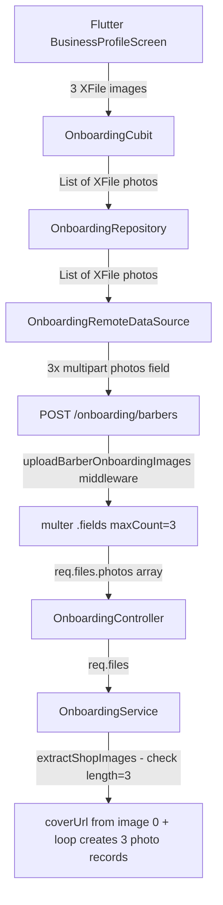
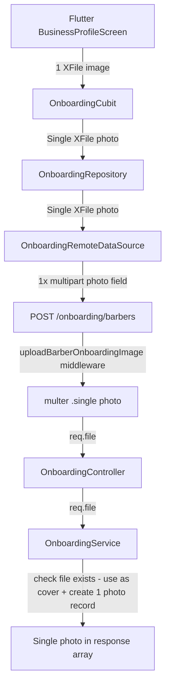

# Plan: Reduce Barber Onboarding from 3 Images to 1 Image

## Summary

Currently, barber onboarding requires exactly **3 shop images** uploaded as multipart fields under the key `photos`. This change reduces the requirement to exactly **1 shop image**, and renames the field from `photos` (plural) to `photo` (singular) for consistency with the customer onboarding flow which already uses `photo`.

---

## Current Architecture



## Target Architecture



---

## Files to Change

### 1. Server - Upload Middleware
**File:** `server/src/middleware/upload.middleware.js`

| Line | Current | New |
|------|---------|-----|
| 86 | Comment: requires 3 files | Comment: requires 1 file |
| 87-96 | `uploadBarberOnboardingImages` using `.fields([{ name: 'photos', maxCount: 3 }])` with `files: 3` | `uploadBarberOnboardingImage` using `.single('photo')` with just `fileSize` limit |

**Details:**
- Rename export from `uploadBarberOnboardingImages` → `uploadBarberOnboardingImage`
- Replace `.fields([{ name: 'photos', maxCount: 3 }])` with `.single('photo')`
- Remove `files: 3` from limits (not needed for `.single()`)
- Update JSDoc comment

---

### 2. Server - Onboarding Service
**File:** `server/src/services/onboarding.service.js`

| Line | Current | New |
|------|---------|-----|
| 113-118 | `extractShopImages(files)` helper function | Remove entirely - no longer needed |
| 303 | `createBarberOnboarding(phoneNumber, shopData, files)` | `createBarberOnboarding(phoneNumber, shopData, file)` |
| 317-319 | `extractShopImages(files)` + check `length !== 3` | Check `!file` directly |
| 329-331 | `coverImage = onboardingImages[0]` + extract path/cloudinaryId | Use `file.path` and `file.public_id \|\| file.filename` directly |
| 382-395 | Loop through `onboardingImages` creating multiple photo records | Create single photo record from `file` |
| 318-319 | Error: Please upload exactly 3 shop images | Error: Shop image is required |

**Details:**
- Remove `extractShopImages` helper function
- Change third parameter from `files` to `file`
- Replace image count validation with single file existence check
- Use `file` directly for coverUrl and coverCloudinaryId
- Create a single photo record instead of looping
- Return `photos: serializePhotos([photo])` to maintain array response shape

---

### 3. Server - Onboarding Controller
**File:** `server/src/controllers/onboarding.controller.js`

| Line | Current | New |
|------|---------|-----|
| 30 | `onboardingService.createBarberOnboarding(phoneNumber, body, req.files)` | `onboardingService.createBarberOnboarding(phoneNumber, body, req.file)` |

---

### 4. Server - Onboarding Routes
**File:** `server/src/routes/onboarding.routes.js`

| Line | Current | New |
|------|---------|-----|
| 4 | Import `uploadBarberOnboardingImages` | Import `uploadBarberOnboardingImage` |
| 39 | Middleware: `uploadBarberOnboardingImages` | Middleware: `uploadBarberOnboardingImage` |

---

### 5. Flutter - Business Profile Screen
**File:** `app/lib/features/onboarding/presentation/views/business_profile/business_profile_screen.dart`

| Line | Current | New |
|------|---------|-----|
| 42 | `List<XFile?> _selectedImages = List<XFile?>.filled(3, null)` | `XFile? _selectedImage` |
| 47 | `bool _doesImageHaveError = false` | Keep as-is |
| 57 | `_selectedImages.any((image) => image == null)` | `_selectedImage == null` |
| 59-60 | SnackBar: Please select 3 shop images | SnackBar: Please select a shop image |
| 76 | `updatePhotos(_selectedImages.whereType<XFile>().toList())` | `updatePhoto(_selectedImage!)` |
| 243 | `List<Widget>.generate(3, (int imageIndex) { ... })` | Single `ImageSelector` widget - no loop |
| 244-245 | `SizedBox(width: constraints.maxWidth * 0.5 - ...)` with `AspectRatio(1.25)` | Full-width `SizedBox` with appropriate aspect ratio |
| 386-390 | `onChange` sets `_selectedImages[imageIndex]` | `onChange` sets `_selectedImage` |

**Details:**
- Replace the 3-image `Wrap` + `List.generate` with a single `ImageSelector` widget
- Adjust sizing: single image should be wider than the current 1/2-width tiles
- Remove the `_selectedImages` list, use a single `_selectedImage` variable
- Update the `_doesImageHaveError` logic to work with single image

---

### 6. Flutter - Onboarding Cubit
**File:** `app/lib/features/onboarding/presentation/cubit/onboarding_cubit.dart`

| Line | Current | New |
|------|---------|-----|
| 8 | `List<XFile> photos` in OnboardingDraft | `XFile? photo` in OnboardingDraft |
| 12 | `this.photos = const <XFile>[]` | `this.photo` |
| 17 | `List<XFile>? photos` in copyWith | `XFile? photo` in copyWith |
| 20 | `photos: photos ?? this.photos` | `photo: photo ?? this.photo` |
| 39-41 | `updatePhotos(List<XFile> photos)` method | `updatePhoto(XFile photo)` method |

---

### 7. Flutter - Onboarding Remote Data Source Interface
**File:** `app/lib/features/onboarding/data/data_sources/onboarding_remote_data_source.dart`

| Line | Current | New |
|------|---------|-----|
| 8 | `required List<XFile> photos` | `required XFile photo` |

---

### 8. Flutter - Onboarding Remote Data Source Implementation
**File:** `app/lib/features/onboarding/data/data_sources/onboarding_remote_data_source_impl.dart`

| Line | Current | New |
|------|---------|-----|
| 23 | `required List<XFile> photos` | `required XFile photo` |
| 36-47 | Loop through `photos` adding each as `photos` field | Add single file as `photo` field |

**Details:**
- Replace the `for` loop with a single `http.MultipartFile.fromPath('photo', photo.path, ...)`

---

### 9. Flutter - Onboarding Repository Interface
**File:** `app/lib/features/onboarding/domain/repositories/onboarding_repository.dart`

| Line | Current | New |
|------|---------|-----|
| 8 | `required List<XFile> photos` | `required XFile photo` |

---

### 10. Flutter - Onboarding Repository Implementation
**File:** `app/lib/features/onboarding/data/repositories/onboarding_repository_impl.dart`

| Line | Current | New |
|------|---------|-----|
| 24 | `required List<XFile> photos` | `required XFile photo` |
| 33-34 | `photos: photos` | `photo: photo` |

---

### 11. Flutter - Payout Details Screen
**File:** `app/lib/features/onboarding/presentation/views/payout_details/payout_details_screen.dart`

| Line | Current | New |
|------|---------|-----|
| 63 | `photos: cubit.draft.photos` | `photo: cubit.draft.photo` |

---

### 12. Postman Collection
**File:** `server/postman-collections/02-onboarding.json`

| Line | Current | New |
|------|---------|-----|
| 138 | Description: three shop image fields | Description: single shop image field |
| 239-252 | 3x `photos` file fields with descriptions 1/3, 2/3, 3/3 | 1x `photo` file field |

---

### 13. Postman Regeneration Script
**File:** `server/scripts/regenerate-postman-collections.mjs`

| Line | Current | New |
|------|---------|-----|
| 450-452 | 3x `fileField('photos', 'Attach shop image X of 3...')` | 1x `fileField('photo', 'Attach shop image manually in Postman')` |
| 454 | Description: three shop image fields | Description: single shop image field |
| 1597 | Comment: Barber onboarding already creates three gallery photos | Comment: Barber onboarding already creates one gallery photo |

---

### 14. Onboarding Data Guide Documentation
**File:** `docs/features/auth/ONBOARDING-DATA-GUIDE.md`

Multiple references to update:

| Line | Current | New |
|------|---------|-----|
| 247 | `photos` File[] 1-3 images required | `photo` File 1 image required |
| 377 | `required List<File> photos` | `required File photo` |
| 438-444 | Loop: `for (var i = 0; i < photos.length && i < 3; i++)` with key `photos` | Single: `request.files.add(await http.MultipartFile.fromPath('photo', photo.path))` |
| 569 | `photos` ❌ No / ✅ Required / 1-3 images | `photo` ❌ No / ✅ Required / 1 image |
| 598 | 1-3 shop images required | 1 shop image required |
| 692 | Include all required fields + 1-3 shop images | Include all required fields + 1 shop image |
| 719 | 20+ required fields + 1-3 photos | 20+ required fields + 1 photo |
| 726 | Images: ✅ Required / 1-3 shop images | Images: ✅ Required / 1 shop image |

---

## Files That Do NOT Need Changes

- `server/src/validators/onboarding.validator.js` — No file-count validation in Joi schema
- `server/src/validators/__tests__/onboarding.validator.test.js` — No image-related tests
- `server/src/models/user.model.js` — No image references
- `server/src/config/index.js` — `maxFiles: 10` is for gallery, not onboarding
- `server/src/utils/upload-cleanup.utils.js` — Generic cleanup, not onboarding-specific
- Other doc files (MSG91 guides, etc.) — No onboarding image references

---

## Response Shape Impact

The barber onboarding response currently returns:
```json
{
  "photos": [ /* array of 3 photo objects */ ]
}
```

After the change, it will return:
```json
{
  "photos": [ /* array with 1 photo object */ ]
}
```

The `photos` key remains an array in the response for backward compatibility with consumers that expect an array. Only the length changes from 3 to 1.

---

## Execution Order

1. Server middleware — Change upload from 3 to 1
2. Server service — Update to handle single file
3. Server controller — Pass `req.file` instead of `req.files`
4. Server routes — Update import and middleware reference
5. Flutter cubit — Change from list to single photo
6. Flutter data source interface — Update signature
7. Flutter data source implementation — Send single file as `photo`
8. Flutter repository interface — Update signature
9. Flutter repository implementation — Pass single photo
10. Flutter business profile screen — Single image UI
11. Flutter payout details screen — Reference single photo
12. Postman collection JSON — Update file fields
13. Postman regeneration script — Update file field definitions
14. Onboarding data guide doc — Update all references
15. Run Postman regeneration script to regenerate collections
