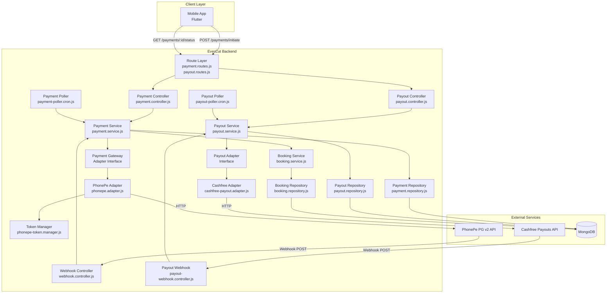
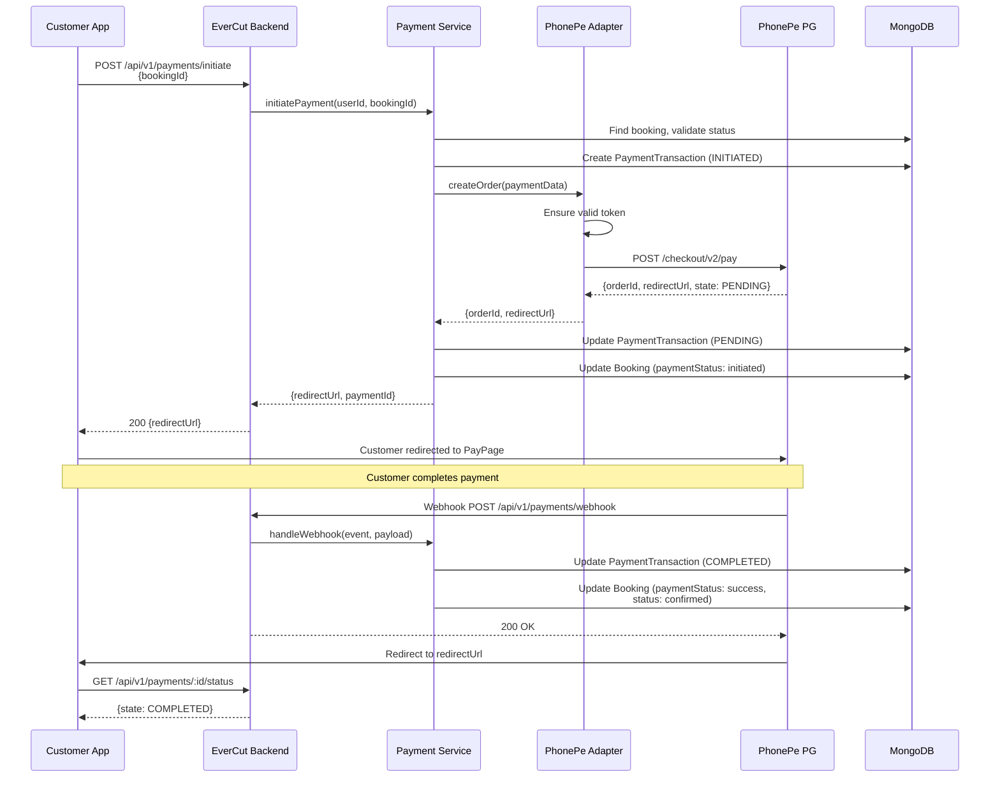
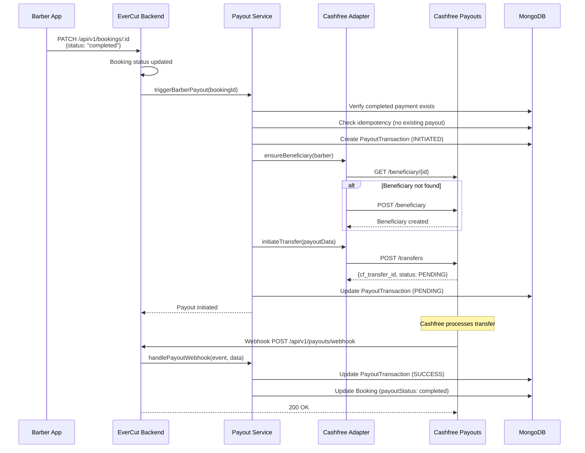
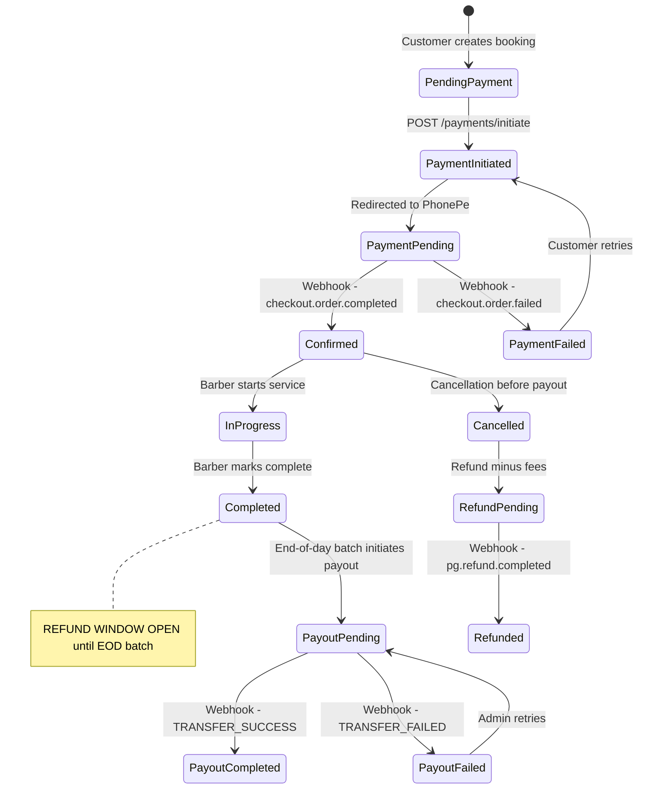

# Payment & Payout System — Implementation Guide

> **EverCut Salon Booking Platform**
> Version: 2.0 | Last Updated: April 2026
> Audience: Backend Engineers implementing the payment and payout integration
> Prerequisite: Read [PAYMENT-GATEWAY-RESEARCH-GUIDE.md](./PAYMENT-GATEWAY-RESEARCH-GUIDE.md) first

---

## Table of Contents

1. [System Architecture](#1-system-architecture)
2. [Folder Structure & New Files](#2-folder-structure--new-files)
3. [Environment Configuration](#3-environment-configuration)
4. [Database Schema Changes](#4-database-schema-changes)
5. [Adapter Pattern — Payment & Payout Interfaces](#5-adapter-pattern--payment--payout-interfaces)
6. [PhonePe Adapter Implementation](#6-phonepe-adapter-implementation)
7. [Cashfree Payout Adapter Implementation](#7-cashfree-payout-adapter-implementation)
8. [Payment Service Layer](#8-payment-service-layer)
9. [Payout Service Layer](#9-payout-service-layer)
10. [Payment Controller](#10-payment-controller)
11. [Payout Controller & Webhook](#11-payout-controller--webhook)
12. [Webhook Controller — PhonePe](#12-webhook-controller--phonepe)
13. [Route Registration](#13-route-registration)
14. [Validation Schemas](#14-validation-schemas)
15. [Status Polling & Cron Jobs](#15-status-polling--cron-jobs)
16. [Refund Flow](#16-refund-flow)
17. [Integration with Existing Booking Flow](#17-integration-with-existing-booking-flow)
18. [Error Handling](#18-error-handling)
19. [Logging & Monitoring](#19-logging--monitoring)
20. [Testing Strategy](#20-testing-strategy)
21. [Deployment Checklist](#21-deployment-checklist)
22. [Implementation Phases](#22-implementation-phases)

---

## 1. System Architecture

### 1.1 High-Level Architecture — Dual Provider



### 1.2 Request Flow — Payment Collection (PhonePe)



### 1.3 Request Flow — Barber Payout (Cashfree)



### 1.4 Design Principles

| Principle | Implementation |
|---|---|
| **Adapter Pattern** | Separate adapters for PhonePe (collection) and Cashfree (payout) |
| **Single Responsibility** | Controller → Service → Adapter → External API (each layer has one job) |
| **Idempotency** | Every operation uses unique reference IDs; webhooks checked for duplicates |
| **Fail-Safe** | Server-side verification via status APIs; never trust client-side callbacks |
| **Dual Webhook Handling** | Separate webhook endpoints for PhonePe and Cashfree |
| **Observability** | Structured logging with redacted sensitive data at every state transition |
| **Consistency** | Uses existing EverCut patterns: ApiResponse, AppError, validate middleware |

---

## 2. Folder Structure & New Files

### 2.1 Files to Create

```
server/src/
├── adapters/
│   ├── payment-gateway.adapter.js          # Abstract payment interface
│   ├── payout-gateway.adapter.js           # Abstract payout interface
│   ├── phonepe/
│   │   ├── phonepe.adapter.js              # PhonePe-specific implementation
│   │   ├── phonepe-token.manager.js        # OAuth token lifecycle management
│   │   └── phonepe.constants.js            # PhonePe-specific constants
│   └── cashfree/
│       ├── cashfree-payout.adapter.js      # Cashfree payout implementation
│       └── cashfree.constants.js           # Cashfree-specific constants
│
├── controllers/
│   ├── payment/
│   │   ├── payment.controller.js           # Customer-facing payment actions
│   │   └── webhook.controller.js           # PhonePe webhook handler
│   └── payout/
│       ├── payout.controller.js            # Payout management actions
│       └── payout-webhook.controller.js    # Cashfree webhook handler
│
├── models/
│   ├── payment-transaction.model.js        # PaymentTransaction schema
│   └── payout-transaction.model.js         # PayoutTransaction schema
│
├── repositories/
│   ├── payment.repository.js               # PaymentTransaction data access
│   └── payout.repository.js                # PayoutTransaction data access
│
├── routes/
│   ├── payment.routes.js                   # Payment route definitions
│   └── payout.routes.js                    # Payout route definitions
│
├── services/
│   ├── payment.service.js                  # Payment business logic
│   └── payout.service.js                   # Payout business logic (Cashfree)
│
├── validators/
│   ├── payment.validator.js                # Joi schemas for payment endpoints
│   └── payout.validator.js                 # Joi schemas for payout endpoints
│
└── jobs/
    ├── payment-poller.cron.js              # Cron: pending payment resolution
    └── payout-poller.cron.js               # Cron: pending payout resolution
```

### 2.2 Files to Modify

```
server/src/
├── config/index.js                         # Add PhonePe + Cashfree config variables
├── models/booking.model.js                 # Add payment + payout reference fields
├── routes/index.js                         # Register payment + payout routes
├── services/booking.service.js             # Integrate payment + payout into booking flow
├── utils/constants.js                      # Add payment + payout constants
└── server.js                               # Initialize payment + payout pollers
```

---

## 3. Environment Configuration

### 3.1 New Environment Variables

Add to `.env`:

```env
# ─── PhonePe Payment Gateway ───
PHONEPE_CLIENT_ID=your_client_id
PHONEPE_CLIENT_SECRET=your_client_secret
PHONEPE_CLIENT_VERSION=1
PHONEPE_MERCHANT_ID=your_merchant_id
PHONEPE_ENV=SANDBOX

# ─── PhonePe Webhook Security ───
PHONEPE_WEBHOOK_USERNAME=evercut_webhook
PHONEPE_WEBHOOK_PASSWORD=securePass123

# ─── Cashfree Payouts ───
CASHFREE_PAYOUT_CLIENT_ID=your_cashfree_payout_client_id
CASHFREE_PAYOUT_CLIENT_SECRET=your_cashfree_payout_client_secret
CASHFREE_PAYOUT_ENV=TEST

# ─── Payment Settings ───
PAYMENT_REDIRECT_BASE_URL=https://api.evercut.in/api/v1/payments/redirect
```

> **Note:** Platform fees, refund fees, and bundle minimum are **not** environment variables. They are business constants hardcoded in the config module (see §3.2 below). Only credentials, secrets, and environment-specific URLs belong in `.env`.

### 3.2 Config Module Update

```javascript
// server/src/config/index.js — ADD to the config object
// NOTE: The existing config uses Object.freeze() and requireEnv()/optionalEnv() helpers.
// Add the following sections inside the config object BEFORE the freeze.
// Do NOT use getter functions (get baseUrl()) — they don't work inside Object.freeze().

phonepe: Object.freeze({
    clientId: requireEnv('PHONEPE_CLIENT_ID'),
    clientSecret: requireEnv('PHONEPE_CLIENT_SECRET'),
    clientVersion: parseInt(optionalEnv('PHONEPE_CLIENT_VERSION', '1'), 10),
    merchantId: requireEnv('PHONEPE_MERCHANT_ID'),
    env: optionalEnv('PHONEPE_ENV', 'SANDBOX'),
    webhookUsername: requireEnv('PHONEPE_WEBHOOK_USERNAME'),
    webhookPassword: requireEnv('PHONEPE_WEBHOOK_PASSWORD'),
    baseUrl: optionalEnv('PHONEPE_ENV', 'SANDBOX') === 'PRODUCTION'
        ? 'https://api.phonepe.com/apis/pg'
        : 'https://api-preprod.phonepe.com/apis/pg-sandbox',
}),
cashfree: Object.freeze({
    payoutClientId: requireEnv('CASHFREE_PAYOUT_CLIENT_ID'),
    payoutClientSecret: requireEnv('CASHFREE_PAYOUT_CLIENT_SECRET'),
    payoutEnv: optionalEnv('CASHFREE_PAYOUT_ENV', 'TEST'),
    payoutBaseUrl: optionalEnv('CASHFREE_PAYOUT_ENV', 'TEST') === 'PRODUCTION'
        ? 'https://api.cashfree.com/payout'
        : 'https://sandbox.cashfree.com/payout',
    payoutApiVersion: '2025-01-01',
}),
payment: Object.freeze({
    redirectBaseUrl: optionalEnv('PAYMENT_REDIRECT_BASE_URL', 'http://localhost:5001/api/v1/payments/redirect'),
    // ─── Business Constants (hardcoded, NOT from .env) ───
    // These are fixed pricing rules per Payment-Payout-Logic.md.
    // Change here if business pricing changes — no deploy-time env override needed.
    platformFeeSingle: 3,             // ₹3 platform fee for single service
    platformFeeBundle: 10,            // ₹10 platform fee for bundle
    refundFeeSingle: 7,               // ₹7 refund processing fee (single)
    refundFeeBundle: 15,              // ₹15 refund processing fee (bundle)
    minBundleServiceAmount: 300,      // ₹300 minimum service amount for bundles
    sessionExpirySeconds: 1200,       // 20 minutes
    maxPollAttempts: 10,
    pollIntervalBaseMs: 3000,         // 3 seconds, doubles each attempt
    payoutBatchCronTime: '0 23 * * *', // 11:00 PM IST daily
}),
```

> **Alignment Note:** The existing config uses `Object.freeze()`, `requireEnv()`, and `optionalEnv()` — not `getEnvVar()`. URLs are computed at config creation time rather than using getter functions, because getters do not work inside `Object.freeze()`. The `redirectBaseUrl` default port is `5001` to match the existing `config.port` default.
>
> **Why hardcoded?** Platform fees, refund fees, and bundle minimums are **business constants**, not environment-specific configuration. They should be the same across dev/staging/production. Putting them in `.env` would risk inconsistent values across environments. If these values ever need to change, update them directly in `config/index.js` — see [Payment-Payout-Logic.md](./Payment-Payout-Logic.md) for the canonical definitions.

---

## 4. Database Schema Changes

### 4.1 New Model — PaymentTransaction

```javascript
// server/src/models/payment-transaction.model.js

import mongoose from 'mongoose';

const paymentTransactionSchema = new mongoose.Schema(
    {
        // ─── Identifiers ───
        bookingId: {
            type: mongoose.Schema.Types.ObjectId,
            ref: 'Booking',
            required: true,
            index: true,
        },
        customerId: {
            type: mongoose.Schema.Types.ObjectId,
            ref: 'Customer',
            required: true,
            index: true,
        },
        shopId: {
            type: mongoose.Schema.Types.ObjectId,
            ref: 'Shop',
            required: true,
        },

        // ─── Merchant Reference ───
        merchantOrderId: {
            type: String,
            required: true,
            unique: true,
            index: true,
        },

        // ─── PhonePe Gateway Fields ───
        gatewayOrderId: {
            type: String,   // PhonePe's `orderId` (e.g., OMO...)
            index: true,
        },
        gatewayTransactionId: {
            type: String,   // From paymentDetails[0].transactionId
        },
        redirectUrl: {
            type: String,   // PhonePe checkout URL
        },

        // ─── Amount ───
        amount: {
            type: Number,    // Amount in PAISA
            required: true,
            min: 100,        // Minimum ₹1.00
        },
        amountInRupees: {
            type: Number,    // Convenience field
            required: true,
        },
        currency: {
            type: String,
            default: 'INR',
        },

        // ─── State ───
        status: {
            type: String,
            enum: ['initiated', 'pending', 'completed', 'failed', 'expired', 'refund_pending', 'refunded', 'refund_failed'],
            default: 'initiated',
            index: true,
        },
        gatewayState: {
            type: String,   // Raw state from PhonePe (PENDING, COMPLETED, FAILED)
        },

        // ─── Payment Details ───
        paymentMode: {
            type: String,   // UPI_INTENT, UPI_QR, UPI_COLLECT, CARD, NET_BANKING
        },
        paymentInstrument: {
            type: mongoose.Schema.Types.Mixed,   // Instrument details from PhonePe
        },
        rail: {
            type: mongoose.Schema.Types.Mixed,   // Rail details (UTR, UPI transaction ID)
        },

        // ─── Refund ───
        refund: {
            merchantRefundId: String,
            gatewayRefundId: String,
            amount: Number,              // Refund amount in paisa
            status: {
                type: String,
                enum: ['pending', 'completed', 'failed'],
            },
            initiatedAt: Date,
            completedAt: Date,
            reason: String,
        },

        // ─── Settlement ───
        settlement: {
            serviceAmount: Number,        // Service amount in paisa (barber's price)
            platformFee: Number,          // Fixed platform fee in paisa (₹3 or ₹10)
            barberPayout: Number,         // = serviceAmount (barber gets 100%)
            isBundle: Boolean,            // true if bundle (affects fee tiers)
            settled: { type: Boolean, default: false },
            settledAt: Date,
        },

        // ─── Refund Details ───
        refundFee: Number,                // Fixed refund fee in paisa (₹7 or ₹15)

        // ─── Error Tracking ───
        errorCode: String,
        detailedErrorCode: String,
        errorSource: String,              // CUSTOMER, BANK, MERCHANT, PHONEPE
        errorStage: String,               // AUTHENTICATION, AUTHORIZATION, SETTLEMENT
        errorDescription: String,

        // ─── Metadata ───
        gatewayResponse: {
            type: mongoose.Schema.Types.Mixed,   // Full gateway response (redacted)
        },
        webhookReceivedAt: Date,
        statusPolledAt: Date,
        expiresAt: Date,

        // ─── Idempotency ───
        webhookProcessed: {
            type: Boolean,
            default: false,
        },
        webhookEventId: String,           // Dedup key for webhooks

        // ─── Retry Tracking ───
        pollAttempts: {
            type: Number,
            default: 0,
        },
        lastPollAt: Date,
    },
    {
        timestamps: true,
        collection: 'payment_transactions',
    },
);

// ─── Indexes ───
paymentTransactionSchema.index({ status: 1, createdAt: 1 });
paymentTransactionSchema.index({ bookingId: 1, status: 1 });
paymentTransactionSchema.index({ merchantOrderId: 1 }, { unique: true });

const PaymentTransaction = mongoose.model('PaymentTransaction', paymentTransactionSchema);

export default PaymentTransaction;
```

### 4.2 New Model — PayoutTransaction

```javascript
// server/src/models/payout-transaction.model.js

import mongoose from 'mongoose';

const payoutTransactionSchema = new mongoose.Schema(
    {
        // ─── Identifiers ───
        bookingId: {
            type: mongoose.Schema.Types.ObjectId,
            ref: 'Booking',
            required: true,
            index: true,
        },
        barberId: {
            type: mongoose.Schema.Types.ObjectId,
            ref: 'User',
            required: true,
            index: true,
        },
        shopId: {
            type: mongoose.Schema.Types.ObjectId,
            ref: 'Shop',
            required: true,
        },
        paymentTransactionId: {
            type: mongoose.Schema.Types.ObjectId,
            ref: 'PaymentTransaction',
            required: true,
        },

        // ─── Transfer Reference ───
        transferId: {
            type: String,       // Our unique transfer ID (idempotency key)
            required: true,
            unique: true,
            index: true,
        },
        gatewayTransferId: {
            type: String,       // Cashfree's internal transfer ID
            index: true,
        },

        // ─── Beneficiary ───
        beneficiaryId: {
            type: String,       // Cashfree beneficiary ID
            required: true,
        },

        // ─── Amount ───
        amount: {
            type: Number,       // Amount in PAISA (internal consistency)
            required: true,
        },
        amountInRupees: {
            type: Number,       // Amount sent to Cashfree (in rupees)
            required: true,
        },

        // ─── Transfer Details ───
        transferMode: {
            type: String,
            enum: ['UPI', 'IMPS', 'NEFT', 'RTGS', 'BANK'],
            default: 'UPI',
        },

        // ─── State ───
        status: {
            type: String,
            enum: ['INITIATED', 'PENDING', 'SUCCESS', 'FAILED', 'REVERSED'],
            default: 'INITIATED',
            index: true,
        },

        // ─── Completion Details ───
        utr: {
            type: String,       // Bank UTR on success
        },
        processedAt: {
            type: Date,
        },

        // ─── Error Tracking ───
        failureReason: {
            type: String,
        },
        errorCode: {
            type: String,
        },

        // ─── Retry Tracking ───
        retryCount: {
            type: Number,
            default: 0,
        },
        maxRetries: {
            type: Number,
            default: 3,
        },
        lastRetryAt: {
            type: Date,
        },

        // ─── Webhook ───
        webhookReceivedAt: {
            type: Date,
        },
        webhookProcessed: {
            type: Boolean,
            default: false,
        },

        // ─── Remarks ───
        remarks: {
            type: String,
        },
    },
    {
        timestamps: true,
        collection: 'payout_transactions',
    },
);

// ─── Indexes ───
payoutTransactionSchema.index({ status: 1, createdAt: 1 });
payoutTransactionSchema.index({ bookingId: 1, status: 1 });
payoutTransactionSchema.index({ transferId: 1 }, { unique: true });

const PayoutTransaction = mongoose.model('PayoutTransaction', payoutTransactionSchema);

export default PayoutTransaction;
```

### 4.3 Booking Model Additions

Add the following fields to the existing `bookingSchema` in `booking.model.js`:

> **⚠️ IMPORTANT:** You must ALSO update the `PAYMENT_STATUS` constant and `ALL_PAYMENT_STATUSES` in `constants.js` (see §4.4) to include the new values (`initiated`, `refund_pending`, `refunded`, `refund_failed`) BEFORE adding these fields. The booking model's `paymentStatus` enum references `ALL_PAYMENT_STATUSES`, so the constant must be extended first or the schema will reject the new values.

```javascript
// ADD these fields to the existing bookingSchema

// ─── Payment Reference ───
paymentTransactionId: {
    type: mongoose.Schema.Types.ObjectId,
    ref: 'PaymentTransaction',
},
merchantOrderId: {
    type: String,
    index: true,
},
paymentGateway: {
    type: String,
    enum: ['phonepe', 'razorpay', 'cashfree', 'manual'],
    default: 'phonepe',
},
paidAt: {
    type: Date,
},
paymentMode: {
    type: String,  // UPI_INTENT, UPI_QR, CARD, etc.
},

// ─── Payout Reference ───
payoutTransactionId: {
    type: mongoose.Schema.Types.ObjectId,
    ref: 'PayoutTransaction',
},
payoutStatus: {
    type: String,
    enum: ['not_initiated', 'initiated', 'pending', 'completed', 'failed', 'reversed'],
    default: 'not_initiated',
    index: true,
},
payoutCompletedAt: {
    type: Date,
},
barberUtr: {
    type: String,  // UTR for barber payout
},
```

### 4.4 Constants Update

```javascript
// server/src/utils/constants.js — ADD

// ─── Payment Status (on Booking model — extends existing PAYMENT_STATUS) ───
// NOTE: The existing PAYMENT_STATUS in constants.js has only ['pending', 'success', 'failed'].
// We EXTEND it with these additional values for the payment + refund lifecycle.
// Update the existing PAYMENT_STATUS and ALL_PAYMENT_STATUSES to include these.

export const PAYMENT_STATUS = Object.freeze({
    PENDING: 'pending',
    INITIATED: 'initiated',
    SUCCESS: 'success',
    FAILED: 'failed',
    REFUND_PENDING: 'refund_pending',
    REFUNDED: 'refunded',
    REFUND_FAILED: 'refund_failed',
});

export const ALL_PAYMENT_STATUSES = Object.values(PAYMENT_STATUS);

// ─── Payment Transaction Status (on PaymentTransaction model — internal states) ───

export const PAYMENT_TRANSACTION_STATUS = Object.freeze({
    INITIATED: 'initiated',
    PENDING: 'pending',
    COMPLETED: 'completed',
    FAILED: 'failed',
    EXPIRED: 'expired',
    REFUND_PENDING: 'refund_pending',
    REFUNDED: 'refunded',
    REFUND_FAILED: 'refund_failed',
});

// ─── Payout Status (on Booking model) ───

export const PAYOUT_STATUS = Object.freeze({
    NOT_INITIATED: 'not_initiated',
    INITIATED: 'initiated',
    PENDING: 'pending',
    COMPLETED: 'completed',
    FAILED: 'failed',
    REVERSED: 'reversed',
});

export const ALL_PAYOUT_STATUSES = Object.values(PAYOUT_STATUS);

// ─── Payout Transaction Status (on PayoutTransaction model — Cashfree states) ───

export const PAYOUT_TRANSACTION_STATUS = Object.freeze({
    INITIATED: 'INITIATED',
    PENDING: 'PENDING',
    SUCCESS: 'SUCCESS',
    FAILED: 'FAILED',
    REVERSED: 'REVERSED',
});

// ─── Webhook Events ───

export const PHONEPE_WEBHOOK_EVENTS = Object.freeze({
    ORDER_COMPLETED: 'checkout.order.completed',
    ORDER_FAILED: 'checkout.order.failed',
    REFUND_COMPLETED: 'pg.refund.completed',
    REFUND_FAILED: 'pg.refund.failed',
});

export const CASHFREE_WEBHOOK_EVENTS = Object.freeze({
    TRANSFER_SUCCESS: 'TRANSFER_SUCCESS',
    TRANSFER_FAILED: 'TRANSFER_FAILED',
    TRANSFER_REVERSED: 'TRANSFER_REVERSED',
});

export const PAYMENT_GATEWAYS = Object.freeze({
    PHONEPE: 'phonepe',
    RAZORPAY: 'razorpay',
    CASHFREE: 'cashfree',
    MANUAL: 'manual',
});

export const PAYOUT_MODES = Object.freeze({
    UPI: 'UPI',
    IMPS: 'IMPS',
    NEFT: 'NEFT',
    BANK: 'BANK',
    RTGS: 'RTGS',
});

// ─── Fixed Platform Fees (in rupees) — per Payment-Payout-Logic.md ───

export const PLATFORM_FEES = Object.freeze({
    SINGLE_SERVICE: 3,   // ₹3 fixed fee for single service
    BUNDLE: 10,          // ₹10 fixed fee for bundle of services
});

// ─── Fixed Refund Fees (in rupees) — per Payment-Payout-Logic.md ───

export const REFUND_FEES = Object.freeze({
    SINGLE_SERVICE: 7,   // ₹7 refund processing fee
    BUNDLE: 15,          // ₹15 refund processing fee
});

// ─── Bundle Pricing Rules ───

export const BUNDLE_RULES = Object.freeze({
    MIN_SERVICE_AMOUNT: 300,  // Minimum total service amount for bundles (₹300)
});
```

---

## 5. Adapter Pattern — Payment & Payout Interfaces

### 5.1 Abstract Payment Gateway Adapter

```javascript
// server/src/adapters/payment-gateway.adapter.js

/**
 * Abstract Payment Gateway Adapter Interface.
 *
 * All payment gateway implementations (PhonePe, Razorpay, etc.)
 * MUST implement this interface. The PaymentService interacts
 * ONLY with this interface, never with gateway-specific code.
 *
 * This ensures:
 * 1. Gateway-agnostic business logic
 * 2. Easy multi-gateway support in the future
 * 3. Clean testability via mock adapters
 */
export class PaymentGatewayAdapter {
    getGatewayName() {
        throw new Error('getGatewayName() must be implemented');
    }

    async createOrder(params) {
        throw new Error('createOrder() must be implemented');
    }

    async getOrderStatus(merchantOrderId) {
        throw new Error('getOrderStatus() must be implemented');
    }

    async initiateRefund(params) {
        throw new Error('initiateRefund() must be implemented');
    }

    async getRefundStatus(merchantRefundId) {
        throw new Error('getRefundStatus() must be implemented');
    }

    verifyWebhook(headers, body) {
        throw new Error('verifyWebhook() must be implemented');
    }

    parseWebhookPayload(body) {
        throw new Error('parseWebhookPayload() must be implemented');
    }
}
```

### 5.2 Abstract Payout Gateway Adapter

```javascript
// server/src/adapters/payout-gateway.adapter.js

/**
 * Abstract Payout Gateway Adapter Interface.
 *
 * All payout implementations (Cashfree, RazorpayX, etc.)
 * MUST implement this interface. The PayoutService interacts
 * ONLY with this interface, never with provider-specific code.
 */
export class PayoutGatewayAdapter {
    /**
     * Get the unique identifier for this payout provider.
     * @returns {string} Provider name (e.g., 'cashfree')
     */
    getProviderName() {
        throw new Error('getProviderName() must be implemented');
    }

    /**
     * Create a beneficiary (payout recipient).
     * @param {Object} params
     * @param {string} params.beneficiaryId - Unique beneficiary ID
     * @param {string} params.name - Recipient full name
     * @param {string} params.phone - Recipient phone
     * @param {string} [params.email] - Recipient email
     * @param {string} [params.vpa] - UPI VPA (for UPI payouts)
     * @param {string} [params.bankAccount] - Bank account number
     * @param {string} [params.ifsc] - IFSC code
     * @returns {Promise<{beneficiaryId: string, created: boolean}>}
     */
    async createBeneficiary(params) {
        throw new Error('createBeneficiary() must be implemented');
    }

    /**
     * Get beneficiary details.
     * @param {string} beneficiaryId
     * @returns {Promise<Object|null>}
     */
    async getBeneficiary(beneficiaryId) {
        throw new Error('getBeneficiary() must be implemented');
    }

    /**
     * Remove a beneficiary.
     * @param {string} beneficiaryId
     * @returns {Promise<boolean>}
     */
    async removeBeneficiary(beneficiaryId) {
        throw new Error('removeBeneficiary() must be implemented');
    }

    /**
     * Initiate a payout transfer.
     * @param {Object} params
     * @param {string} params.transferId - Unique transfer ID (idempotency key)
     * @param {number} params.amountInRupees - Amount in rupees
     * @param {string} params.beneficiaryId - Registered beneficiary ID
     * @param {string} [params.transferMode] - UPI, IMPS, NEFT, BANK
     * @param {string} [params.remarks] - Transfer remarks
     * @returns {Promise<{gatewayTransferId: string, transferId: string, status: string}>}
     */
    async initiateTransfer(params) {
        throw new Error('initiateTransfer() must be implemented');
    }

    /**
     * Get status of a transfer.
     * @param {string} transferId
     * @returns {Promise<{status: string, utr?: string, amount: number}>}
     */
    async getTransferStatus(transferId) {
        throw new Error('getTransferStatus() must be implemented');
    }

    /**
     * Verify bank account via penny drop.
     * @param {Object} params
     * @param {string} params.bankAccount - Bank account number
     * @param {string} params.ifsc - IFSC code
     * @param {string} [params.name] - Expected name for matching
     * @returns {Promise<{accountExists: boolean, nameMatch: boolean, registeredName: string}>}
     */
    async verifyBankAccount(params) {
        throw new Error('verifyBankAccount() must be implemented');
    }

    /**
     * Verify webhook authenticity.
     * @param {Object} headers - Request headers
     * @param {string} rawBody - Raw request body (not parsed)
     * @returns {boolean}
     */
    verifyWebhook(headers, rawBody) {
        throw new Error('verifyWebhook() must be implemented');
    }

    /**
     * Parse webhook payload into normalized format.
     * @param {Object} body - Parsed webhook body
     * @returns {{event: string, transferId: string, status: string, utr?: string, amount?: number}}
     */
    parseWebhookPayload(body) {
        throw new Error('parseWebhookPayload() must be implemented');
    }
}
```

---

## 6. PhonePe Adapter Implementation

### 6.1 Token Manager

```javascript
// server/src/adapters/phonepe/phonepe-token.manager.js

import config from '../../config/index.js';
import logger from '../../utils/logger.js';

/**
 * Manages PhonePe OAuth 2.0 token lifecycle.
 *
 * - Caches token in memory (singleton)
 * - Auto-refreshes 5 minutes before expiry
 * - Thread-safe via promise deduplication
 */
class PhonePeTokenManager {
    constructor() {
        this._token = null;
        this._expiresAt = 0;
        this._refreshPromise = null;
        this._REFRESH_BUFFER_MS = 5 * 60 * 1000; // 5 minutes
    }

    async getToken() {
        if (this._isTokenValid()) {
            return this._token;
        }

        if (!this._refreshPromise) {
            this._refreshPromise = this._refreshToken();
        }

        try {
            await this._refreshPromise;
            return this._token;
        } finally {
            this._refreshPromise = null;
        }
    }

    async forceRefresh() {
        this._token = null;
        this._expiresAt = 0;
        return this.getToken();
    }

    _isTokenValid() {
        return (
            this._token
            && Date.now() < (this._expiresAt - this._REFRESH_BUFFER_MS)
        );
    }

    async _refreshToken() {
        const url = `${config.phonepe.baseUrl}/v1/oauth/token`;

        const body = new URLSearchParams({
            client_id: config.phonepe.clientId,
            client_version: String(config.phonepe.clientVersion),
            client_secret: config.phonepe.clientSecret,
            grant_type: 'client_credentials',
        });

        logger.info('[PhonePeTokenManager] Refreshing access token', {
            environment: config.phonepe.env,
        });

        const response = await fetch(url, {
            method: 'POST',
            headers: { 'Content-Type': 'application/x-www-form-urlencoded' },
            body: body.toString(),
        });

        if (!response.ok) {
            const errorText = await response.text();
            logger.error('[PhonePeTokenManager] Token refresh failed', {
                status: response.status,
                error: errorText,
            });
            throw new Error(`PhonePe token refresh failed: ${response.status}`);
        }

        const data = await response.json();

        this._token = data.access_token;
        this._expiresAt = data.expires_at * 1000; // Convert to milliseconds

        logger.info('[PhonePeTokenManager] Token refreshed successfully', {
            expiresAt: new Date(this._expiresAt).toISOString(),
        });
    }
}

const tokenManager = new PhonePeTokenManager();
export default tokenManager;
```

### 6.2 PhonePe Constants

```javascript
// server/src/adapters/phonepe/phonepe.constants.js

export const PHONEPE_ENDPOINTS = {
    AUTH_TOKEN: '/v1/oauth/token',
    CREATE_PAYMENT: '/checkout/v2/pay',
    ORDER_STATUS: (merchantOrderId) => `/checkout/v2/order/${merchantOrderId}/status`,
    INITIATE_REFUND: '/checkout/v2/refund',
    REFUND_STATUS: (merchantRefundId) => `/checkout/v2/refund/${merchantRefundId}/status`,
};

export const PHONEPE_STATES = {
    PENDING: 'PENDING',
    COMPLETED: 'COMPLETED',
    FAILED: 'FAILED',
};

export const PHONEPE_PAYMENT_MODES = {
    UPI_INTENT: 'UPI_INTENT',
    UPI_QR: 'UPI_QR',
    UPI_COLLECT: 'UPI_COLLECT',
    CARD: 'CARD',
    NET_BANKING: 'NET_BANKING',
};
```

### 6.3 PhonePe Adapter

```javascript
// server/src/adapters/phonepe/phonepe.adapter.js

import crypto from 'crypto';
import config from '../../config/index.js';
import logger from '../../utils/logger.js';
import { PaymentGatewayAdapter } from '../payment-gateway.adapter.js';
import tokenManager from './phonepe-token.manager.js';
import { PHONEPE_ENDPOINTS, PHONEPE_STATES } from './phonepe.constants.js';

class PhonePeAdapter extends PaymentGatewayAdapter {
    constructor() {
        super();
        this._baseUrl = config.phonepe.baseUrl;
    }

    getGatewayName() {
        return 'phonepe';
    }

    // ─── Core Payment Operations ───

    async createOrder({ merchantOrderId, amount, redirectUrl, message, metadata }) {
        const requestBody = {
            merchantOrderId,
            amount,     // Already in paisa
            expireAfter: config.payment.sessionExpirySeconds,
            paymentFlow: {
                type: 'PG_CHECKOUT',
                message: message || 'Payment for EverCut salon booking',
                merchantUrls: {
                    redirectUrl,
                },
            },
        };

        if (metadata) {
            requestBody.metaInfo = {};
            const metaKeys = Object.keys(metadata);
            metaKeys.forEach((key, index) => {
                if (index < 15) {
                    requestBody.metaInfo[`udf${index + 1}`] = String(metadata[key]);
                }
            });
        }

        const data = await this._makeRequest(
            'POST',
            PHONEPE_ENDPOINTS.CREATE_PAYMENT,
            requestBody,
        );

        logger.info('[PhonePeAdapter] Order created', {
            merchantOrderId,
            gatewayOrderId: data.orderId,
            state: data.state,
        });

        return {
            orderId: data.orderId,
            redirectUrl: data.redirectUrl,
            state: data.state,
            expiresAt: data.expireAt,
        };
    }

    async getOrderStatus(merchantOrderId) {
        const endpoint = `${PHONEPE_ENDPOINTS.ORDER_STATUS(merchantOrderId)}?details=true`;
        const data = await this._makeRequest('GET', endpoint);

        return {
            orderId: data.orderId,
            state: data.state,
            amount: data.amount,
            expiresAt: data.expireAt,
            paymentDetails: data.paymentDetails || [],
            errorCode: data.errorCode,
            detailedErrorCode: data.detailedErrorCode,
            errorContext: data.errorContext,
            metaInfo: data.metaInfo,
        };
    }

    async initiateRefund({ merchantRefundId, originalMerchantOrderId, amount }) {
        const data = await this._makeRequest(
            'POST',
            PHONEPE_ENDPOINTS.INITIATE_REFUND,
            { merchantRefundId, originalMerchantOrderId, amount },
        );

        logger.info('[PhonePeAdapter] Refund initiated', {
            merchantRefundId,
            refundId: data.refundId,
            state: data.state,
        });

        return {
            refundId: data.refundId,
            state: data.state,
            amount: data.amount,
        };
    }

    async getRefundStatus(merchantRefundId) {
        const endpoint = PHONEPE_ENDPOINTS.REFUND_STATUS(merchantRefundId);
        const data = await this._makeRequest('GET', endpoint);
        return {
            originalMerchantOrderId: data.originalMerchantOrderId,
            refundId: data.refundId,
            state: data.state,
            amount: data.amount,
            timestamp: data.timestamp,
            errorCode: data.errorCode,
            detailedErrorCode: data.detailedErrorCode,
        };
    }

    // ─── Webhook Operations ───

    verifyWebhook(headers) {
        const receivedAuth = headers['authorization'] || headers['Authorization'];
        if (!receivedAuth) {
            logger.warn('[PhonePeAdapter] Webhook missing Authorization header');
            return false;
        }

        const expectedAuth = crypto
            .createHash('sha256')
            .update(`${config.phonepe.webhookUsername}:${config.phonepe.webhookPassword}`)
            .digest('hex');

        try {
            return crypto.timingSafeEqual(
                Buffer.from(receivedAuth),
                Buffer.from(expectedAuth),
            );
        } catch {
            return false;
        }
    }

    parseWebhookPayload(body) {
        const { event, payload } = body;
        const normalized = {
            event,
            merchantOrderId: payload.merchantOrderId || payload.originalMerchantOrderId,
            state: payload.state,
            amount: payload.amount,
            orderId: payload.orderId,
            merchantId: payload.merchantId,
            paymentDetails: payload.paymentDetails || [],
            errorCode: null,
            detailedErrorCode: null,
        };

        if (payload.paymentDetails?.length > 0) {
            const firstPayment = payload.paymentDetails[0];
            normalized.paymentMode = firstPayment.paymentMode;
            normalized.transactionId = firstPayment.transactionId;
            normalized.errorCode = firstPayment.errorCode || null;
            normalized.detailedErrorCode = firstPayment.detailedErrorCode || null;
        }

        if (event?.startsWith('pg.refund.')) {
            normalized.merchantRefundId = payload.merchantRefundId;
            normalized.refundId = payload.refundId;
            normalized.originalMerchantOrderId = payload.originalMerchantOrderId;
        }

        return normalized;
    }

    // ─── Internal HTTP Client ───

    async _makeRequest(method, endpoint, body = null, retried = false) {
        const token = await tokenManager.getToken();
        const url = `${this._baseUrl}${endpoint}`;

        const options = {
            method,
            headers: {
                'Content-Type': 'application/json',
                'Authorization': `O-Bearer ${token}`,
            },
        };

        if (body && method !== 'GET') {
            options.body = JSON.stringify(body);
        }

        logger.debug('[PhonePeAdapter] API request', { method, endpoint });

        const response = await fetch(url, options);

        if (response.status === 401 && !retried) {
            logger.warn('[PhonePeAdapter] Token expired, refreshing');
            await tokenManager.forceRefresh();
            return this._makeRequest(method, endpoint, body, true);
        }

        const data = await response.json();

        if (!response.ok) {
            logger.error('[PhonePeAdapter] API error', {
                status: response.status,
                code: data.code,
                message: data.message,
                endpoint,
            });
            const error = new Error(data.message || `PhonePe API error: ${response.status}`);
            error.code = data.code;
            error.status = response.status;
            throw error;
        }

        return data;
    }
}

const phonePeAdapter = new PhonePeAdapter();
export default phonePeAdapter;
```

---

## 7. Cashfree Payout Adapter Implementation

### 7.1 Cashfree Constants

```javascript
// server/src/adapters/cashfree/cashfree.constants.js

export const CASHFREE_ENDPOINTS = {
    CREATE_BENEFICIARY: '/beneficiary',
    GET_BENEFICIARY: (beneficiaryId) => `/beneficiary/${beneficiaryId}`,
    REMOVE_BENEFICIARY: (beneficiaryId) => `/beneficiary/${beneficiaryId}`,
    STANDARD_TRANSFER: '/transfers',
    BATCH_TRANSFER: '/transfers/batch',
    GET_TRANSFER_STATUS: (transferId) => `/transfers/${transferId}`,
    VERIFY_BANK_ACCOUNT: '/validation/bankDetails',
};

export const CASHFREE_TRANSFER_STATUS = {
    PENDING: 'PENDING',
    SUCCESS: 'SUCCESS',
    FAILED: 'FAILED',
    REVERSED: 'REVERSED',
};

export const CASHFREE_TRANSFER_MODES = {
    UPI: 'UPI',
    IMPS: 'IMPS',
    NEFT: 'NEFT',
    RTGS: 'RTGS',
    BANK: 'BANK',  // Auto-selects IMPS/NEFT based on amount and timing
};
```

### 7.2 Cashfree Payout Adapter

```javascript
// server/src/adapters/cashfree/cashfree-payout.adapter.js

import crypto from 'crypto';
import config from '../../config/index.js';
import logger from '../../utils/logger.js';
import { PayoutGatewayAdapter } from '../payout-gateway.adapter.js';
import { CASHFREE_ENDPOINTS, CASHFREE_TRANSFER_STATUS } from './cashfree.constants.js';

/**
 * Cashfree Payouts V2 Adapter.
 *
 * Uses direct header-based authentication (x-client-id + x-client-secret)
 * on every API request. No separate token/authorize step required.
 *
 * Amount is in RUPEES (not paisa) — critical distinction from PhonePe.
 */
class CashfreePayoutAdapter extends PayoutGatewayAdapter {
    constructor() {
        super();
        this._baseUrl = config.cashfree.payoutBaseUrl;
    }

    getProviderName() {
        return 'cashfree';
    }

    // ─── Beneficiary Operations ───

    async createBeneficiary({ beneficiaryId, name, phone, email, vpa, bankAccount, ifsc }) {
        const requestBody = {
            beneficiary_id: beneficiaryId,
            beneficiary_name: name,
            beneficiary_phone: phone,
        };

        if (email) {
            requestBody.beneficiary_email = email;
        }

        // Set instrument details based on available data
        if (vpa) {
            requestBody.beneficiary_instrument_details = { vpa };
        } else if (bankAccount && ifsc) {
            requestBody.beneficiary_instrument_details = {
                bank_account_number: bankAccount,
                bank_ifsc: ifsc,
            };
        } else {
            throw new Error('Either UPI VPA or bank account + IFSC is required');
        }

        const data = await this._makeRequest(
            'POST',
            CASHFREE_ENDPOINTS.CREATE_BENEFICIARY,
            requestBody,
        );

        logger.info('[CashfreePayoutAdapter] Beneficiary created', {
            beneficiaryId,
            hasVpa: !!vpa,
            hasBankAccount: !!bankAccount,
        });

        return { beneficiaryId, created: true };
    }

    async getBeneficiary(beneficiaryId) {
        try {
            const data = await this._makeRequest(
                'GET',
                CASHFREE_ENDPOINTS.GET_BENEFICIARY(beneficiaryId),
            );
            return data;
        } catch (error) {
            if (error.status === 404) {
                return null; // Beneficiary does not exist
            }
            throw error;
        }
    }

    async removeBeneficiary(beneficiaryId) {
        await this._makeRequest(
            'DELETE',
            CASHFREE_ENDPOINTS.REMOVE_BENEFICIARY(beneficiaryId),
        );

        logger.info('[CashfreePayoutAdapter] Beneficiary removed', { beneficiaryId });
        return true;
    }

    // ─── Transfer Operations ───

    async initiateTransfer({ transferId, amountInRupees, beneficiaryId, transferMode, remarks }) {
        const requestBody = {
            transfer_id: transferId,
            transfer_amount: amountInRupees,  // Cashfree uses RUPEES
            beneficiary_details: {
                beneficiary_id: beneficiaryId,
            },
        };

        if (transferMode) {
            requestBody.transfer_mode = transferMode;
        }
        if (remarks) {
            requestBody.remarks = remarks;
        }

        const data = await this._makeRequest(
            'POST',
            CASHFREE_ENDPOINTS.STANDARD_TRANSFER,
            requestBody,
        );

        logger.info('[CashfreePayoutAdapter] Transfer initiated', {
            transferId,
            gatewayTransferId: data.cf_transfer_id,
            status: data.status,
        });

        return {
            gatewayTransferId: data.cf_transfer_id,
            transferId: data.transfer_id,
            status: data.status,
        };
    }

    async getTransferStatus(transferId) {
        const data = await this._makeRequest(
            'GET',
            CASHFREE_ENDPOINTS.GET_TRANSFER_STATUS(transferId),
        );

        return {
            gatewayTransferId: data.cf_transfer_id,
            transferId: data.transfer_id,
            status: data.status,
            utr: data.transfer_utr,
            amount: data.transfer_amount,
            updatedAt: data.updated_at,
        };
    }

    // ─── Verification ───

    async verifyBankAccount({ bankAccount, ifsc, name }) {
        const queryParams = new URLSearchParams({
            bankAccount,
            ifsc,
            ...(name && { name }),
        });

        const data = await this._makeRequest(
            'GET',
            `${CASHFREE_ENDPOINTS.VERIFY_BANK_ACCOUNT}?${queryParams}`,
        );

        return {
            accountExists: data.account_exists,
            nameMatch: data.name_match,
            registeredName: data.registered_name,
        };
    }

    // ─── Webhook Verification ───

    verifyWebhook(headers, rawBody) {
        const receivedSignature = headers['x-webhook-signature'];
        const timestamp = headers['x-webhook-timestamp'];

        if (!receivedSignature || !timestamp) {
            logger.warn('[CashfreePayoutAdapter] Webhook missing signature/timestamp headers');
            return false;
        }

        // Signature data = timestamp + rawBody
        const signatureData = `${timestamp}${rawBody}`;

        const computedSignature = crypto
            .createHmac('sha256', config.cashfree.payoutClientSecret)
            .update(signatureData)
            .digest('base64');

        try {
            return crypto.timingSafeEqual(
                Buffer.from(computedSignature),
                Buffer.from(receivedSignature),
            );
        } catch {
            return false; // Length mismatch
        }
    }

    parseWebhookPayload(body) {
        const { event, data } = body;

        return {
            event,
            transferId: data?.transfer_id,
            gatewayTransferId: data?.cf_transfer_id,
            status: data?.status,
            utr: data?.transfer_utr,
            amount: data?.transfer_amount,
            updatedAt: data?.updated_at,
            failureReason: data?.failure_reason,
        };
    }

    // ─── Internal HTTP Client ───

    async _makeRequest(method, endpoint, body = null) {
        const url = `${this._baseUrl}${endpoint}`;

        const options = {
            method,
            headers: {
                'Content-Type': 'application/json',
                'x-client-id': config.cashfree.payoutClientId,
                'x-client-secret': config.cashfree.payoutClientSecret,
                'x-api-version': config.cashfree.payoutApiVersion, // '2025-01-01'
            },
        };

        if (body && method !== 'GET') {
            options.body = JSON.stringify(body);
        }

        logger.debug('[CashfreePayoutAdapter] API request', { method, endpoint });

        const response = await fetch(url, options);
        const data = await response.json();

        if (!response.ok) {
            logger.error('[CashfreePayoutAdapter] API error', {
                status: response.status,
                message: data.message,
                code: data.code,
                endpoint,
            });
            const error = new Error(data.message || `Cashfree API error: ${response.status}`);
            error.code = data.code;
            error.status = response.status;
            throw error;
        }

        return data;
    }
}

const cashfreePayoutAdapter = new CashfreePayoutAdapter();
export default cashfreePayoutAdapter;
```

---

## 8. Payment Service Layer

```javascript
// server/src/services/payment.service.js

import crypto from 'crypto';
import config from '../config/index.js';
import logger from '../utils/logger.js';
import {
    BadRequestError,
    NotFoundError,
    ConflictError,
} from '../utils/api-error.js';
import {
    PAYMENT_TRANSACTION_STATUS,
    PHONEPE_WEBHOOK_EVENTS,
    BOOKING_STATUS,
    PAYMENT_STATUS,
} from '../utils/constants.js';
import paymentRepository from '../repositories/payment.repository.js';
import bookingRepository from '../repositories/booking.repository.js';
import phonePeAdapter from '../adapters/phonepe/phonepe.adapter.js';

// ─── Helper: Generate unique merchant order ID ───
const generateMerchantOrderId = (bookingId) => {
    const timestamp = Date.now();
    const random = crypto.randomBytes(4).toString('hex');
    return `EC-${bookingId}-${timestamp}-${random}`;
};

// ─── Helper: Generate unique refund ID ───
const generateMerchantRefundId = (merchantOrderId) => {
    const timestamp = Date.now();
    return `RF-${merchantOrderId}-${timestamp}`;
};

// ─── Helper: Calculate settlement split (fixed platform fee model) ───
// Per Payment-Payout-Logic.md:
//   - Single service: platform fee = ₹3, refund fee = ₹7
//   - Bundle (≥2 services): platform fee = ₹10, refund fee = ₹15
//   - Barber always gets 100% of service amount
//   - Customer pays: serviceAmount + platformFee
const calculateSettlement = (booking) => {
    const isBundle = (booking.services?.length || 1) > 1;
    const serviceAmountInRupees = booking.serviceAmount || booking.totalAmount;
    const platformFeeInRupees = isBundle
        ? config.payment.platformFeeBundle
        : config.payment.platformFeeSingle;

    const serviceAmountInPaisa = Math.round(serviceAmountInRupees * 100);
    const platformFeeInPaisa = platformFeeInRupees * 100;
    const totalAmountInPaisa = serviceAmountInPaisa + platformFeeInPaisa;
    const barberPayoutInPaisa = serviceAmountInPaisa; // Barber gets 100% of service amount

    return {
        serviceAmount: serviceAmountInPaisa,
        platformFee: platformFeeInPaisa,
        barberPayout: barberPayoutInPaisa,
        isBundle,
        totalAmountInPaisa,
        totalAmountInRupees: totalAmountInPaisa / 100,
    };
};

/**
 * Initiate a payment for a booking.
 */
export const initiatePayment = async (userId, bookingId) => {
    // 1. Validate booking exists and belongs to user
    const booking = await bookingRepository.findById(bookingId);
    if (!booking) {
        throw new NotFoundError('Booking');
    }
    if (String(booking.customerId) !== String(userId)) {
        throw new BadRequestError('You can only pay for your own bookings');
    }

    // 2. Check booking is in a payable state
    if (booking.paymentStatus === PAYMENT_STATUS.SUCCESS) {
        throw new ConflictError('Booking is already paid');
    }

    // 3. Check for existing pending payment
    const existingPending = await paymentRepository.findPendingByBookingId(bookingId);
    if (existingPending) {
        if (existingPending.expiresAt && new Date(existingPending.expiresAt) > new Date()) {
            return {
                redirectUrl: existingPending.redirectUrl,
                paymentId: existingPending._id,
                merchantOrderId: existingPending.merchantOrderId,
            };
        }
        await paymentRepository.updateStatus(existingPending._id, PAYMENT_TRANSACTION_STATUS.EXPIRED);
    }

    // 4. Calculate settlement using fixed platform fee model
    const settlement = calculateSettlement(booking);
    const { totalAmountInPaisa, totalAmountInRupees } = settlement;

    if (!totalAmountInPaisa || totalAmountInPaisa <= 0) {
        throw new BadRequestError('Booking amount must be greater than zero');
    }

    // 5. Validate bundle minimum
    if (settlement.isBundle && (settlement.serviceAmount / 100) < config.payment.minBundleServiceAmount) {
        throw new BadRequestError(`Bundle service amount must be at least ₹${config.payment.minBundleServiceAmount}`);
    }

    // 6. Generate unique merchant order ID
    const merchantOrderId = generateMerchantOrderId(bookingId);

    // 7. Create payment transaction record with settlement split
    const paymentTransaction = await paymentRepository.create({
        bookingId,
        customerId: userId,
        shopId: booking.shopId,
        merchantOrderId,
        amount: totalAmountInPaisa,
        amountInRupees: totalAmountInRupees,
        status: PAYMENT_TRANSACTION_STATUS.INITIATED,
        settlement: {
            serviceAmount: settlement.serviceAmount,
            platformFee: settlement.platformFee,
            barberPayout: settlement.barberPayout,
            isBundle: settlement.isBundle,
            settled: false,
        },
    });

    // 7. Create order on PhonePe
    const redirectUrl = `${config.payment.redirectBaseUrl}?bookingId=${bookingId}`;

    try {
        const gatewayResponse = await phonePeAdapter.createOrder({
            merchantOrderId,
            amount: amountInPaisa,
            redirectUrl,
            message: `EverCut Salon Booking #${bookingId}`,
            metadata: {
                bookingId: String(bookingId),
                customerId: String(userId),
                shopId: String(booking.shopId),
            },
        });

        // 8. Update payment transaction with gateway response
        await paymentRepository.updateById(paymentTransaction._id, {
            gatewayOrderId: gatewayResponse.orderId,
            redirectUrl: gatewayResponse.redirectUrl,
            status: PAYMENT_TRANSACTION_STATUS.PENDING,
            gatewayState: gatewayResponse.state,
            expiresAt: gatewayResponse.expiresAt
                ? new Date(gatewayResponse.expiresAt)
                : new Date(Date.now() + config.payment.sessionExpirySeconds * 1000),
        });

        // 9. Update booking with payment reference
        await bookingRepository.updateById(bookingId, {
            paymentTransactionId: paymentTransaction._id,
            merchantOrderId,
            paymentStatus: PAYMENT_STATUS.INITIATED,
            paymentGateway: 'phonepe',
        });

        logger.info('[PaymentService] Payment initiated', {
            bookingId,
            merchantOrderId,
            amountInRupees,
        });

        return {
            redirectUrl: gatewayResponse.redirectUrl,
            paymentId: paymentTransaction._id,
            merchantOrderId,
        };
    } catch (error) {
        await paymentRepository.updateStatus(paymentTransaction._id, PAYMENT_TRANSACTION_STATUS.FAILED, {
            errorDescription: error.message,
        });
        throw error;
    }
};

/**
 * Handle incoming webhook from PhonePe.
 */
export const handleWebhook = async (headers, body) => {
    const isValid = phonePeAdapter.verifyWebhook(headers);
    if (!isValid) {
        logger.warn('[PaymentService] Invalid webhook authentication');
        throw new BadRequestError('Invalid webhook authentication');
    }

    const webhookData = phonePeAdapter.parseWebhookPayload(body);

    logger.info('[PaymentService] Webhook received', {
        event: webhookData.event,
        merchantOrderId: webhookData.merchantOrderId,
        state: webhookData.state,
    });

    switch (webhookData.event) {
        case PHONEPE_WEBHOOK_EVENTS.ORDER_COMPLETED:
            return _handlePaymentSuccess(webhookData);
        case PHONEPE_WEBHOOK_EVENTS.ORDER_FAILED:
            return _handlePaymentFailure(webhookData);
        case PHONEPE_WEBHOOK_EVENTS.REFUND_COMPLETED:
            return _handleRefundSuccess(webhookData);
        case PHONEPE_WEBHOOK_EVENTS.REFUND_FAILED:
            return _handleRefundFailure(webhookData);
        default:
            logger.warn('[PaymentService] Unknown webhook event', { event: webhookData.event });
            return { processed: false, event: webhookData.event };
    }
};

/**
 * Check payment status.
 */
export const getPaymentStatus = async (userId, paymentId) => {
    const payment = await paymentRepository.findById(paymentId);
    if (!payment) {
        throw new NotFoundError('Payment');
    }
    if (String(payment.customerId) !== String(userId)) {
        throw new BadRequestError('Unauthorized access to payment');
    }

    // If still pending, try polling PhonePe for latest status
    if (payment.status === PAYMENT_TRANSACTION_STATUS.PENDING) {
        try {
            const statusResponse = await phonePeAdapter.getOrderStatus(payment.merchantOrderId);
            if (statusResponse.state === 'COMPLETED') {
                await _handlePaymentSuccess({
                    merchantOrderId: payment.merchantOrderId,
                    state: 'COMPLETED',
                    paymentDetails: statusResponse.paymentDetails,
                    amount: statusResponse.amount,
                });
                return paymentRepository.findById(paymentId);
            }
            if (statusResponse.state === 'FAILED') {
                await _handlePaymentFailure({
                    merchantOrderId: payment.merchantOrderId,
                    state: 'FAILED',
                    errorCode: statusResponse.errorCode,
                    detailedErrorCode: statusResponse.detailedErrorCode,
                });
                return paymentRepository.findById(paymentId);
            }
        } catch (error) {
            logger.warn('[PaymentService] Status poll failed', {
                paymentId,
                error: error.message,
            });
        }
    }

    return {
        _id: payment._id,
        bookingId: payment.bookingId,
        merchantOrderId: payment.merchantOrderId,
        status: payment.status,
        amountInRupees: payment.amountInRupees,
        paymentMode: payment.paymentMode,
        createdAt: payment.createdAt,
    };
};

/**
 * Get payment status by booking ID.
 */
export const getPaymentByBooking = async (userId, bookingId) => {
    const payment = await paymentRepository.findLatestByBookingId(bookingId);
    if (!payment) {
        throw new NotFoundError('Payment for this booking');
    }
    if (String(payment.customerId) !== String(userId)) {
        throw new BadRequestError('Unauthorized');
    }
    return {
        _id: payment._id,
        bookingId: payment.bookingId,
        status: payment.status,
        amountInRupees: payment.amountInRupees,
        paymentMode: payment.paymentMode,
    };
};

// ─── Internal Webhook Handlers ───

async function _handlePaymentSuccess(webhookData) {
    const { merchantOrderId } = webhookData;

    const payment = await paymentRepository.findByMerchantOrderId(merchantOrderId);
    if (!payment) {
        logger.warn('[PaymentService] Payment not found for webhook', { merchantOrderId });
        return { processed: false, event: 'checkout.order.completed' };
    }
    if (payment.status === PAYMENT_TRANSACTION_STATUS.COMPLETED) {
        logger.info('[PaymentService] Duplicate webhook — already completed', { merchantOrderId });
        return { processed: true, event: 'checkout.order.completed' };
    }

    const firstPayment = webhookData.paymentDetails?.[0];

    await paymentRepository.updateById(payment._id, {
        status: PAYMENT_TRANSACTION_STATUS.COMPLETED,
        gatewayState: webhookData.state,
        paymentMode: firstPayment?.paymentMode,
        gatewayTransactionId: firstPayment?.transactionId,
        paymentInstrument: firstPayment?.instrument,
        rail: firstPayment?.rail,
        webhookReceivedAt: new Date(),
        webhookProcessed: true,
    });

    await bookingRepository.updateById(payment.bookingId, {
        paymentStatus: PAYMENT_STATUS.SUCCESS,
        status: BOOKING_STATUS.CONFIRMED,
        paidAt: new Date(),
        paymentMode: firstPayment?.paymentMode,
    });

    logger.info('[PaymentService] Payment completed', {
        merchantOrderId,
        bookingId: payment.bookingId,
        paymentMode: firstPayment?.paymentMode,
    });

    return { processed: true, event: 'checkout.order.completed' };
}

async function _handlePaymentFailure(webhookData) {
    const { merchantOrderId } = webhookData;

    const payment = await paymentRepository.findByMerchantOrderId(merchantOrderId);
    if (!payment) return { processed: false, event: 'checkout.order.failed' };
    if (payment.status === PAYMENT_TRANSACTION_STATUS.FAILED) {
        return { processed: true, event: 'checkout.order.failed' };
    }

    await paymentRepository.updateById(payment._id, {
        status: PAYMENT_TRANSACTION_STATUS.FAILED,
        gatewayState: webhookData.state,
        errorCode: webhookData.errorCode,
        detailedErrorCode: webhookData.detailedErrorCode,
        webhookReceivedAt: new Date(),
        webhookProcessed: true,
    });

    await bookingRepository.updateById(payment.bookingId, {
        paymentStatus: PAYMENT_STATUS.FAILED,
    });

    logger.info('[PaymentService] Payment failed', {
        merchantOrderId,
        errorCode: webhookData.errorCode,
    });

    return { processed: true, event: 'checkout.order.failed' };
}

async function _handleRefundSuccess(webhookData) {
    const { originalMerchantOrderId, merchantRefundId } = webhookData;

    const payment = await paymentRepository.findByMerchantOrderId(originalMerchantOrderId);
    if (!payment) return { processed: false, event: 'pg.refund.completed' };

    await paymentRepository.updateById(payment._id, {
        status: PAYMENT_TRANSACTION_STATUS.REFUNDED,
        'refund.status': 'completed',
        'refund.completedAt': new Date(),
        'refund.gatewayRefundId': webhookData.refundId,
    });

    await bookingRepository.updateById(payment.bookingId, {
        paymentStatus: PAYMENT_STATUS.REFUNDED,
    });

    logger.info('[PaymentService] Refund completed', {
        merchantOrderId: originalMerchantOrderId,
        merchantRefundId,
    });

    return { processed: true, event: 'pg.refund.completed' };
}

async function _handleRefundFailure(webhookData) {
    const { originalMerchantOrderId, merchantRefundId } = webhookData;

    const payment = await paymentRepository.findByMerchantOrderId(originalMerchantOrderId);
    if (!payment) return { processed: false, event: 'pg.refund.failed' };

    await paymentRepository.updateById(payment._id, {
        status: PAYMENT_TRANSACTION_STATUS.REFUND_FAILED,
        'refund.status': 'failed',
        errorCode: webhookData.errorCode,
        detailedErrorCode: webhookData.detailedErrorCode,
    });

    await bookingRepository.updateById(payment.bookingId, {
        paymentStatus: PAYMENT_STATUS.REFUND_FAILED,
    });

    logger.warn('[PaymentService] Refund failed', {
        merchantOrderId: originalMerchantOrderId,
        merchantRefundId,
        errorCode: webhookData.errorCode,
    });

    return { processed: true, event: 'pg.refund.failed' };
}

/**
 * Initiate a refund for a completed booking.
 *
 * Per Payment-Payout-Logic.md:
 *   refundAmount = totalPaid - refundFee - platformFee
 *   - Platform fee is non-refundable
 *   - Refund fee: ₹7 (single) / ₹15 (bundle)
 *   - No refunds after payout is processed
 */
export const initiateRefund = async (bookingId, reason) => {
    const payment = await paymentRepository.findCompletedByBookingId(bookingId);
    if (!payment) {
        throw new NotFoundError('Completed payment for this booking');
    }
    if (payment.status !== PAYMENT_TRANSACTION_STATUS.COMPLETED) {
        throw new BadRequestError('Can only refund completed payments');
    }

    // Check refund window — no refunds after payout is initiated
    const booking = await bookingRepository.findById(bookingId);
    if (booking?.payoutStatus && booking.payoutStatus !== 'not_initiated') {
        throw new BadRequestError(
            'Refund not allowed — payout has already been initiated. Contact admin for manual resolution.'
        );
    }

    // Calculate refund amount with fee deductions
    const isBundle = payment.settlement?.isBundle || false;
    const refundFeeInPaisa = (isBundle
        ? config.payment.refundFeeBundle
        : config.payment.refundFeeSingle) * 100;
    const platformFeeInPaisa = payment.settlement?.platformFee || 0;
    const refundAmountInPaisa = payment.amount - refundFeeInPaisa - platformFeeInPaisa;

    if (refundAmountInPaisa <= 0) {
        throw new BadRequestError('Refund amount after fee deduction is zero or negative');
    }

    const merchantRefundId = generateMerchantRefundId(payment.merchantOrderId);

    const refundResponse = await phonePeAdapter.initiateRefund({
        merchantRefundId,
        originalMerchantOrderId: payment.merchantOrderId,
        amount: refundAmountInPaisa,   // Refund only the net amount (total - fees)
    });

    await paymentRepository.updateById(payment._id, {
        status: PAYMENT_TRANSACTION_STATUS.REFUND_PENDING,
        refundFee: refundFeeInPaisa,
        refund: {
            merchantRefundId,
            gatewayRefundId: refundResponse.refundId,
            amount: refundAmountInPaisa,
            status: 'pending',
            initiatedAt: new Date(),
            reason,
        },
    });

    await bookingRepository.updateById(bookingId, {
        paymentStatus: PAYMENT_STATUS.REFUND_PENDING,
    });

    logger.info('[PaymentService] Refund initiated', {
        bookingId,
        merchantRefundId,
        originalAmount: payment.amountInRupees,
        refundAmount: refundAmountInPaisa / 100,
        refundFee: refundFeeInPaisa / 100,
        platformFee: platformFeeInPaisa / 100,
    });

    return {
        merchantRefundId,
        refundId: refundResponse.refundId,
        state: refundResponse.state,
        refundAmount: refundAmountInPaisa / 100,
        deductions: {
            refundFee: refundFeeInPaisa / 100,
            platformFee: platformFeeInPaisa / 100,
        },
    };
};

/**
 * Poll pending payments that haven't received webhooks.
 */
export const pollPendingPayments = async () => {
    const thirtyMinutesAgo = new Date(Date.now() - 30 * 60 * 1000);
    const twentyFourHoursAgo = new Date(Date.now() - 24 * 60 * 60 * 1000);

    const pendingPayments = await paymentRepository.findStalePayments(
        thirtyMinutesAgo,
        twentyFourHoursAgo,
        config.payment.maxPollAttempts,
    );

    logger.info('[PaymentService] Polling pending payments', { count: pendingPayments.length });

    for (const payment of pendingPayments) {
        try {
            const status = await phonePeAdapter.getOrderStatus(payment.merchantOrderId);

            await paymentRepository.updateById(payment._id, {
                pollAttempts: payment.pollAttempts + 1,
                lastPollAt: new Date(),
                statusPolledAt: new Date(),
            });

            if (status.state === 'COMPLETED') {
                await _handlePaymentSuccess({
                    merchantOrderId: payment.merchantOrderId,
                    state: 'COMPLETED',
                    paymentDetails: status.paymentDetails,
                    amount: status.amount,
                });
            } else if (status.state === 'FAILED') {
                await _handlePaymentFailure({
                    merchantOrderId: payment.merchantOrderId,
                    state: 'FAILED',
                    errorCode: status.errorCode,
                    detailedErrorCode: status.detailedErrorCode,
                });
            }
        } catch (error) {
            logger.error('[PaymentService] Poll failed for payment', {
                merchantOrderId: payment.merchantOrderId,
                error: error.message,
            });
        }
    }

    const expiredCount = await paymentRepository.expireOldPendingPayments(twentyFourHoursAgo);
    if (expiredCount > 0) {
        logger.info('[PaymentService] Expired old pending payments', { count: expiredCount });
    }
};
```

---

## 9. Payout Service Layer

```javascript
// server/src/services/payout.service.js

import logger from '../utils/logger.js';
import config from '../config/index.js';
import { NotFoundError, BadRequestError } from '../utils/api-error.js';
import { PAYOUT_TRANSACTION_STATUS } from '../utils/constants.js';
import User from '../models/user.model.js';
import payoutRepository from '../repositories/payout.repository.js';
import paymentRepository from '../repositories/payment.repository.js';
import bookingRepository from '../repositories/booking.repository.js';
import cashfreePayoutAdapter from '../adapters/cashfree/cashfree-payout.adapter.js';

// ─── Helper: Generate unique transfer ID ───
const generateTransferId = (bookingId) => {
    return `PAYOUT_${bookingId}_${Date.now()}`;
};

// ─── Helper: Generate beneficiary ID from barber ID ───
const generateBeneficiaryId = (barberId) => {
    return `BARBER_${barberId}`;
};

/**
 * Trigger payout to barber for completed bookings.
 *
 * Called by the end-of-day batch payout job with AGGREGATED amount.
 * Per Payment-Payout-Logic.md: barber receives 100% of service amount.
 * Cashfree payout fees (₹6 + GST for UPI ≤₹1,000) are borne by the platform.
 *
 * Per-barber aggregation: multiple bookings for the same barber are combined
 * into a single Cashfree transfer to minimize payout fees.
 *
 * @param {string} barberId - The barber's user ID
 * @param {Array<string>} bookingIds - All booking IDs being paid out
 * @param {number} totalPayoutInPaisa - Aggregated service amount in paisa
 * @returns {Promise<Object>} PayoutTransaction record
 */
export const triggerBarberPayout = async (barberId, bookingIds, totalPayoutInPaisa) => {
    logger.info('[PayoutService] Triggering aggregated payout for barber', {
        barberId,
        bookingCount: bookingIds.length,
        amountInRupees: totalPayoutInPaisa / 100,
    });

    // 1. Verify completed payment exists
    const payment = await paymentRepository.findCompletedByBookingId(bookingId);
    if (!payment) {
        logger.error('[PayoutService] No completed payment found', { bookingId });
        throw new NotFoundError('Completed payment for this booking');
    }

    // 2. Idempotency — check for existing payout
    const existingPayout = await payoutRepository.findByBookingId(bookingId);
    if (existingPayout) {
        if (existingPayout.status === PAYOUT_TRANSACTION_STATUS.SUCCESS) {
            logger.info('[PayoutService] Payout already completed', { bookingId });
            return existingPayout;
        }
        if (existingPayout.status === PAYOUT_TRANSACTION_STATUS.PENDING) {
            logger.info('[PayoutService] Payout already pending', { bookingId });
            return existingPayout;
        }
        // If FAILED or REVERSED — allow retry (handled below)
    }

    // 3. Calculate payout amount (barber gets 100% of service amount)
    const barberPayoutInPaisa = payment.settlement?.barberPayout
        || payment.settlement?.serviceAmount;
    if (!barberPayoutInPaisa || barberPayoutInPaisa <= 0) {
        throw new BadRequestError('Invalid barber payout amount');
    }
    const barberPayoutInRupees = barberPayoutInPaisa / 100;

    // 4. Fetch barber/shop details
    const booking = await bookingRepository.findById(bookingId);
    if (!booking) {
        throw new NotFoundError('Booking');
    }

    // Populate shop for payout details
    const populatedBooking = await booking.populate('shopId');
    const shop = populatedBooking.shopId;

    // Shop model has upiId, accountHolderName, bankName at ROOT level
    // Additional payout config (bankAccount, ifsc, beneficiaryId)
    // is in shop.payoutConfig (added during payment integration)
    //
    // IMPORTANT: Shop model does NOT have phone/email fields.
    // These live on the User model (accessed via shop.ownerId).
    // We must populate the owner User to get phone and email for Cashfree beneficiary.
    if (!shop?.upiId && !shop?.payoutConfig?.bankAccount) {
        logger.error('[PayoutService] No payout details for shop', {
            shopId: shop?._id,
        });
        throw new BadRequestError('Shop has no payout details configured');
    }

    // Populate the owner User for phone and email
    const ownerUser = await User.findById(shop.ownerId).select('phoneNumber email');

    const barber = {
        _id: shop.ownerId || shop._id,
        fullName: shop.accountHolderName || shop.ownerName || shop.shopName,
        phone: ownerUser?.phoneNumber || '',   // User model field is 'phoneNumber'
        email: ownerUser?.email || '',          // User model field is 'email'
        upiId: shop.upiId,
        bankAccount: shop.payoutConfig?.bankAccount,
        ifsc: shop.payoutConfig?.ifsc,
    };

    // 5. Generate transfer ID
    const transferId = generateTransferId(bookingId);
    const beneficiaryId = generateBeneficiaryId(barber._id);

    // 6. Create PayoutTransaction record
    const payoutTxn = await payoutRepository.create({
        bookingId,
        barberId: barber._id,
        shopId: shop._id,
        paymentTransactionId: payment._id,
        transferId,
        beneficiaryId,
        amount: barberPayoutInPaisa,
        amountInRupees: barberPayoutInRupees,
        transferMode: barber.upiId ? 'UPI' : 'BANK',
        status: PAYOUT_TRANSACTION_STATUS.INITIATED,
        remarks: `EverCut - Booking ${bookingId}`,
    });

    try {
        // 7. Ensure beneficiary exists on Cashfree
        await _ensureBeneficiary(barber, beneficiaryId);

        // 8. Initiate transfer via Cashfree
        const transferResponse = await cashfreePayoutAdapter.initiateTransfer({
            transferId,
            amountInRupees: barberPayoutInRupees,
            beneficiaryId,
            transferMode: barber.upiId ? 'UPI' : 'BANK',
            remarks: `EverCut - Booking ${bookingId}`,
        });

        // 9. Update PayoutTransaction to PENDING
        await payoutRepository.updateById(payoutTxn._id, {
            status: PAYOUT_TRANSACTION_STATUS.PENDING,
            gatewayTransferId: transferResponse.gatewayTransferId,
        });

        // 10. Update booking payout status
        await bookingRepository.updateById(bookingId, {
            payoutTransactionId: payoutTxn._id,
            payoutStatus: 'pending',
        });

        logger.info('[PayoutService] Payout initiated successfully', {
            bookingId,
            transferId,
            amountInRupees: barberPayoutInRupees,
        });

        return payoutTxn;

    } catch (error) {
        // Mark payout as FAILED on error
        await payoutRepository.updateById(payoutTxn._id, {
            status: PAYOUT_TRANSACTION_STATUS.FAILED,
            failureReason: error.message,
            errorCode: error.code,
        });

        await bookingRepository.updateById(bookingId, {
            payoutStatus: 'failed',
        });

        logger.error('[PayoutService] Payout initiation failed', {
            bookingId,
            transferId,
            error: error.message,
            errorCode: error.code,
        });

        throw error;
    }
};

/**
 * Handle incoming webhook from Cashfree Payouts.
 */
export const handlePayoutWebhook = async (headers, rawBody, parsedBody) => {
    // 1. Verify webhook authenticity
    const isValid = cashfreePayoutAdapter.verifyWebhook(headers, rawBody);
    if (!isValid) {
        logger.warn('[PayoutService] Invalid Cashfree webhook signature');
        throw new BadRequestError('Invalid webhook signature');
    }

    // 2. Parse payload
    const webhookData = cashfreePayoutAdapter.parseWebhookPayload(parsedBody);

    logger.info('[PayoutService] Payout webhook received', {
        event: webhookData.event,
        transferId: webhookData.transferId,
        status: webhookData.status,
    });

    // 3. Find payout transaction
    const payout = await payoutRepository.findByTransferId(webhookData.transferId);
    if (!payout) {
        logger.warn('[PayoutService] Payout not found for webhook', {
            transferId: webhookData.transferId,
        });
        return { processed: false, event: webhookData.event };
    }

    // 4. Idempotency — skip if already in terminal state
    if ([PAYOUT_TRANSACTION_STATUS.SUCCESS, PAYOUT_TRANSACTION_STATUS.FAILED, PAYOUT_TRANSACTION_STATUS.REVERSED].includes(payout.status)
        && payout.webhookProcessed) {
        logger.info('[PayoutService] Duplicate payout webhook', {
            transferId: webhookData.transferId,
        });
        return { processed: true, event: webhookData.event };
    }

    // 5. Process based on event type
    switch (webhookData.event) {
        case 'TRANSFER_SUCCESS':
            await payoutRepository.updateById(payout._id, {
                status: PAYOUT_TRANSACTION_STATUS.SUCCESS,
                utr: webhookData.utr,
                processedAt: webhookData.updatedAt ? new Date(webhookData.updatedAt) : new Date(),
                webhookReceivedAt: new Date(),
                webhookProcessed: true,
            });
            await bookingRepository.updateById(payout.bookingId, {
                payoutStatus: 'completed',
                payoutCompletedAt: new Date(),
                barberUtr: webhookData.utr,
            });
            // Mark payment as settled
            await paymentRepository.updateById(payout.paymentTransactionId, {
                'settlement.settled': true,
                'settlement.settledAt': new Date(),
            });
            break;

        case 'TRANSFER_FAILED':
        case 'TRANSFER_REVERSED':
            await payoutRepository.updateById(payout._id, {
                status: webhookData.event === 'TRANSFER_REVERSED'
                    ? PAYOUT_TRANSACTION_STATUS.REVERSED
                    : PAYOUT_TRANSACTION_STATUS.FAILED,
                failureReason: webhookData.failureReason || webhookData.event,
                webhookReceivedAt: new Date(),
                webhookProcessed: true,
            });
            await bookingRepository.updateById(payout.bookingId, {
                payoutStatus: webhookData.event === 'TRANSFER_REVERSED' ? 'reversed' : 'failed',
            });
            logger.warn('[PayoutService] Payout failed/reversed', {
                transferId: webhookData.transferId,
                reason: webhookData.failureReason,
            });
            // TODO: Send admin notification for manual intervention
            break;

        default:
            logger.warn('[PayoutService] Unknown payout webhook event', {
                event: webhookData.event,
            });
            return { processed: false, event: webhookData.event };
    }

    return { processed: true, event: webhookData.event };
};

/**
 * Retry a failed payout (admin action).
 */
export const retryPayout = async (payoutId) => {
    const payout = await payoutRepository.findById(payoutId);
    if (!payout) {
        throw new NotFoundError('Payout');
    }
    if (![PAYOUT_TRANSACTION_STATUS.FAILED, PAYOUT_TRANSACTION_STATUS.REVERSED].includes(payout.status)) {
        throw new BadRequestError('Can only retry failed or reversed payouts');
    }
    if (payout.retryCount >= payout.maxRetries) {
        throw new BadRequestError('Maximum retry attempts exceeded');
    }

    // Generate new transfer ID for retry
    const newTransferId = `${payout.transferId.split('_R')[0]}_R${payout.retryCount + 1}`;

    // Update the existing record to reset state
    await payoutRepository.updateById(payout._id, {
        transferId: newTransferId,
        status: PAYOUT_TRANSACTION_STATUS.INITIATED,
        retryCount: payout.retryCount + 1,
        lastRetryAt: new Date(),
        failureReason: null,
        errorCode: null,
        webhookProcessed: false,
        gatewayTransferId: null,
        utr: null,
    });

    // Re-initiate the transfer directly (not via triggerBarberPayout to avoid idempotency block)
    const payment = await paymentRepository.findCompletedByBookingId(payout.bookingId);
    const { barberPayout: barberPayoutInPaisa } = payment.settlement;
    const barberPayoutInRupees = barberPayoutInPaisa / 100;

    try {
        // Re-fetch barber/shop details for beneficiary verification
        const retryBooking = await bookingRepository.findById(payout.bookingId);
        const retryPopulated = await retryBooking.populate('shopId');
        const retryShop = retryPopulated.shopId;
        const retryOwner = await User.findById(retryShop.ownerId).select('phoneNumber email');

        await _ensureBeneficiary(
            {
                _id: retryShop.ownerId || retryShop._id,
                fullName: retryShop.accountHolderName || retryShop.ownerName || retryShop.shopName,
                phone: retryOwner?.phoneNumber || '',
                email: retryOwner?.email || '',
                upiId: retryShop.upiId,
                bankAccount: retryShop.payoutConfig?.bankAccount,
                ifsc: retryShop.payoutConfig?.ifsc,
            },
            payout.beneficiaryId,
        );

        const transferResponse = await cashfreePayoutAdapter.initiateTransfer({
            transferId: newTransferId,
            amountInRupees: barberPayoutInRupees,
            beneficiaryId: payout.beneficiaryId,
            transferMode: payout.transferMode,
            remarks: payout.remarks || `EverCut - Booking ${payout.bookingId} (retry)`,
        });

        await payoutRepository.updateById(payout._id, {
            status: PAYOUT_TRANSACTION_STATUS.PENDING,
            gatewayTransferId: transferResponse.gatewayTransferId,
        });

        await bookingRepository.updateById(payout.bookingId, {
            payoutStatus: 'pending',
        });

        logger.info('[PayoutService] Payout retry initiated', {
            payoutId,
            newTransferId,
            retryCount: payout.retryCount + 1,
        });

        return payoutRepository.findById(payout._id);
    } catch (error) {
        await payoutRepository.updateById(payout._id, {
            status: PAYOUT_TRANSACTION_STATUS.FAILED,
            failureReason: error.message,
            errorCode: error.code,
        });
        throw error;
    }
};

/**
 * Poll pending payouts that haven't received webhooks.
 */
export const pollPendingPayouts = async () => {
    const tenMinutesAgo = new Date(Date.now() - 10 * 60 * 1000);

    const stuckPayouts = await payoutRepository.findStuckPayouts(tenMinutesAgo);

    logger.info('[PayoutService] Polling stuck payouts', { count: stuckPayouts.length });

    for (const payout of stuckPayouts) {
        try {
            const statusResponse = await cashfreePayoutAdapter.getTransferStatus(payout.transferId);

            if (statusResponse.status === 'SUCCESS') {
                await payoutRepository.updateById(payout._id, {
                    status: PAYOUT_TRANSACTION_STATUS.SUCCESS,
                    utr: statusResponse.utr,
                    processedAt: statusResponse.updatedAt
                        ? new Date(statusResponse.updatedAt) : new Date(),
                });
                await bookingRepository.updateById(payout.bookingId, {
                    payoutStatus: 'completed',
                    payoutCompletedAt: new Date(),
                    barberUtr: statusResponse.utr,
                });
                await paymentRepository.updateById(payout.paymentTransactionId, {
                    'settlement.settled': true,
                    'settlement.settledAt': new Date(),
                });
            } else if (statusResponse.status === 'FAILED' || statusResponse.status === 'REVERSED') {
                await payoutRepository.updateById(payout._id, {
                    status: statusResponse.status === 'REVERSED'
                        ? PAYOUT_TRANSACTION_STATUS.REVERSED
                        : PAYOUT_TRANSACTION_STATUS.FAILED,
                });
                await bookingRepository.updateById(payout.bookingId, {
                    payoutStatus: statusResponse.status === 'REVERSED' ? 'reversed' : 'failed',
                });
            }
        } catch (error) {
            logger.error('[PayoutService] Payout poll failed', {
                transferId: payout.transferId,
                error: error.message,
            });
        }
    }
};

// ─── Internal Helpers ───

/**
 * Ensure barber is registered as Cashfree beneficiary.
 * Creates beneficiary if not already registered.
 */
async function _ensureBeneficiary(barber, beneficiaryId) {
    // Check if already registered
    const existing = await cashfreePayoutAdapter.getBeneficiary(beneficiaryId);
    if (existing) return;

    // Register new beneficiary
    await cashfreePayoutAdapter.createBeneficiary({
        beneficiaryId,
        name: barber.fullName,
        phone: barber.phone,
        email: barber.email,
        vpa: barber.upiId,
        bankAccount: barber.bankAccount,
        ifsc: barber.ifsc,
    });

    logger.info('[PayoutService] Beneficiary registered', {
        beneficiaryId,
        hasVpa: !!barber.upiId,
    });
}
```

---

## 10. Payment Controller

```javascript
// server/src/controllers/payment/payment.controller.js

import * as paymentService from '../../services/payment.service.js';
import { ApiResponse } from '../../utils/api-response.js';
import { getValidatedRequestData } from '../../utils/request-validation.utils.js';

export const initiatePayment = async (req, res, next) => {
    try {
        const { bookingId } = getValidatedRequestData(req, 'body');
        const result = await paymentService.initiatePayment(req.user._id, bookingId);
        return res.status(200).json(ApiResponse.success(result, 'Payment initiated'));
    } catch (err) {
        next(err);
    }
};

export const getPaymentStatus = async (req, res, next) => {
    try {
        const { id } = getValidatedRequestData(req, 'params');
        const result = await paymentService.getPaymentStatus(req.user._id, id);
        return res.status(200).json(ApiResponse.success(result, 'Payment status'));
    } catch (err) {
        next(err);
    }
};

export const getPaymentByBooking = async (req, res, next) => {
    try {
        const { bookingId } = getValidatedRequestData(req, 'params');
        const result = await paymentService.getPaymentByBooking(req.user._id, bookingId);
        return res.status(200).json(ApiResponse.success(result, 'Payment details'));
    } catch (err) {
        next(err);
    }
};

export const handleRedirect = async (req, res, next) => {
    try {
        const { bookingId } = req.query;
        const deepLink = `evercut://payment-result?bookingId=${bookingId}`;
        return res.redirect(deepLink);
    } catch (err) {
        next(err);
    }
};

export const initiateRefund = async (req, res, next) => {
    try {
        const { bookingId } = getValidatedRequestData(req, 'params');
        const { reason } = getValidatedRequestData(req, 'body');
        const result = await paymentService.initiateRefund(bookingId, reason);
        return res.status(200).json(ApiResponse.success(result, 'Refund initiated'));
    } catch (err) {
        next(err);
    }
};
```

---

## 11. Payout Controller & Webhook

### 11.1 Payout Controller

```javascript
// server/src/controllers/payout/payout.controller.js

import * as payoutService from '../../services/payout.service.js';
import { ApiResponse } from '../../utils/api-response.js';
import { getValidatedRequestData } from '../../utils/request-validation.utils.js';

/**
 * POST /api/v1/payouts/:payoutId/retry
 * Retry a failed payout (admin action).
 */
export const retryPayout = async (req, res, next) => {
    try {
        const { payoutId } = getValidatedRequestData(req, 'params');
        const result = await payoutService.retryPayout(payoutId);
        return res.status(200).json(ApiResponse.success(result, 'Payout retry initiated'));
    } catch (err) {
        next(err);
    }
};
```

### 11.2 Payout Webhook Controller

```javascript
// server/src/controllers/payout/payout-webhook.controller.js

import * as payoutService from '../../services/payout.service.js';
import logger from '../../utils/logger.js';

/**
 * POST /api/v1/payouts/webhook
 *
 * Handles incoming Cashfree Payouts webhook notifications.
 *
 * CRITICAL RULES:
 * 1. Must respond with 200 OK immediately
 * 2. Must NOT require authentication middleware (public endpoint)
 * 3. Must verify webhook via x-webhook-signature header
 * 4. Must use raw body for signature verification
 * 5. Must be idempotent
 */
export const handlePayoutWebhook = async (req, res) => {
    try {
        // req.rawBody must be captured by middleware before JSON parsing
        const rawBody = req.rawBody || JSON.stringify(req.body);

        const result = await payoutService.handlePayoutWebhook(
            req.headers,
            rawBody,
            req.body,
        );

        logger.info('[PayoutWebhookController] Webhook processed', {
            event: result.event,
            processed: result.processed,
        });

        return res.status(200).json({ received: true });
    } catch (error) {
        logger.error('[PayoutWebhookController] Webhook processing error', {
            error: error.message,
        });

        // Return 200 even on error to prevent infinite retries
        // The payout poller cron will catch any missed updates
        return res.status(200).json({ received: true, error: 'processing_error' });
    }
};
```

---

## 12. Webhook Controller — PhonePe

```javascript
// server/src/controllers/payment/webhook.controller.js

import * as paymentService from '../../services/payment.service.js';
import logger from '../../utils/logger.js';

/**
 * POST /api/v1/payments/webhook
 *
 * Handles incoming PhonePe webhook notifications.
 *
 * CRITICAL RULES:
 * 1. Must respond within 3-5 seconds (200 OK)
 * 2. Must NOT require authentication middleware (public endpoint)
 * 3. Must verify webhook via Authorization header
 * 4. Must be idempotent — same event may be sent multiple times
 */
export const handleWebhook = async (req, res) => {
    try {
        const result = await paymentService.handleWebhook(req.headers, req.body);

        logger.info('[WebhookController] Webhook processed', {
            event: result.event,
            processed: result.processed,
        });

        return res.status(200).json({ received: true });
    } catch (error) {
        logger.error('[WebhookController] Webhook processing error', {
            error: error.message,
        });

        return res.status(200).json({ received: true, error: 'processing_error' });
    }
};
```

---

## 13. Route Registration

### 13.1 Payment Routes

```javascript
// server/src/routes/payment.routes.js

import { Router } from 'express';
import * as paymentController from '../controllers/payment/payment.controller.js';
import * as webhookController from '../controllers/payment/webhook.controller.js';
import authenticate from '../middleware/authenticate.middleware.js';
import { authorize } from '../middleware/authorize.middleware.js';
import { validate } from '../middleware/validate.middleware.js';
import {
    initiatePaymentSchema,
    paymentIdParamSchema,
    bookingIdParamSchema,
    refundSchema,
} from '../validators/payment.validator.js';
import { ROLES } from '../utils/constants.js';

const router = Router();

// ─── Public Routes (No Auth) ───
router.post('/webhook', webhookController.handleWebhook);
router.get('/redirect', paymentController.handleRedirect);

// ─── Protected Routes ───
router.post(
    '/initiate',
    authenticate,
    authorize(ROLES.CUSTOMER),
    validate(initiatePaymentSchema, 'body'),
    paymentController.initiatePayment,
);

router.get(
    '/:id/status',
    authenticate,
    validate(paymentIdParamSchema, 'params'),
    paymentController.getPaymentStatus,
);

router.get(
    '/booking/:bookingId',
    authenticate,
    validate(bookingIdParamSchema, 'params'),
    paymentController.getPaymentByBooking,
);

router.post(
    '/:bookingId/refund',
    authenticate,
    authorize(ROLES.ADMIN, ROLES.BARBER),
    validate(bookingIdParamSchema, 'params'),
    validate(refundSchema, 'body'),
    paymentController.initiateRefund,
);

export default router;
```

### 13.2 Payout Routes

```javascript
// server/src/routes/payout.routes.js

import { Router } from 'express';
import * as payoutController from '../controllers/payout/payout.controller.js';
import * as payoutWebhookController from '../controllers/payout/payout-webhook.controller.js';
import authenticate from '../middleware/authenticate.middleware.js';
import { authorize } from '../middleware/authorize.middleware.js';
import { validate } from '../middleware/validate.middleware.js';
import { payoutIdParamSchema } from '../validators/payout.validator.js';
import { ROLES } from '../utils/constants.js';

const router = Router();

// ─── Public Routes (No Auth) ───
// Cashfree payout webhook — MUST be public, no auth middleware
router.post('/webhook', payoutWebhookController.handlePayoutWebhook);

// ─── Protected Routes ───
// Retry a failed payout (admin only)
router.post(
    '/:payoutId/retry',
    authenticate,
    authorize(ROLES.ADMIN),
    validate(payoutIdParamSchema, 'params'),
    payoutController.retryPayout,
);

export default router;
```

### 13.3 Register in Main Router

```javascript
// server/src/routes/index.js — ADD these imports and registrations

import paymentRoutes from './payment.routes.js';
import payoutRoutes from './payout.routes.js';

// Inside the router setup function, add:
router.use('/payments', paymentRoutes);
router.use('/payouts', payoutRoutes);
```

### 13.4 Raw Body Middleware for Cashfree Webhooks

```javascript
// In app.js — Modify the createApp() factory to capture raw body for Cashfree webhook
// The raw body middleware MUST be registered BEFORE express.json() to prevent
// the body from being consumed before we can capture it.
//
// In the existing createApp() function in app.js, add this block
// BEFORE the "── 3. Body parsing" section:

    // ── 2.5. Raw body capture for Cashfree payout webhook ──────────────────
    // Cashfree webhook signature verification requires the raw (unparsed) body.
    // This MUST be placed before express.json() so the body buffer is available.
    app.use(`${config.apiPrefix}/payouts/webhook`, express.raw({ type: 'application/json' }), (req, _res, next) => {
        req.rawBody = req.body.toString('utf8');
        req.body = JSON.parse(req.rawBody);
        next();
    });

    // ── 3. Body parsing (existing — no changes) ────────────────────────────
    app.use(express.json({ limit: '10mb' }));
    app.use(express.urlencoded({ extended: true, limit: '10mb' }));
```

> **⚠️ Critical Placement:** This middleware uses `config.apiPrefix` (which is `/api/v1`) to match the full route path. It MUST appear before `express.json()` in the middleware stack. If placed after, the body will already be parsed and `req.rawBody` will be undefined, causing webhook signature verification to fail silently.

---

## 14. Validation Schemas

### 14.1 Payment Validation

```javascript
// server/src/validators/payment.validator.js

import Joi from 'joi';
import { objectId } from './common.validator.js';
export const initiatePaymentSchema = Joi.object({
    bookingId: objectId.required()
        .messages({
            'any.required': 'Booking ID is required',
        }),
});

export const paymentIdParamSchema = Joi.object({
    id: objectId.required()
        .messages({
            'any.required': 'Payment ID is required',
        }),
});

export const bookingIdParamSchema = Joi.object({
    bookingId: objectId.required()
        .messages({
            'any.required': 'Booking ID is required',
        }),
});

export const refundSchema = Joi.object({
    reason: Joi.string()
        .min(3)
        .max(500)
        .required()
        .messages({
            'string.min': 'Refund reason must be at least 3 characters',
            'any.required': 'Refund reason is required',
        }),
});
```

### 14.2 Payout Validation

```javascript
// server/src/validators/payout.validator.js

import Joi from 'joi';
import { objectId } from './common.validator.js';

export const payoutIdParamSchema = Joi.object({
    payoutId: objectId.required()
        .messages({
            'any.required': 'Payout ID is required',
        }),
});
```

---

## 15. Status Polling & Cron Jobs

### 15.1 Payment Poller

```javascript
// server/src/jobs/payment-poller.cron.js

import logger from '../utils/logger.js';
import { pollPendingPayments } from '../services/payment.service.js';

const POLL_INTERVAL_MS = 5 * 60 * 1000; // 5 minutes
let intervalId = null;

export const startPaymentPoller = () => {
    logger.info('[PaymentPoller] Starting payment status poller', {
        intervalMs: POLL_INTERVAL_MS,
    });

    pollPendingPayments().catch((err) => {
        logger.error('[PaymentPoller] Initial poll failed', { error: err.message });
    });

    intervalId = setInterval(async () => {
        try {
            await pollPendingPayments();
        } catch (err) {
            logger.error('[PaymentPoller] Poll cycle failed', { error: err.message });
        }
    }, POLL_INTERVAL_MS);
};

export const stopPaymentPoller = () => {
    if (intervalId) {
        clearInterval(intervalId);
        intervalId = null;
        logger.info('[PaymentPoller] Stopped');
    }
};
```

### 15.2 Payout Poller

```javascript
// server/src/jobs/payout-poller.cron.js

import logger from '../utils/logger.js';
import { pollPendingPayouts } from '../services/payout.service.js';

const POLL_INTERVAL_MS = 10 * 60 * 1000; // 10 minutes
let intervalId = null;

/**
 * Polls Cashfree for payouts stuck in PENDING state.
 * Runs every 10 minutes to resolve payouts where webhooks were missed.
 */
export const startPayoutPoller = () => {
    logger.info('[PayoutPoller] Starting payout status poller', {
        intervalMs: POLL_INTERVAL_MS,
    });

    // Run after initial delay (let server stabilize)
    setTimeout(() => {
        pollPendingPayouts().catch((err) => {
            logger.error('[PayoutPoller] Initial poll failed', { error: err.message });
        });
    }, 30_000); // 30 second delay

    intervalId = setInterval(async () => {
        try {
            await pollPendingPayouts();
        } catch (err) {
            logger.error('[PayoutPoller] Poll cycle failed', { error: err.message });
        }
    }, POLL_INTERVAL_MS);
};

export const stopPayoutPoller = () => {
    if (intervalId) {
        clearInterval(intervalId);
        intervalId = null;
        logger.info('[PayoutPoller] Stopped');
    }
};
```

### 15.3 End-of-Day Batch Payout Job

```javascript
// server/src/jobs/payout-batch.cron.js

import cron from 'node-cron';
import logger from '../utils/logger.js';
import config from '../config/index.js';
import { triggerBarberPayout } from '../services/payout.service.js';
import bookingRepository from '../repositories/booking.repository.js';

let cronJob = null;

/**
 * End-of-day batch payout job with per-barber aggregation.
 *
 * Per Payment-Payout-Logic.md:
 * - Payouts are processed at end of day for completed services
 * - Once payout is initiated, the refund window closes
 *
 * Per-barber aggregation:
 * - Groups all completed bookings by barber_id
 * - Sums service amounts per barber
 * - Sends ONE Cashfree transfer per barber (not per booking)
 * - Cashfree fee (₹6 + GST = ₹7.08 for UPI ≤₹1,000) applies once per barber per day
 *
 * Runs daily at 11:00 PM IST (configurable via config.payment.payoutBatchCronTime).
 */
export const startPayoutBatchJob = () => {
    const cronTime = config.payment.payoutBatchCronTime; // '0 23 * * *'

    logger.info('[PayoutBatchJob] Scheduling end-of-day batch payout', {
        cronTime,
        timezone: 'Asia/Kolkata',
    });

    cronJob = cron.schedule(cronTime, async () => {
        logger.info('[PayoutBatchJob] Starting end-of-day payout batch');

        try {
            // 1. Find all completed bookings with pending payouts
            const pendingBookings = await bookingRepository.findCompletedWithPendingPayout();

            if (pendingBookings.length === 0) {
                logger.info('[PayoutBatchJob] No pending payouts');
                return;
            }

            // 2. Group bookings by barber and aggregate service amounts
            const barberPayouts = new Map();
            for (const booking of pendingBookings) {
                const barberId = String(booking.barberId || booking.shopId);
                if (!barberPayouts.has(barberId)) {
                    barberPayouts.set(barberId, { bookingIds: [], totalServiceAmountInPaisa: 0 });
                }
                const entry = barberPayouts.get(barberId);
                entry.bookingIds.push(booking._id);
                // Get service amount from the linked payment's settlement
                const payment = await paymentRepository.findCompletedByBookingId(booking._id);
                if (payment?.settlement?.serviceAmount) {
                    entry.totalServiceAmountInPaisa += payment.settlement.serviceAmount;
                }
            }

            logger.info('[PayoutBatchJob] Aggregated payouts', {
                totalBookings: pendingBookings.length,
                uniqueBarbers: barberPayouts.size,
                feesSaved: `${pendingBookings.length - barberPayouts.size} transfers avoided`,
            });

            // 3. Initiate ONE Cashfree transfer per barber
            let successCount = 0;
            let failCount = 0;

            for (const [barberId, { bookingIds, totalServiceAmountInPaisa }] of barberPayouts) {
                try {
                    await triggerBarberPayout(barberId, bookingIds, totalServiceAmountInPaisa);
                    successCount++;
                } catch (error) {
                    failCount++;
                    logger.error('[PayoutBatchJob] Payout failed for barber', {
                        barberId,
                        bookingCount: bookingIds.length,
                        error: error.message,
                    });
                }
            }

            logger.info('[PayoutBatchJob] Batch completed', {
                totalBookings: pendingBookings.length,
                uniqueBarbers: barberPayouts.size,
                success: successCount,
                failed: failCount,
            });
        } catch (error) {
            logger.error('[PayoutBatchJob] Batch job failed', {
                error: error.message,
            });
        }
    }, {
        timezone: 'Asia/Kolkata',
    });
};

export const stopPayoutBatchJob = () => {
    if (cronJob) {
        cronJob.stop();
        cronJob = null;
        logger.info('[PayoutBatchJob] Stopped');
    }
};
```

> **Dependency:** This job requires the `node-cron` package (`npm install node-cron`). Add it to `package.json`.
>
> **Repository Method Required:** Add `findCompletedWithPendingPayout()` to `booking.repository.js`:
> ```javascript
> async findCompletedWithPendingPayout() {
>     return Booking.find({
>         status: 'completed',
>         payoutStatus: 'not_initiated',
>         paymentStatus: 'success',
>     });
> }
> ```

### 15.4 Payout Repository

```javascript
// server/src/repositories/payout.repository.js

import PayoutTransaction from '../models/payout-transaction.model.js';
import { PAYOUT_TRANSACTION_STATUS } from '../utils/constants.js';

class PayoutRepository {
    async create(data) {
        return PayoutTransaction.create(data);
    }

    async findById(id) {
        return PayoutTransaction.findById(id);
    }

    async findByBookingId(bookingId) {
        return PayoutTransaction.findOne({ bookingId })
            .sort({ createdAt: -1 });
    }

    async findByTransferId(transferId) {
        return PayoutTransaction.findOne({ transferId });
    }

    async updateById(id, updates) {
        return PayoutTransaction.findByIdAndUpdate(id, updates, { new: true });
    }

    /**
     * Find payouts stuck in PENDING state older than the given cutoff.
     */
    async findStuckPayouts(olderThan) {
        return PayoutTransaction.find({
            status: PAYOUT_TRANSACTION_STATUS.PENDING,
            createdAt: { $lt: olderThan },
        }).limit(50);
    }
}

export default new PayoutRepository();
```

### 15.4 Payment Repository

```javascript
// server/src/repositories/payment.repository.js

import PaymentTransaction from '../models/payment-transaction.model.js';
import { PAYMENT_TRANSACTION_STATUS } from '../utils/constants.js';

class PaymentRepository {
    async create(data) {
        return PaymentTransaction.create(data);
    }

    async findById(id) {
        return PaymentTransaction.findById(id);
    }

    async findByMerchantOrderId(merchantOrderId) {
        return PaymentTransaction.findOne({ merchantOrderId });
    }

    async findPendingByBookingId(bookingId) {
        return PaymentTransaction.findOne({
            bookingId,
            status: { $in: [
                PAYMENT_TRANSACTION_STATUS.INITIATED,
                PAYMENT_TRANSACTION_STATUS.PENDING,
            ] },
        }).sort({ createdAt: -1 });
    }

    async findCompletedByBookingId(bookingId) {
        return PaymentTransaction.findOne({
            bookingId,
            status: PAYMENT_TRANSACTION_STATUS.COMPLETED,
        });
    }

    async findLatestByBookingId(bookingId) {
        return PaymentTransaction.findOne({ bookingId })
            .sort({ createdAt: -1 });
    }

    async updateById(id, updates) {
        return PaymentTransaction.findByIdAndUpdate(id, updates, { new: true });
    }

    async updateStatus(id, status, additionalFields = {}) {
        return PaymentTransaction.findByIdAndUpdate(
            id,
            { status, ...additionalFields },
            { new: true },
        );
    }

    /**
     * Find payments stuck in PENDING state for polling.
     * @param {Date} olderThan - Only poll payments older than this
     * @param {Date} notOlderThan - Don't poll payments older than this (they'll be expired)
     * @param {number} maxAttempts - Skip payments that exceeded max poll attempts
     */
    async findStalePayments(olderThan, notOlderThan, maxAttempts) {
        return PaymentTransaction.find({
            status: PAYMENT_TRANSACTION_STATUS.PENDING,
            createdAt: { $lt: olderThan, $gt: notOlderThan },
            pollAttempts: { $lt: maxAttempts },
        }).limit(50);
    }

    /**
     * Expire old pending payments that were never resolved.
     * @param {Date} olderThan - Expire payments older than this date
     * @returns {number} Number of expired payments
     */
    async expireOldPendingPayments(olderThan) {
        const result = await PaymentTransaction.updateMany(
            {
                status: PAYMENT_TRANSACTION_STATUS.PENDING,
                createdAt: { $lt: olderThan },
            },
            { status: PAYMENT_TRANSACTION_STATUS.EXPIRED },
        );
        return result.modifiedCount;
    }
}

export default new PaymentRepository();
```

### 15.5 Register Both Pollers in Server Startup

```javascript
// server/src/server.js — ADD to the startup sequence

import { startPaymentPoller, stopPaymentPoller } from './jobs/payment-poller.cron.js';
import { startPayoutPoller, stopPayoutPoller } from './jobs/payout-poller.cron.js';
import { startPayoutBatchJob, stopPayoutBatchJob } from './jobs/payout-batch.cron.js';

// After database connection is established:
startPaymentPoller();         // Polls PhonePe for stuck payments (every 5 min)
startPayoutPoller();          // Polls Cashfree for stuck payouts (every 10 min)
startPayoutBatchJob();        // End-of-day batch payout (11 PM IST daily)

// In graceful shutdown handler:
stopPaymentPoller();
stopPayoutPoller();
stopPayoutBatchJob();
```

---

## 16. Refund Flow

### 16.1 Refund Trigger Points

| Trigger | Who Initiates | API |
|---|---|---|
| Booking cancelled by customer (before service) | Customer | Automatic via `cancelBooking()` |
| Booking cancelled by barber | Barber | `POST /payments/:bookingId/refund` |
| Service dispute | Admin | Dashboard action |
| Payment error (double charge) | System | Automatic detection |

### 16.2 Refund + Payout Interaction

Per **Payment-Payout-Logic.md**, the refund window is strictly tied to payout status:

```
IF payoutStatus === 'not_initiated':
    → Refund ALLOWED
    → Refund amount = totalPaid - refundFee - platformFee
    → refundFee: ₹7 (single) / ₹15 (bundle)
    → platformFee: ₹3 (single) / ₹10 (bundle) — non-refundable

IF payoutStatus === 'initiated' OR 'pending' OR 'completed':
    → Refund NOT ALLOWED automatically
    → Return error: "Payout already initiated — contact admin"
    → Flag for manual reconciliation

IF payoutStatus === 'failed' OR 'reversed':
    → Refund ALLOWED (payout didn't go through)
    → Same fee deduction formula applies
```

> **Key Rule:** The end-of-day batch payout job (11 PM IST) is the cutoff. Once the batch runs, payoutStatus moves from `not_initiated` → `initiated`, and the refund window closes permanently for those bookings.

### 16.3 Integration with Booking Cancellation

```javascript
// In booking.service.js — Modify cancelBooking to handle refund + payout

import { initiateRefund } from './payment.service.js';

export const cancelBooking = async (bookingId, userId) => {
    const booking = await bookingRepository.findById(bookingId);
    // ... existing validation ...

    // Check payout status before refunding
    if (booking.payoutStatus && booking.payoutStatus !== 'not_initiated') {
        logger.warn('[BookingService] Cannot auto-refund: payout already processed', { bookingId });
        // Mark for manual resolution
        await bookingRepository.updateById(bookingId, {
            status: 'cancelled',
            cancellationNote: 'Refund requires manual resolution — payout already initiated/completed',
        });
        return;
    }

    // If payment was made, initiate refund (with fee deductions)
    // Refund amount = totalPaid - refundFee - platformFee
    if (booking.paymentStatus === PAYMENT_STATUS.SUCCESS) {
        try {
            const refundResult = await initiateRefund(bookingId, 'Booking cancelled by customer');
            logger.info('[BookingService] Refund initiated with fee deductions', {
                bookingId,
                refundAmount: refundResult.refundAmount,
                deductions: refundResult.deductions,
            });
        } catch (refundError) {
            logger.error('[BookingService] Auto-refund failed', {
                bookingId,
                error: refundError.message,
            });
        }
    }

    // ... rest of cancellation logic ...
};
```

---

## 17. Integration with Existing Booking Flow

### 17.1 Modified Booking Creation Flow

```
Current Flow:
  1. Validate booking data
  2. Check slot availability
  3. Create booking (status: confirmed)
  4. Return booking

New Flow (with payment & end-of-day batch payout):
  1. Validate booking data (enforce ₹300 minimum for bundles)
  2. Check slot availability
  3. Create booking (status: pending, paymentStatus: pending, payoutStatus: not_initiated)
  4. Return booking with paymentRequired: true
  5. Client calls POST /payments/initiate with bookingId
  6. Client redirects to PhonePe PayPage (customer pays serviceAmount + platformFee)
  7. Webhook confirms payment → booking status: confirmed
  8. Barber performs service
  9. Barber marks booking completed → payoutStatus remains not_initiated
  10. REFUND WINDOW: Customer can request refund (minus refundFee + platformFee) until payout
  11. End-of-day batch job (11 PM IST):
      a. Groups all completed bookings by barber_id
      b. Aggregates service amounts per barber
      c. Sends ONE Cashfree transfer per barber (1 fee per barber, not per booking)
  12. Cashfree transfers aggregated amount to barber's UPI/bank
  13. Webhook confirms payout → ALL linked bookings → payoutStatus: completed
```

### 17.2 Booking Completion Handler (Payout Trigger)

```javascript
// In booking.service.js — Booking completion NO LONGER triggers payout directly.
// Payout is handled by the end-of-day batch job (see §15.3).

export const completeBooking = async (bookingId, barberId) => {
    const booking = await bookingRepository.findById(bookingId);
    // ... existing validation ...

    // Update booking status to completed
    // payoutStatus remains 'not_initiated' — the end-of-day batch will pick it up
    await bookingRepository.updateById(bookingId, {
        status: BOOKING_STATUS.COMPLETED,
        completedAt: new Date(),
    });

    logger.info('[BookingService] Booking completed — payout queued for end-of-day batch', {
        bookingId,
    });

    return booking;
};
```

> **⚠️ Design Change:** In the previous version, payout was triggered immediately via `setImmediate()` on booking completion. Per Payment-Payout-Logic.md, payouts are now processed at end-of-day to keep the refund window open. The booking simply transitions to `completed` status with `payoutStatus: not_initiated`, and the nightly batch job (§15.3) initiates all pending payouts.

### 17.3 Complete Booking State Machine



---

## 18. Error Handling

### 18.1 Payment & Payout Error Classes

```javascript
// Add to server/src/utils/api-error.js

export class PaymentError extends AppError {
    constructor(message, gatewayCode = null, gatewayMessage = null) {
        super(message, 502);  // AppError(message, statusCode, errors, isOperational)
        this.gatewayCode = gatewayCode;
        this.gatewayMessage = gatewayMessage;
    }
}

export class PaymentTimeoutError extends AppError {
    constructor(merchantOrderId) {
        super(`Payment session expired for order ${merchantOrderId}`, 408);
        this.merchantOrderId = merchantOrderId;
    }
}

export class PayoutError extends AppError {
    constructor(message, providerCode = null, providerMessage = null) {
        super(message, 502);
        this.providerCode = providerCode;
        this.providerMessage = providerMessage;
    }
}

export class InsufficientWalletBalanceError extends AppError {
    constructor() {
        super('Payout wallet has insufficient balance', 503);
    }
}
```

### 18.2 Payout Retry Strategy

```javascript
// Retry logic built into payout.service.js

const NON_RETRYABLE_ERRORS = [
    'INSUFFICIENT_BALANCE',
    'INVALID_VPA',
    'INVALID_ACCOUNT',
    'IP_NOT_WHITELISTED',
    'INVALID_CREDENTIALS',
];

async function initiatePayoutWithRetry(bookingId, maxAttempts = 3) {
    let attempt = 0;
    let delayMs = 3000;

    while (attempt < maxAttempts) {
        try {
            return await triggerBarberPayout(bookingId);
        } catch (error) {
            attempt++;
            if (attempt >= maxAttempts) throw error;
            if (NON_RETRYABLE_ERRORS.includes(error.code)) throw error;
            await new Promise(r => setTimeout(r, delayMs));
            delayMs *= 3; // Exponential backoff: 3s, 9s, 27s
        }
    }
}
```

---

## 19. Logging & Monitoring

### 19.1 Structured Logging

All payment and payout operations use structured logging with the following fields:

```javascript
// Payment operations
logger.info('[PaymentService] Payment initiated', {
    bookingId,
    merchantOrderId,
    amountInRupees,
    gateway: 'phonepe',
});

// Payout operations
logger.info('[PayoutService] Payout initiated', {
    bookingId,
    transferId,
    amountInRupees,
    provider: 'cashfree',
    transferMode: 'UPI',
});
```

### 19.2 Metrics to Monitor

| Metric | Alert Threshold | Action |
|---|---|---|
| Payment success rate | < 95% over 1 hour | Check PhonePe status page |
| Payout success rate | < 90% over 1 hour | Check Cashfree wallet balance |
| Webhook latency (PhonePe) | > 30 seconds | Verify webhook URL reachability |
| Webhook latency (Cashfree) | > 5 minutes | Verify webhook URL reachability |
| Payments stuck in PENDING | > 10 for > 1 hour | Check payment poller cron |
| Payouts stuck in PENDING | > 5 for > 30 min | Check payout poller cron |
| Cashfree wallet balance | < ₹5,000 | Fund wallet immediately |
| Failed payouts per day | > 5 | Investigate failure reasons |

### 19.3 Data Redaction Rules

```javascript
// Ensure these fields are NEVER logged in plain text:
const REDACTED_FIELDS = [
    'client_secret',
    'access_token',
    'x-client-secret',
    'bankAccount',        // Mask to ******1234
    'upiId',              // Mask to ra****ma@upi
    'ifsc',               // Can log (public data)
    'webhook_password',
];
```

---

## 20. Testing Strategy

### 20.1 Unit Tests

| Component | Test Cases |
|---|---|
| `PhonePeTokenManager` | Token caching, refresh on expiry, force-refresh, concurrent request dedup |
| `PhonePeAdapter` | Request formatting, response parsing, webhook verification, error handling |
| `CashfreePayoutAdapter` | Beneficiary CRUD, transfer initiation, webhook verification, error handling |
| `PaymentService` | Initiation flow, webhook handling, idempotency, refund flow, poll logic |
| `PayoutService` | Payout trigger, beneficiary auto-creation, webhook handling, retry logic |
| `PaymentRepository` | CRUD operations, query filters |
| `PayoutRepository` | CRUD operations, stuck payout queries |
| Validation schemas | Valid/invalid inputs for all schemas |

### 20.2 Integration Tests

| Scenario | Provider | Method |
|---|---|---|
| Full payment flow | PhonePe | Sandbox end-to-end |
| Full payout flow | Cashfree | Sandbox end-to-end |
| Payment → Payout lifecycle | Both | Combined sandbox test |
| Webhook delivery | PhonePe | Sandbox triggers |
| Webhook delivery | Cashfree | Sandbox triggers |
| Refund flow | PhonePe | Post-payment refund on sandbox |
| Beneficiary management | Cashfree | Create, get, delete on sandbox |
| Token refresh | PhonePe | Let token expire, observe auto-refresh |
| Error recovery | Both | Simulate gateway errors |
| Payout retry | Cashfree | Simulate failure, then retry |

### 20.3 Mock Adapters for Tests

```javascript
// server/src/adapters/__mocks__/phonepe.adapter.js
export class MockPhonePeAdapter extends PaymentGatewayAdapter {
    getGatewayName() { return 'phonepe-mock'; }

    async createOrder({ merchantOrderId, amount }) {
        return {
            orderId: `MOCK-OMO-${Date.now()}`,
            redirectUrl: `https://mock.phonepe.com/pay?order=${merchantOrderId}`,
            state: 'PENDING',
            expiresAt: Date.now() + 1200000,
        };
    }

    async getOrderStatus(merchantOrderId) {
        return {
            orderId: `MOCK-OMO-${merchantOrderId}`,
            state: 'COMPLETED',
            amount: 50000,
            paymentDetails: [{
                paymentMode: 'UPI_INTENT',
                transactionId: `MOCK-TXN-${Date.now()}`,
                amount: 50000,
                state: 'COMPLETED',
            }],
        };
    }

    verifyWebhook() { return true; }
}

// server/src/adapters/__mocks__/cashfree-payout.adapter.js
export class MockCashfreePayoutAdapter extends PayoutGatewayAdapter {
    getProviderName() { return 'cashfree-mock'; }

    async createBeneficiary({ beneficiaryId }) {
        return { beneficiaryId, created: true };
    }

    async getBeneficiary(beneficiaryId) {
        return { beneficiary_id: beneficiaryId };
    }

    async initiateTransfer({ transferId, amountInRupees }) {
        return {
            gatewayTransferId: `MOCK-CF-${Date.now()}`,
            transferId,
            status: 'PENDING',
        };
    }

    async getTransferStatus(transferId) {
        return {
            transferId,
            status: 'SUCCESS',
            utr: `MOCK-UTR-${Date.now()}`,
            amount: 425.0,
        };
    }

    verifyWebhook() { return true; }
}
```

---

## 21. Deployment Checklist

### 21.1 Pre-Production — PhonePe PG

- [ ] All environment variables set in production `.env`
- [ ] `PHONEPE_ENV=PRODUCTION` (not SANDBOX)
- [ ] Production `Client ID` and `Client Secret` from PhonePe dashboard
- [ ] Webhook URL configured in PhonePe production dashboard
- [ ] Webhook username/password set and matching
- [ ] MongoDB indexes created for `payment_transactions` collection
- [ ] HTTPS enabled on webhook endpoint
- [ ] IP whitelisting configured (if behind firewall)
- [ ] Payment poller cron job enabled
- [ ] Logger redaction verified for payment data
- [ ] Error alerting configured for payment failures

### 21.2 Pre-Production — Cashfree Payouts

- [ ] Cashfree Payouts account activated (separate from PG)
- [ ] Production Payout API credentials generated (`x-client-id`, `x-client-secret`)
- [ ] `CASHFREE_PAYOUT_ENV=PRODUCTION` in `.env`
- [ ] Production server IP(s) whitelisted in Cashfree Dashboard
- [ ] Payout wallet funded with initial balance (≥ 2× expected daily payout volume)
- [ ] Production webhook URL configured in Cashfree Dashboard
- [ ] HTTPS on production webhook endpoint
- [ ] Raw body capture middleware working for webhook endpoint
- [ ] Payout poller cron job enabled
- [ ] MongoDB indexes created for `payout_transactions` collection
- [ ] `CASHFREE_PAYOUT_CLIENT_SECRET` never logged or committed
- [ ] Payout wallet low-balance alert configured

### 21.3 Post-Deployment Monitoring

- [ ] Monitor first 10 live payments in real-time
- [ ] Verify PhonePe webhook delivery in dashboard logs
- [ ] Confirm PhonePe settlement reports
- [ ] Monitor first 10 live payouts
- [ ] Verify Cashfree webhook delivery
- [ ] Confirm payout wallet deductions match expectations
- [ ] Check MongoDB for correct payment + payout records
- [ ] Validate booking status transitions (payment → payout)
- [ ] Test a live refund (small amount)
- [ ] Verify payout UTR appears in barber's bank statement

---

## 22. Implementation Phases

### Phase 1 — Core Payment Collection (Week 1-2)

| Task | Priority | Effort |
|---|---|---|
| Create `PaymentTransaction` model | 🔴 Critical | 1 day |
| Update `Booking` model with payment fields | 🔴 Critical | 0.5 day |
| Implement `PaymentGatewayAdapter` interface | 🔴 Critical | 0.5 day |
| Implement `PhonePeTokenManager` | 🔴 Critical | 1 day |
| Implement `PhonePeAdapter` | 🔴 Critical | 2 days |
| Implement `PaymentService` | 🔴 Critical | 2 days |
| Implement payment controllers + routes | 🔴 Critical | 1 day |
| Validation schemas | 🟡 High | 0.5 day |
| Config updates + env vars | 🔴 Critical | 0.5 day |
| PhonePe webhook handler | 🔴 Critical | 1 day |
| Payment status poller cron job | 🔴 Critical | 0.5 day |
| **Subtotal** | | **~10.5 days** |

### Phase 2 — Payout Infrastructure (Week 2-3)

| Task | Priority | Effort |
|---|---|---|
| Create `PayoutTransaction` model | 🔴 Critical | 0.5 day |
| Implement `PayoutGatewayAdapter` interface | 🔴 Critical | 0.5 day |
| Implement `CashfreePayoutAdapter` | 🔴 Critical | 2 days |
| Implement `PayoutService` (with beneficiary management) | 🔴 Critical | 2 days |
| Implement payout controllers + routes | 🔴 Critical | 1 day |
| Cashfree webhook handler (with raw body capture) | 🔴 Critical | 1 day |
| Payout status poller cron job | 🟡 High | 0.5 day |
| Update `Booking` model with payout fields | 🔴 Critical | 0.5 day |
| Integrate payout trigger into booking completion | 🔴 Critical | 1 day |
| Payout validation schemas | 🟡 High | 0.5 day |
| **Subtotal** | | **~9.5 days** |

### Phase 3 — Reliability & Edge Cases (Week 3-4)

| Task | Priority | Effort |
|---|---|---|
| Idempotency for payment webhooks | 🔴 Critical | 0.5 day |
| Idempotency for payout webhooks | 🔴 Critical | 0.5 day |
| Error handling + PaymentError/PayoutError classes | 🟡 High | 0.5 day |
| Refund flow (PhonePe) | 🟡 High | 1 day |
| Refund + payout interaction logic | 🟡 High | 1 day |
| Payout retry mechanism | 🟡 High | 0.5 day |
| Integration with booking cancellation | 🟡 High | 0.5 day |
| Logging redaction verification | 🟡 High | 0.5 day |
| **Subtotal** | | **~5 days** |

### Phase 4 — Testing & Go-Live (Week 4-5)

| Task | Priority | Effort |
|---|---|---|
| Unit tests — payment components | 🔴 Critical | 2 days |
| Unit tests — payout components | 🔴 Critical | 2 days |
| PhonePe sandbox integration testing | 🔴 Critical | 1 day |
| Cashfree sandbox integration testing | 🔴 Critical | 1 day |
| End-to-end flow testing (payment → payout) | 🔴 Critical | 1 day |
| UAT checklist completion (both providers) | 🔴 Critical | 1 day |
| Production deployment | 🔴 Critical | 1 day |
| Live transaction monitoring | 🔴 Critical | 1 day |
| **Subtotal** | | **~10 days** |

### Phase 5 — Future Enhancements (Post-Launch)

| Task | Priority | Effort |
|---|---|---|
| Payment analytics dashboard | 🟢 Medium | 2-3 days |
| Payout analytics & reconciliation dashboard | 🟢 Medium | 2-3 days |
| Multi-gateway support (Razorpay) | 🟢 Medium | 3-5 days |
| Batch payouts (daily settlement mode) | 🟢 Medium | 2-3 days |
| UPI Autopay (recurring bookings) | 🔵 Low | 5-7 days |

---

## API Endpoint Summary

### Payment Endpoints (PhonePe Collection)

| Method | Endpoint | Auth | Description |
|---|---|---|---|
| `POST` | `/api/v1/payments/initiate` | Customer | Initiate payment for a booking |
| `GET` | `/api/v1/payments/:id/status` | Customer | Check payment status |
| `GET` | `/api/v1/payments/booking/:bookingId` | Customer | Get payment by booking |
| `GET` | `/api/v1/payments/redirect` | Public | Handle post-payment redirect |
| `POST` | `/api/v1/payments/webhook` | Public* | PhonePe webhook endpoint |
| `POST` | `/api/v1/payments/:bookingId/refund` | Admin/Barber | Initiate refund |

### Payout Endpoints (Cashfree Disbursement)

| Method | Endpoint | Auth | Description |
|---|---|---|---|
| `POST` | `/api/v1/payouts/webhook` | Public** | Cashfree payout webhook |
| `POST` | `/api/v1/payouts/:payoutId/retry` | Admin | Retry a failed payout |

*\* PhonePe webhook uses SHA256 Basic Auth, not app JWT auth.*
*\*\* Cashfree webhook uses HMAC-SHA256 signature verification, not app JWT auth.*

---

*This implementation guide provides a complete, production-ready blueprint for the dual-provider payment and payout system. All code follows existing EverCut patterns (ApiResponse, AppError, validate middleware, repository pattern). Test thoroughly in both PhonePe and Cashfree sandboxes before going live.*
