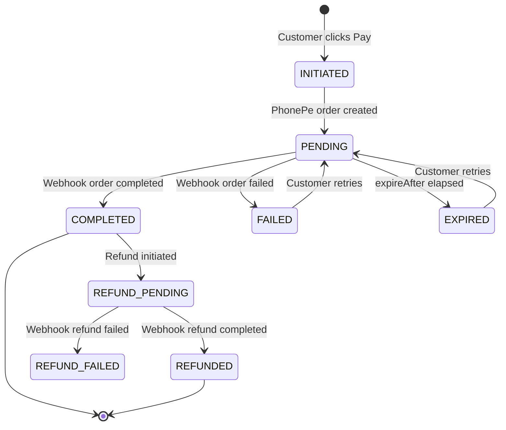
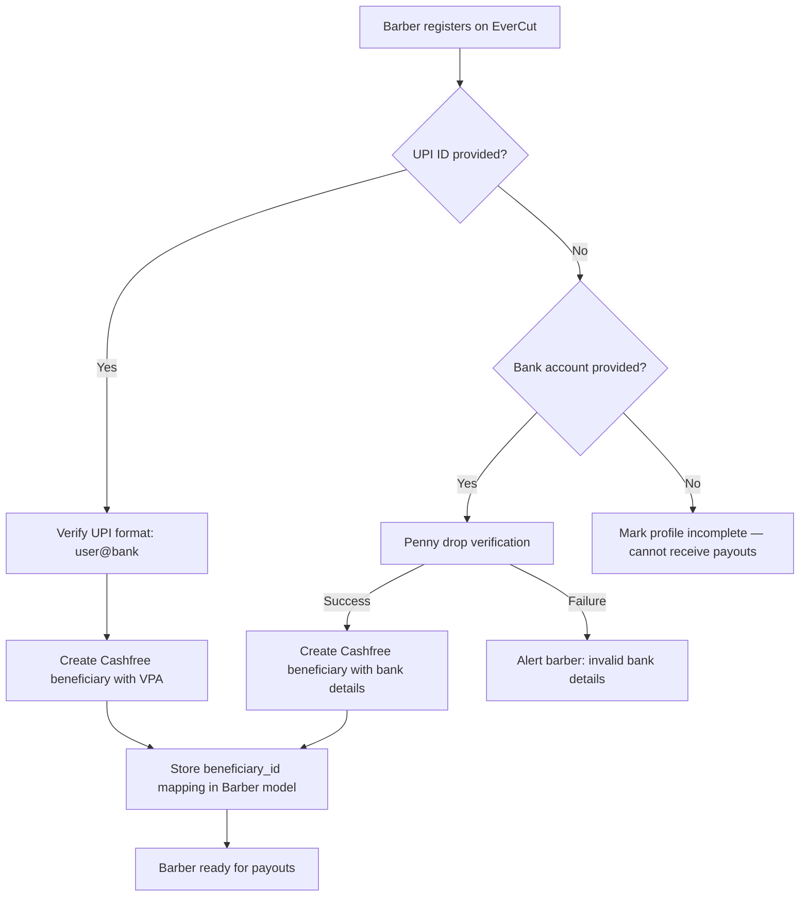
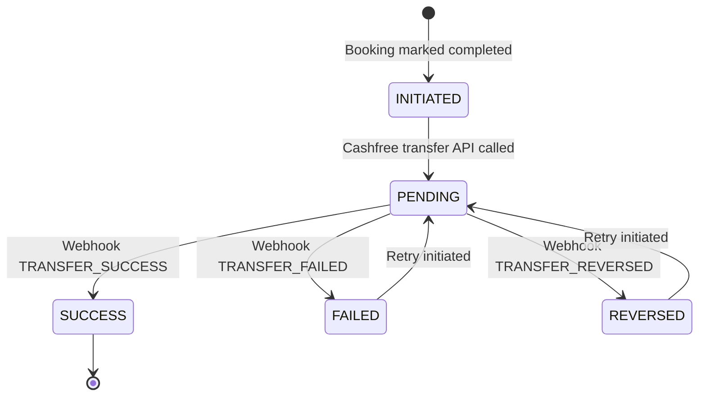
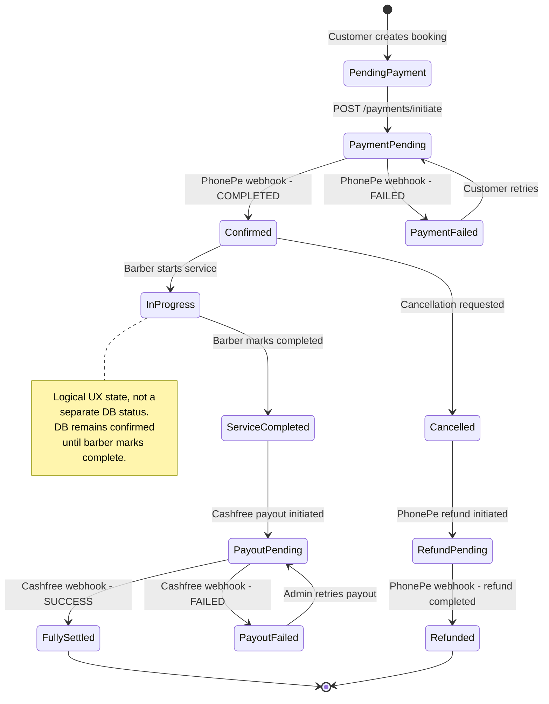

# Payment & Payout System — Research & Integration Guide

> **EverCut Salon Booking Platform**
> Version: 2.0 | Last Updated: April 2026
> Audience: Backend Engineers, Architects, Technical Decision-Makers
> Scope: PhonePe PG (Collection) + Cashfree Payouts (Disbursement)

---

## Table of Contents

1. [Executive Summary](#1-executive-summary)
2. [UPI Ecosystem Overview](#2-upi-ecosystem-overview)
3. [PhonePe PG Architecture — v2 Standard Checkout](#3-phonepe-pg-architecture--v2-standard-checkout)
4. [Merchant Onboarding — PhonePe](#4-merchant-onboarding--phonepe)
5. [Authentication — PhonePe OAuth 2.0 Token Flow](#5-authentication--phonepe-oauth-20-token-flow)
6. [Core API Reference — PhonePe](#6-core-api-reference--phonepe)
7. [Webhook Architecture — PhonePe](#7-webhook-architecture--phonepe)
8. [Payment State Machine](#8-payment-state-machine)
9. [Refund Lifecycle](#9-refund-lifecycle)
10. [Marketplace Payment Flow — EverCut Model](#10-marketplace-payment-flow--evercut-model)
11. [Cashfree Payouts — Provider Overview](#11-cashfree-payouts--provider-overview)
12. [Merchant Onboarding — Cashfree Payouts](#12-merchant-onboarding--cashfree-payouts)
13. [Authentication — Cashfree Payouts](#13-authentication--cashfree-payouts)
14. [Cashfree Payouts — API Reference](#14-cashfree-payouts--api-reference)
15. [Beneficiary (Barber) Onboarding](#15-beneficiary-barber-onboarding)
16. [Webhook Architecture — Cashfree Payouts](#16-webhook-architecture--cashfree-payouts)
17. [Payout State Machine](#17-payout-state-machine)
18. [Security & Compliance](#18-security--compliance)
19. [Edge Cases & Failure Scenarios](#19-edge-cases--failure-scenarios)
20. [Sandbox vs Production](#20-sandbox-vs-production)
21. [Pricing & Cost Analysis](#21-pricing--cost-analysis)
22. [Appendix — Error Codes](#22-appendix--error-codes)

---

## 1. Executive Summary

### Dual-Provider Architecture

EverCut uses a **dual-provider payment architecture** to handle the complete marketplace money flow:

| Layer | Provider | Purpose |
|---|---|---|
| **Collection (Inbound)** | PhonePe PG v2 | Customer pays for salon booking |
| **Disbursement (Outbound)** | Cashfree Payouts | Platform transfers barber's share |

**Why two providers?**

PhonePe PG is optimal for collection (~50% UPI market share, 0% MDR on UPI), but **PhonePe does not offer a Payout/Disbursement API** (verified against official developer portal — see [PAYOUT-API-RESEARCH.md](../../research/PAYOUT-API-RESEARCH.md)). Cashfree Payouts is the best-in-class payout provider for Indian startups based on cost, API maturity, and onboarding speed.

### End-to-End Money Flow

```
Customer ──[pays]──▶ PhonePe PG ──[settles T+1]──▶ EverCut Platform Account
                                                          │
                                              ┌───────────┴───────────┐
                                              │                       │
                                       Platform Commission     Barber Payout
                                          (15% retained)       (85% disbursed)
                                                                      │
                                              Cashfree Payouts ◀──────┘
                                                    │
                                                    ▼
                                         Barber's UPI / Bank Account
                                         (Real-time via UPI/IMPS)
```

### Integration Scope

```
COLLECTION:
  Customer App → EverCut Backend → PhonePe PG v2 → UPI/Card/NetBanking → Customer's Bank
                                        ↕
                                  Webhook (S2S)
                                        ↕
                             Order Status Polling (Fallback)

DISBURSEMENT:
  Booking Completed Event → EverCut Backend → Cashfree Payouts API → Barber's UPI/Bank
                                                    ↕
                                              Webhook (S2S)
                                                    ↕
                                       Transfer Status Polling (Fallback)
```

**Payment Methods Supported (Collection):**
- UPI Intent (preferred for mobile)
- UPI QR Code
- UPI Collect
- Debit/Credit Cards
- Net Banking
- PhonePe Wallet

**Payout Methods Supported (Disbursement):**
- UPI (real-time, 24×7)
- IMPS (real-time, 24×7)
- NEFT (banking hours)
- RTGS (banking hours, for high-value transfers)

---

## 2. UPI Ecosystem Overview

### 2.1 UPI Architecture Stack

```
┌─────────────────────────────────────────────────────┐
│                    NPCI (Switch)                    │
│            National Payments Corporation            │
├─────────────────┬───────────────────────────────────┤
│   PSP Banks     │   Issuer Banks   │  Acquirer Banks│
│  (PhonePe via   │  (Customer's     │  (Merchant's   │
│   Yes Bank)     │    Bank)         │    Bank)       │
├─────────────────┴───────────────────────────────────┤
│              Payment Aggregators (PAs)              │
│         PhonePe PG, Razorpay, Cashfree, etc.        │
├─────────────────────────────────────────────────────┤
│          Technology Service Providers (TSPs)        │
│            EverCut (Platform Layer)                 │
└─────────────────────────────────────────────────────┘
```

### 2.2 UPI Transaction Types Relevant to EverCut

| Type | Direction | Use Case | Chargeback Risk |
|---|---|---|---|
| **UPI Intent** | Customer → Merchant | Primary checkout flow | Low |
| **UPI QR** | Customer → Merchant | In-store/web fallback | Low |
| **UPI Collect** | Merchant → Customer | Fallback request | Medium |
| **P2M (Pay to Merchant)** | Customer → Merchant VPA | All EverCut transactions | Low |

### 2.3 Transaction Lifecycle

```
1. INITIATED    → Payment request created on backend
2. PENDING      → Customer redirected to PhonePe checkout / UPI app
3. PROCESSING   → Customer has authorized; awaiting bank confirmation
4. COMPLETED    → Funds debited & credited; webhook received
5. FAILED       → Transaction failed (timeout, wrong PIN, insufficient funds)
6. EXPIRED      → Customer did not complete within expiry window
```

### 2.4 Settlement Timeline

| Instrument | Settlement Speed |
|---|---|
| UPI (Bank-to-Bank) | T+1 business day (standard) |
| UPI (via PPI/Wallet) | T+1 business day |
| Debit Card | T+2 business days |
| Credit Card | T+2 business days |
| Net Banking | T+2 business days |

> **Critical:** Settlement is into PhonePe's escrow/nodal account first, then disbursed to the merchant's registered bank account.

---

## 3. PhonePe PG Architecture — v2 Standard Checkout

### 3.1 Integration Model

PhonePe PG v2 uses the **Standard Checkout** model:

1. **Backend creates a payment order** via API → receives a `redirectUrl`
2. **Frontend redirects customer** to the hosted PhonePe PayPage
3. **Customer completes payment** on PhonePe's secure page
4. **PhonePe sends webhook** to the backend (S2S callback)
5. **Customer is redirected** back to the merchant's `redirectUrl`
6. **Backend verifies** payment via Order Status API (fallback)

```
┌──────────┐      ┌──────────────┐     ┌──────────────┐      ┌──────────┐
│ EverCut  │────▶│ EverCut      │────▶│ PhonePe PG   │────▶│ Customer │
│ Mobile   │      │ Backend      │     │ v2 API       │      │ Bank     │
│ App      │◀────│              │◀────│              │◀────│          │
└──────────┘      └──────────────┘     └──────────────┘      └──────────┘
     │                  ▲                    │
     │                  │                    │
     │            ┌─────┴─────┐              │
     │            │ Webhook   │◀─────────────┘
     │            │ (S2S)     │
     │            └───────────┘
     │                  ▲
     └──────────────────┘
        Redirect back
```

### 3.2 API Base URLs

| Environment | Base URL |
|---|---|
| **UAT (Sandbox)** | `https://api-preprod.phonepe.com/apis/pg-sandbox` |
| **Production** | `https://api.phonepe.com/apis/pg` |

### 3.3 Node.js SDK

```bash
# Installation (official PhonePe SDK)
npm install @phonepe-pg/pg-sdk-node
```

**SDK Capabilities:**
- `new StandardCheckoutClient(config)` — SDK initialization with credentials and environment
- `client.pay(request)` — Create payment (returns `redirectUrl`)
- `client.createSdkOrder(request)` — Create order token for mobile SDKs
- `client.getOrderStatus(merchantOrderId)` — Check payment status
- `client.refund(request)` — Initiate refund
- `client.validateCallback(headers, body)` — Verify webhook authenticity

> **Design Decision — SDK vs Direct HTTP:**
> The Implementation Guide uses **direct HTTP calls** (`fetch()`) rather than the PhonePe SDK. This is a deliberate architectural choice for three reasons:
> 1. **Transparency:** Direct calls make the exact request/response structure visible in code — critical for debugging payment issues.
> 2. **No dependency lock-in:** Avoids coupling to a third-party SDK upgrade cycle.
> 3. **Adapter control:** The adapter pattern requires full control over request construction, which SDK abstractions can obscure.
> The SDK remains a valid alternative for teams preferring higher-level abstractions.

---

## 4. Merchant Onboarding — PhonePe

### 4.1 Registration Process

```
Step 1: Visit https://business.phonepe.com/pg/register
Step 2: Submit business details (GSTIN optional for < ₹40L turnover)
Step 3: Complete KYC (PAN + 1 OVD for simplified; full KYC for higher volumes)
Step 4: Activate sandbox environment (Test Mode ON)
Step 5: Obtain API credentials from Developer Settings
Step 6: Complete UAT testing
Step 7: Submit go-live request
Step 8: PhonePe review & production activation
```

### 4.2 Credentials Structure (v2)

| Credential | Purpose | Where to Find |
|---|---|---|
| **Client ID** | Identifies the merchant application | Dashboard → Developer Settings |
| **Client Secret** | Used to generate OAuth tokens | Dashboard → Developer Settings |
| **Client Version** | API version number | Dashboard → Developer Settings |
| **Merchant ID** | Unique merchant identifier | Dashboard → Account Settings |

> **Important (v2 vs v1):** The v2 API uses OAuth 2.0 (`client_id`, `client_secret`, `client_version`) instead of the legacy v1 approach (`merchantId`, `saltKey`, `saltIndex`). The old `X-VERIFY` SHA256 checksum model has been replaced by `O-Bearer` token authentication in v2.

### 4.3 Business Types Supported

| Type | KYC Requirement | Onboarding Time |
|---|---|---|
| Individual/Sole Proprietor | PAN + Aadhaar | 2-3 business days |
| Partnership | Partnership Deed + PAN | 3-5 business days |
| Pvt Ltd / LLP | CoI + Board Resolution + PAN | 5-7 business days |
| Trust / Society | Trust Deed + PAN | 7-10 business days |

---

## 5. Authentication — PhonePe OAuth 2.0 Token Flow

### 5.1 Token Generation

The v2 API requires an **OAuth 2.0 Bearer Token** for all authenticated requests.

**Endpoint:**
```
POST {base_url}/v1/oauth/token
Content-Type: application/x-www-form-urlencoded
```

**Request Body:**
```
client_id=<CLIENT_ID>
&client_version=<CLIENT_VERSION>
&client_secret=<CLIENT_SECRET>
&grant_type=client_credentials
```

**Response:**
```json
{
  "access_token": "eyJhbGciOiJIUzI1NiJ9...",
  "encrypted_access_token": "eyJhbGciOiJIUzI1NiJ9...",
  "expires_in": null,
  "issued_at": 1706073005,
  "expires_at": 1706697605,
  "session_expires_at": 1706697605,
  "token_type": "O-Bearer"
}
```

### 5.2 Token Usage

All subsequent API calls must include the token in the `Authorization` header:

```
Authorization: O-Bearer <access_token>
Content-Type: application/json
```

### 5.3 Token Lifecycle Management

```
┌──────────────────────────────────────────────────────────┐
│                   Token Lifecycle                        │
├──────────────────────────────────────────────────────────┤
│                                                          │
│  1. Generate token on application startup                │
│  2. Cache token in memory (NOT database)                 │
│  3. Track `expires_at` timestamp                         │
│  4. Refresh proactively at (expires_at - 5 minutes)      │
│  5. On 401 response → force-refresh and retry once       │
│  6. On persistent 401 → circuit-break and alert          │
│                                                          │
└──────────────────────────────────────────────────────────┘
```

> **Critical Rule:** Never store `client_secret` in code, logs, or client-facing responses. Use environment variables exclusively.

---

## 6. Core API Reference — PhonePe

### 6.1 Create Payment

Creates a checkout session. Customer is redirected to complete payment.

**Endpoint:**
```
POST {base_url}/checkout/v2/pay
Authorization: O-Bearer <access_token>
Content-Type: application/json
```

**Request Body:**
```json
{
  "merchantOrderId": "EC-BK-67e3f123abc",
  "amount": 50000,
  "expireAfter": 1200,
  "paymentFlow": {
    "type": "PG_CHECKOUT",
    "message": "Payment for salon booking at EverCut",
    "merchantUrls": {
      "redirectUrl": "https://api.evercut.in/api/v1/payments/redirect"
    }
  },
  "metaInfo": {
    "udf1": "booking_67e3f123abc",
    "udf2": "customer_64a1b2c3d4e5",
    "udf3": "shop_61f2a3b4c5d6"
  }
}
```

| Field | Type | Required | Description |
|---|---|---|---|
| `merchantOrderId` | String | ✅ | Unique order ID (maps to `booking._id` or custom `paymentReferenceId`) |
| `amount` | Integer | ✅ | Amount in **paisa** (₹500.00 = `50000`) |
| `expireAfter` | Integer | ❌ | Session expiry in seconds (default: 1200 = 20 min) |
| `paymentFlow.type` | String | ✅ | Always `"PG_CHECKOUT"` for standard checkout |
| `paymentFlow.merchantUrls.redirectUrl` | String | ✅ | URL to redirect customer after payment |
| `paymentFlow.message` | String | ❌ | Displayed on UPI collect requests |
| `metaInfo.udf1-udf15` | String | ❌ | Custom metadata fields (max 15) |

**Success Response (HTTP 200):**
```json
{
  "orderId": "OMO2403282020198641071317",
  "state": "PENDING",
  "expireAt": 1703756259307,
  "redirectUrl": "https://mercury.phonepe.com/transact/v2?token=eyJ..."
}
```

### 6.2 Order Status

Check the current status of a payment order.

**Endpoint:**
```
GET {base_url}/checkout/v2/order/{merchantOrderId}/status?details=true
Authorization: O-Bearer <access_token>
```

**Response (Completed):**
```json
{
  "orderId": "OMO2403282020198641071317",
  "state": "COMPLETED",
  "amount": 50000,
  "expireAt": 1711867462542,
  "paymentDetails": [
    {
      "paymentMode": "UPI_INTENT",
      "transactionId": "OM2403282020198651071949",
      "timestamp": 1711694662542,
      "amount": 50000,
      "state": "COMPLETED",
      "rail": {
        "type": "UPI",
        "utr": "455069731511",
        "upiTransactionId": "YBL369f6d96...",
        "vpa": "90****12@ybl"
      },
      "instrument": {
        "type": "ACCOUNT",
        "maskedAccountNumber": "******1234",
        "accountType": "SAVINGS"
      }
    }
  ],
  "metaInfo": {
    "udf1": "booking_67e3f123abc",
    "udf2": "customer_64a1b2c3d4e5",
    "udf3": "shop_61f2a3b4c5d6"
  }
}
```

**Possible `state` Values:**

| State | Meaning | Action |
|---|---|---|
| `PENDING` | Payment initiated, awaiting customer action | Wait for webhook or poll |
| `COMPLETED` | Payment successful | Update booking to `confirmed`, `paymentStatus: success` |
| `FAILED` | Payment failed | Update booking `paymentStatus: failed`, allow retry |

### 6.3 Initiate Refund

Process full or partial refund for a completed transaction.

**Endpoint:**
```
POST {base_url}/checkout/v2/refund
Authorization: O-Bearer <access_token>
Content-Type: application/json
```

**Request Body:**
```json
{
  "merchantRefundId": "EC-RF-67e3f123abc-001",
  "originalMerchantOrderId": "EC-BK-67e3f123abc",
  "amount": 50000
}
```

| Field | Type | Required | Description |
|---|---|---|---|
| `merchantRefundId` | String | ✅ | Unique refund ID (idempotency key) |
| `originalMerchantOrderId` | String | ✅ | Original `merchantOrderId` of the payment |
| `amount` | Integer | ✅ | Refund amount in paisa (≤ original amount) |

**Response:**
```json
{
  "refundId": "OMRxxxxx",
  "amount": 50000,
  "state": "PENDING"
}
```

### 6.4 Check Refund Status

**Endpoint:**
```
GET {base_url}/checkout/v2/refund/{merchantRefundId}/status
Authorization: O-Bearer <access_token>
```

---

## 7. Webhook Architecture — PhonePe

### 7.1 Configuration

Webhooks are configured via the **PhonePe Business Dashboard**:

1. Login → Developer Settings → Webhook tab
2. Set environment (Sandbox/Production)
3. Provide:
   - **Webhook URL:** `https://api.evercut.in/api/v1/payments/webhook`
   - **Username:** Alphanumeric, 5-20 chars, letters/digits/underscores
   - **Password:** 8-20 chars, must contain both letters and numbers

### 7.2 Webhook Events

| Event | Description | Trigger |
|---|---|---|
| `checkout.order.completed` | Payment succeeded | Customer completed payment |
| `checkout.order.failed` | Payment failed | Customer's payment was rejected/timed out |
| `pg.refund.completed` | Refund processed | Refund was successfully disbursed |
| `pg.refund.failed` | Refund failed | Refund processing encountered an error |

### 7.3 Webhook Payload — Order Completed

```json
{
  "event": "checkout.order.completed",
  "payload": {
    "orderId": "OMO2403282020198641071317",
    "merchantId": "EVERCUT_MERCHANT",
    "merchantOrderId": "EC-BK-67e3f123abc",
    "state": "COMPLETED",
    "amount": 50000,
    "expireAt": 1724866793837,
    "paymentDetails": [
      {
        "paymentMode": "UPI_QR",
        "transactionId": "OM12334",
        "timestamp": 1724866793837,
        "amount": 50000,
        "state": "COMPLETED"
      }
    ],
    "metaInfo": {
      "udf1": "booking_67e3f123abc",
      "udf2": "customer_64a1b2c3d4e5",
      "udf3": "shop_61f2a3b4c5d6"
    }
  }
}
```

### 7.4 Webhook Payload — Order Failed

```json
{
  "event": "checkout.order.failed",
  "payload": {
    "orderId": "OMO2403282020198641071311",
    "merchantId": "EVERCUT_MERCHANT",
    "merchantOrderId": "EC-BK-67e3f123abc",
    "state": "FAILED",
    "amount": 50000,
    "expireAt": 1724866793837,
    "paymentDetails": [
      {
        "paymentMode": "UPI_COLLECT",
        "timestamp": 1724866793837,
        "amount": 50000,
        "transactionId": "OM12333",
        "state": "FAILED",
        "errorCode": "AUTHORIZATION_ERROR",
        "detailedErrorCode": "ZM"
      }
    ]
  }
}
```

### 7.5 Authentication & Verification

PhonePe v2 webhooks use **SHA256 hash authentication**. The `Authorization` header value is the hex-encoded SHA256 hash of `username:password` (no `Basic` or `Bearer` prefix — the hash is sent directly):

```
Authorization: <SHA256_HEX(username:password)>
```

**Verification Algorithm:**

```javascript
// 1. Extract the Authorization header from incoming request
const receivedAuth = req.headers['authorization'];

// 2. Compute expected hash
const expectedAuth = crypto
  .createHash('sha256')
  .update(`${WEBHOOK_USERNAME}:${WEBHOOK_PASSWORD}`)
  .digest('hex');

// 3. Compare using timing-safe comparison
const isValid = crypto.timingSafeEqual(
  Buffer.from(receivedAuth),
  Buffer.from(expectedAuth)
);

// 4. If invalid → respond 401, do NOT process
// 5. If valid → process the event, respond 200 within 3-5 seconds
```

### 7.6 IP Whitelisting

If the server has firewall restrictions, whitelist these PhonePe IP ranges:

```
103.116.33.8-11
103.116.33.136-139
103.116.32.16-29
103.116.34.1
103.116.34.16-23
103.243.35.242

CIDR Blocks:
103.116.34.16/29
103.116.32.16/29
103.116.33.8/30
103.116.33.136/30
```

### 7.7 Webhook Best Practices

| Practice | Rationale |
|---|---|
| Return `200 OK` within 3-5 seconds | Prevents timeout retries |
| Use `payload.state` for status | Root-level state is authoritative |
| Use `event` field (not `type`) | `event` is the canonical event identifier |
| Implement idempotency | Same webhook may fire multiple times |
| Avoid strict deserialization | PhonePe may add new fields without notice |
| Always verify via Order Status API | Webhook is notification, not source of truth |

---

## 8. Payment State Machine

### 8.1 State Transitions



### 8.2 EverCut Booking × Payment Status Mapping

| Booking Status | Payment Status | Condition |
|---|---|---|
| `pending` | `pending` | Booking created, awaiting payment |
| `pending` | `initiated` | PhonePe order created, `redirectUrl` sent to client |
| `confirmed` | `success` | Webhook received: `checkout.order.completed` |
| `pending` | `failed` | Webhook received: `checkout.order.failed` |
| `cancelled` | `refunded` | Refund processed: `pg.refund.completed` |
| `cancelled` | `refund_failed` | Refund failed: `pg.refund.failed` |

---

## 9. Refund Lifecycle

### 9.1 Refund Types

| Type | Description | Amount |
|---|---|---|
| **Full Refund** | Complete reversal | Equal to original `amount` |
| **Partial Refund** | Partial reversal | Less than original `amount` |

### 9.2 Refund Flow

```
1. Trigger: Booking cancelled / dispute raised
2. Backend calls POST /checkout/v2/refund with unique merchantRefundId
3. PhonePe responds with refundId, state: PENDING
4. PhonePe processes refund (1-7 business days depending on instrument)
5. Webhook fires: pg.refund.completed OR pg.refund.failed
6. Backend updates booking paymentStatus accordingly
7. If webhook not received, poll via GET /checkout/v2/refund/{id}/status
```

### 9.3 Refund Webhook Payload

```json
{
  "event": "pg.refund.completed",
  "payload": {
    "merchantId": "EVERCUT_MERCHANT",
    "merchantRefundId": "EC-RF-67e3f123abc-001",
    "originalMerchantOrderId": "EC-BK-67e3f123abc",
    "amount": 50000,
    "state": "COMPLETED",
    "timestamp": 1730869961754,
    "refundId": "OMR7878098045517540996",
    "paymentDetails": [
      {
        "paymentMode": "UPI_INTENT",
        "timestamp": 1706629419799,
        "amount": 50000,
        "transactionId": "OMR7896789",
        "state": "COMPLETED"
      }
    ]
  }
}
```

### 9.4 Refund Timeline

| Instrument | Refund Processing Time |
|---|---|
| UPI | 1-3 business days |
| Debit Card | 5-7 business days |
| Credit Card | 5-7 business days |
| Net Banking | 5-7 business days |
| Wallet | Instant to 1 day |

### 9.5 Refund vs Payout — Critical Distinction

| Aspect | Refund (PhonePe) | Payout (Cashfree) |
|---|---|---|
| **Direction** | Platform → Original Payer | Platform → Barber (third party) |
| **Requires prior payment** | ✅ Yes — refund reverses a specific payment | ❌ No — payout is independent |
| **Recipient** | Customer who originally paid | Barber who provided the service |
| **Provider** | PhonePe PG | Cashfree Payouts |
| **Use case** | Booking cancellation, dispute | Barber commission disbursement |

---

## 10. Marketplace Payment Flow — EverCut Model

### 10.1 Complete Dual-Provider Flow Architecture

EverCut operates as a **marketplace platform** connecting customers with barber shops. The complete money flow uses two providers:

```
┌──────────┐         ┌──────────────┐         ┌──────────────┐
│ Customer │──pay──▶ │   PhonePe    │──settle─▶│   EverCut    │
│          │         │   PG Escrow  │  (T+1)   │   Platform   │
│          │         │              │          │   Account    │
└──────────┘         └──────────────┘          └──────┬───────┘
                                                      │
                                          ┌───────────┴───────────┐
                                          │                       │
                                   ┌──────▼──────┐        ┌──────▼──────┐
                                   │  Platform    │        │  Cashfree   │
                                   │  Commission  │        │  Payouts    │
                                   │  (15%)       │        │  Wallet     │
                                   └─────────────┘        └──────┬──────┘
                                                                  │
                                                           ┌──────▼──────┐
                                                           │   Barber    │
                                                           │   UPI/Bank  │
                                                           │   (85%)     │
                                                           └─────────────┘
```

### 10.2 Settlement Model

| Component | Percentage | Example (₹500 booking) |
|---|---|---|
| Total Collection | 100% | ₹500.00 |
| Platform Commission | 15% | ₹75.00 |
| GST on Commission (18%) | — | ₹13.50 |
| Barber Payout | 85% | ₹425.00 |
| PhonePe MDR (UPI) | 0% | ₹0.00 |
| Cashfree Payout Fee (UPI) | — | ₹3.00 (+GST) |

### 10.3 Complete Lifecycle — Booking to Payout

```
Step  1: Customer creates booking → status: pending, paymentStatus: pending
Step  2: Customer calls POST /payments/initiate
Step  3: Backend creates PaymentTransaction (INITIATED)
Step  4: Backend calls PhonePe POST /checkout/v2/pay → gets redirectUrl
Step  5: Customer redirected to PhonePe PayPage
Step  6: Customer completes payment (enters UPI PIN)
Step  7: PhonePe webhook → checkout.order.completed
Step  8: Backend verifies webhook, updates PaymentTransaction (COMPLETED)
Step  9: Booking → status: confirmed, paymentStatus: success
Step 10: Barber performs service
Step 11: Barber marks booking → status: completed
Step 12: Backend calculates payout: ₹500 × 85% = ₹425
Step 13: Backend ensures barber is Cashfree beneficiary (create if not)
Step 14: Backend calls Cashfree POST /payout/transfers → payout initiated
Step 15: PayoutTransaction created (PENDING)
Step 16: Cashfree webhook → TRANSFER_SUCCESS
Step 17: PayoutTransaction updated (SUCCESS), booking payoutStatus: completed
Step 18: Barber receives ₹425 in their UPI/bank account (real-time for UPI)
```

### 10.4 Payout Trigger Strategy

EverCut uses an **event-driven automated payout** approach:

**Trigger:** When a barber marks a booking as `completed` in their app, the backend listens for this status change and immediately initiates a Cashfree payout.

**Why event-driven (not batched)?**
- Barbers expect instant payment after service completion
- UPI payouts are real-time — no reason to batch
- Reduces support tickets about delayed payments
- Matches gig-economy UX expectations

**Fallback:** A cron job runs every 10 minutes to catch any payouts stuck in PENDING (webhook missed).

### 10.5 Compliance Considerations & Trade-Offs

**The RBI Risk:**
By using the Payout API approach, customer funds officially "pool" into EverCut's corporate bank accounts before being disbursed. Under RBI regulations, platforms that pool merchant funds are technically classified as **Payment Aggregators (PA)**, which theoretically requires a ₹15 crore net worth and an RBI license.

**The Pragmatic Reality:**
In practice, almost all early-stage Indian startups (from local marketplaces to gig platforms) begin by using a Payout/Nodal account structure because enforcing strict PA/Split-KYC drops their supply acquisition to zero. Starting with corporate payout APIs is the industry standard for early-stage platforms. When EverCut reaches substantial scale and transaction volume, it will need to transition to a fully vetted, compliant Escrow/TSP model or secure a PA license.

**Mitigation Strategy:**
- Disburse to barbers within 24 hours (preferably instantly)
- Maintain clear internal ledger showing every rupee collected and disbursed
- Retain only the platform commission; do not hold barber funds excessively
- Plan PA license application once transaction volume warrants it

---

## 11. Cashfree Payouts — Provider Overview

### 11.1 Why Cashfree Payouts for EverCut

**Verification:** PhonePe PG **does not offer a Payout/Disbursement API**. This was verified against the official PhonePe developer portal (`developer.phonepe.com/payment-gateway`). See [PAYOUT-API-RESEARCH.md](../../research/PAYOUT-API-RESEARCH.md) for detailed evidence.

Cashfree Payouts was selected after evaluating Cashfree, RazorpayX, and PayU Payouts:

| Factor | Cashfree Payouts |
|---|---|
| **Cost** | Lowest payout fees (NEFT: ₹1.75 flat; UPI: ₹3–₹10) |
| **Pricing Transparency** | Fully public fee schedule |
| **API Maturity** | V2 REST API with modern design |
| **Onboarding** | 100% digital, 1–2 business days |
| **Zero Fees** | No setup fee, no AMC |
| **Startup Focus** | YC-backed, MSME-friendly |
| **RBI Licensed** | Licensed Payment Aggregator |
| **Scale Proven** | Used by CRED, Nykaa, gig platforms |

### 11.2 Cashfree API Architecture

Cashfree Payouts V2 uses a **direct header-based authentication** model. Unlike PhonePe's OAuth token flow, Cashfree requires API credentials in every request header — there is no separate authorization/token step.

```
┌──────────────┐                    ┌──────────────────┐
│  EverCut     │ ── x-client-id ──▶ │  Cashfree        │
│  Backend     │ ── x-client-secret │  Payouts API     │
│              │ ── x-api-version   │  (REST/JSON)     │
│              │◀── JSON Response ──│                  │
└──────────────┘                    └──────────────────┘
```

### 11.3 API Base URLs

| Environment | Base URL |
|---|---|
| **Sandbox (Test)** | `https://sandbox.cashfree.com/payout` |
| **Production** | `https://api.cashfree.com/payout` |

### 11.4 Key Capabilities

- **Instant fund transfers:** 24×7 real-time to bank accounts, UPI IDs, wallets
- **Multi-mode disbursals:** IMPS, NEFT, RTGS, UPI
- **Batch transfers:** Multiple beneficiaries in a single API call
- **Smart routing:** Multi-bank failover with 99.98% uptime SLA
- **Cashgram (Payout Links):** Send money when only a mobile number/email is known
- **Beneficiary management:** Add, verify, and delete beneficiaries via API
- **Bank Account Verification:** Penny drop API before sending payouts
- **Webhooks:** Real-time success/failure/reversal notifications
- **Payout Protect:** Real-time fraud detection at payout level

---

## 12. Merchant Onboarding — Cashfree Payouts

### 12.1 Registration Process

```
Step 1: Visit https://merchant.cashfree.com/merchants/signup
Step 2: Enter business mobile number → receive OTP → verify
Step 3: Select "Make Payouts" as the preferred product
Step 4: Provide business details:
  - Business Name (legal name / brand name)
  - Business Type (Pvt Ltd / LLP / Sole Proprietor / Partnership)
  - Category (Technology / Marketplace / Services)
  - Website URL (or app description if no website)
  - Annual turnover range
Step 5: Submit KYC documents (see Section 12.2)
Step 6: Aadhaar-based OTP or DigiLocker verification
Step 7: Bank account linking (Cashfree sends ₹1 penny drop for verification)
Step 8: Account activated for TEST environment (~24 working hours)
Step 9: Activate Payouts product separately:
  - Navigate to Dashboard → Products → Payouts → Activate
  - Payouts has a separate virtual wallet and separate API credentials
Step 10: Complete Payouts-specific KYC (business purpose of payouts)
Step 11: Production go-live for Payouts after internal review (1–2 business days)
```

### 12.2 KYC Requirements by Business Type

| Business Type | Documents Required |
|---|---|
| **Sole Proprietor** | PAN Card, Aadhaar Card, Cancelled Cheque, 2 proofs of business existence (e.g., GST + Udyam Certificate) |
| **Private Limited / LLP** | Certificate of Incorporation, MoA/AoA, PAN of Company, GST (if applicable), Board Resolution, Aadhaar + PAN of authorized signatory |
| **Partnership** | Partnership Deed, PAN of firm, Aadhaar + PAN of managing partner |

**GST Requirement:**
- GST is **optional** for businesses with turnover below ₹40L/year
- GST mandatory for businesses above threshold or in mandatory-registration categories
- EverCut should include GST number if available — it streamlines approval

**For Payouts specifically (additional information at signup):**
- Business purpose of payouts (e.g., "platform commission disbursements to service providers")
- Intended beneficiary types (e.g., "Individual bank accounts and UPI IDs of barbers")
- Expected monthly payout volume (even estimated figures acceptable)

### 12.3 Payout Wallet Setup

After Payouts activation, Cashfree creates a **virtual payout wallet**:

| Aspect | Detail |
|---|---|
| **Virtual Account** | Unique account number + IFSC provided by Cashfree |
| **Funding** | Transfer from registered business bank account only (NEFT/IMPS/RTGS) |
| **Balance** | Payouts are debited from this wallet balance |
| **Minimum** | Maintain balance ≥ 2× expected daily payout volume |
| **Alerts** | Set low-balance alerts via dashboard |
| **Dashboard** | Monitor via Payouts Dashboard → Fund Sources |

> **Critical:** The payout wallet is separate from PG settlement. You must explicitly fund it.
>
> **Funding Flow:**
> ```
> PhonePe PG → settles into EverCut's registered bank account (T+1)
>     → You manually or via standing instruction transfer funds
>     → From your bank account → to Cashfree Payout Virtual Account (NEFT/IMPS/RTGS)
>     → Cashfree wallet now has balance for barber payouts
> ```
> This is a manual funding step that must be planned for. Set up low-balance alerts (Dashboard → Alerts) and maintain at least 2× expected daily payout volume.

### 12.4 API Key Generation

```
1. Login to https://merchant.cashfree.com
2. Navigate to: Developers → API Keys
3. For Payouts API: The App ID and Secret Key are SEPARATE from PG credentials
   - PG credentials → Payment Gateway section
   - Payout credentials → Payouts section
4. Generate Payouts API credentials:
   - Click "Create Key" in Payouts section
   - Note the x-client-id (App ID) and x-client-secret (Secret Key)
5. Store securely (never commit to version control)
6. Configure Two-Factor Authentication (2FA) — MANDATORY for production:
    - **Option A — IP Whitelisting (recommended for static IPs):**
      Navigate to: Developers → Two-Factor Authentication → IP Whitelisting
      Add production server IP(s)
    - **Option B — Public Key-based Signature (for dynamic IPs):**
      Generate a Public Key pair in: Developers → Two-Factor Authentication
      For every request, create `x-cf-signature` header:
      Sign `client_id.unix_timestamp` with your RSA Private Key
      Signatures are valid for 5 minutes in production
    - At least one 2FA method is MANDATORY for production payout API calls
```

> **EverCut Recommendation:** Use **IP Whitelisting** if deploying on a cloud server with a static IP (e.g., AWS EC2 with Elastic IP, DigitalOcean Droplet). Use **Public Key-based 2FA** if deploying on serverless or auto-scaling infrastructure where IPs change.

---

## 13. Authentication — Cashfree Payouts

### 13.1 Direct Header-Based Authentication (V2)

Cashfree Payouts V2 uses **direct API key authentication** on every request. Unlike the older V1 token-based flow, there is no separate `/authorize` endpoint.

**Required Headers on Every API Request:**

```http
x-client-id: <CASHFREE_PAYOUT_CLIENT_ID>
x-client-secret: <CASHFREE_PAYOUT_CLIENT_SECRET>
x-api-version: 2025-01-01
Content-Type: application/json
```

| Header | Description |
|---|---|
| `x-client-id` | Your Cashfree Payouts App ID |
| `x-client-secret` | Your Cashfree Payouts Secret Key |
| `x-api-version` | API version date string (e.g., `2025-01-01`) |

> **⚠️ Important Correction:** Earlier research documents referenced a Bearer token flow via `POST /payout/v2/authorize`. The current Cashfree Payouts V2 API uses **direct header-based authentication** without a separate token step. The `x-client-id` and `x-client-secret` are sent in headers on every request. The current recommended `x-api-version` is `2025-01-01`. Always verify against the latest official Cashfree developer documentation.

### 13.2 Security Requirements

| Requirement | Detail |
|---|---|
| **IP Whitelisting** | Mandatory in production; whitelist all server IPs in Cashfree dashboard |
| **Secret Storage** | `x-client-secret` in environment variables only; never in code/logs |
| **HTTPS Only** | All API calls must be over HTTPS |
| **2FA** | Production keys may require 2FA in dashboard to view/generate |

---

## 14. Cashfree Payouts — API Reference

### 14.1 Create Beneficiary

Register a barber as a payout beneficiary before first transfer.

**Endpoint:**
```http
POST {base_url}/beneficiary
x-client-id: <CLIENT_ID>
x-client-secret: <CLIENT_SECRET>
x-api-version: 2025-01-01
Content-Type: application/json
```

**Request Body (UPI):**
```json
{
  "beneficiary_id": "BARBER_64a1b2c3d4e5",
  "beneficiary_name": "Rahul Sharma",
  "beneficiary_phone": "9876543210",
  "beneficiary_email": "rahul@example.com",
  "beneficiary_instrument_details": {
    "vpa": "rahulsharma@upi"
  }
}
```

**Request Body (Bank Account):**
```json
{
  "beneficiary_id": "BARBER_64a1b2c3d4e5",
  "beneficiary_name": "Rahul Sharma",
  "beneficiary_phone": "9876543210",
  "beneficiary_email": "rahul@example.com",
  "beneficiary_instrument_details": {
    "bank_account_number": "1234567890",
    "bank_ifsc": "SBIN0001234"
  }
}
```

| Field | Type | Required | Description |
|---|---|---|---|
| `beneficiary_id` | String | ✅ | Unique ID (use EverCut barber ID with prefix) |
| `beneficiary_name` | String | ✅ | Full legal name of barber |
| `beneficiary_phone` | String | ✅ | Barber's phone number |
| `beneficiary_email` | String | ❌ | Barber's email (recommended) |
| `beneficiary_instrument_details.vpa` | String | ✅* | UPI VPA for UPI payouts |
| `beneficiary_instrument_details.bank_account_number` | String | ✅* | Bank account for IMPS/NEFT |
| `beneficiary_instrument_details.bank_ifsc` | String | ✅* | IFSC for IMPS/NEFT |

*\* Either UPI VPA or bank account details required.*

### 14.2 Get Beneficiary

**Endpoint:**
```http
GET {base_url}/beneficiary/{beneficiary_id}
x-client-id: <CLIENT_ID>
x-client-secret: <CLIENT_SECRET>
x-api-version: 2025-01-01
```

### 14.3 Remove Beneficiary

**Endpoint:**
```http
DELETE {base_url}/beneficiary/{beneficiary_id}
x-client-id: <CLIENT_ID>
x-client-secret: <CLIENT_SECRET>
x-api-version: 2025-01-01
```

### 14.4 Standard Transfer (Single Payout)

Initiate a payout to a registered beneficiary.

**Endpoint:**
```http
POST {base_url}/transfers
x-client-id: <CLIENT_ID>
x-client-secret: <CLIENT_SECRET>
x-api-version: 2025-01-01
Content-Type: application/json
```

**Request Body:**
```json
{
  "transfer_id": "PAYOUT_BOOKING_456_1714000000",
  "transfer_amount": 425.00,
  "transfer_mode": "UPI",
  "beneficiary_details": {
    "beneficiary_id": "BARBER_64a1b2c3d4e5"
  },
  "remarks": "EverCut - Booking #456 - Haircut Service"
}
```

| Field | Type | Required | Description |
|---|---|---|---|
| `transfer_id` | String | ✅ | Unique per transfer (idempotency key) |
| `transfer_amount` | Number | ✅ | Amount in **rupees** (NOT paisa) |
| `transfer_mode` | String | ❌ | `UPI`, `BANK` (IMPS/NEFT auto-selected), `IMPS`, `NEFT`, `RTGS` |
| `beneficiary_details.beneficiary_id` | String | ✅ | Previously registered beneficiary |
| `remarks` | String | ❌ | Transfer description |

> **⚠️ Critical:** Cashfree Payouts uses **rupees** (not paisa) for `transfer_amount`. PhonePe uses paisa. This distinction must be handled carefully in the adapter layer.

**Success Response:**
```json
{
  "cf_transfer_id": "CF_123456",
  "transfer_id": "PAYOUT_BOOKING_456_1714000000",
  "status": "PENDING"
}
```

### 14.5 Get Transfer Status

**Endpoint:**
```http
GET {base_url}/transfers/{transfer_id}
x-client-id: <CLIENT_ID>
x-client-secret: <CLIENT_SECRET>
x-api-version: 2025-01-01
```

**Response:**
```json
{
  "cf_transfer_id": "CF_123456",
  "transfer_id": "PAYOUT_BOOKING_456_1714000000",
  "status": "SUCCESS",
  "transfer_utr": "424242424242",
  "transfer_amount": 425.00,
  "updated_at": "2026-04-17T10:30:00Z"
}
```

**Possible `status` Values:**

| Status | Meaning | Action |
|---|---|---|
| `PENDING` | Transfer initiated, processing | Wait for webhook or poll |
| `SUCCESS` | Transfer completed, funds delivered | Update payoutStatus: completed |
| `FAILED` | Transfer failed | Log failure reason, retry or alert admin |
| `REVERSED` | Funds returned to payout wallet | Same as FAILED; investigate cause |

### 14.6 Batch Transfer

**Endpoint:**
```http
POST {base_url}/transfers/batch
x-client-id: <CLIENT_ID>
x-client-secret: <CLIENT_SECRET>
x-api-version: 2025-01-01
Content-Type: application/json
```

**Request Body:**
```json
{
  "batch_transfer_id": "BATCH_20260417_001",
  "transfers": [
    {
      "transfer_id": "PAYOUT_BOOKING_456",
      "transfer_amount": 425.00,
      "beneficiary_details": {
        "beneficiary_id": "BARBER_64a1b2c3d4e5"
      }
    }
  ]
}
```

### 14.7 Bank Account Verification (Penny Drop)

**Endpoint:**
```http
GET {base_url}/validation/bankDetails?bankAccount={account}&ifsc={ifsc}&name={name}
x-client-id: <CLIENT_ID>
x-client-secret: <CLIENT_SECRET>
x-api-version: 2025-01-01
```

**Response:**
```json
{
  "account_exists": true,
  "name_match": true,
  "registered_name": "RAHUL SHARMA"
}
```

### 14.8 API Endpoint Summary for EverCut

| Method | Cashfree Endpoint | EverCut Usage |
|---|---|---|
| `POST` | `/beneficiary` | Register barber before first payout |
| `GET` | `/beneficiary/{beneficiary_id}` | Check if barber is registered |
| `DELETE` | `/beneficiary/{beneficiary_id}` | Remove barber (UPI/bank change) |
| `GET` | `/validation/bankDetails` | Penny drop bank verification |
| `POST` | `/transfers` | Initiate barber payout |
| `GET` | `/transfers/{transfer_id}` | Poll payout status |
| `POST` | `/transfers/batch` | Batch payouts (future: daily settlement) |
| Webhook | `POST /api/v1/payouts/webhook` | Receive Cashfree transfer events |

---

## 15. Beneficiary (Barber) Onboarding

### 15.1 Barber Registration for Payouts

When a barber registers on EverCut, the platform collects their payout details:

**Minimum Required Information:**

| Field | Required | Purpose |
|---|---|---|
| Full Name (legal) | ✅ | Must match bank/UPI records |
| Phone Number | ✅ | Cashfree beneficiary requirement |
| UPI VPA | ✅ (preferred) | Primary payout method |
| Bank Account Number | ✅ (fallback) | Secondary payout method |
| IFSC Code | ✅ (if bank account) | Required for IMPS/NEFT |
| Email | ❌ (recommended) | Notifications |

### 15.2 Beneficiary Creation Flow



### 15.3 Beneficiary Lifecycle Management

| Event | Action |
|---|---|
| Barber registers with UPI | Create beneficiary immediately |
| Barber registers with bank account | Penny drop → create on success |
| Barber changes UPI ID | Delete old beneficiary → create new one |
| Barber changes bank account | Penny drop → delete old → create new |
| First payout to barber | Verify beneficiary exists (auto-create if missing) |
| Barber deactivated / removed | Delete beneficiary from Cashfree |

### 15.4 Data to Store on Shop Model

The Shop model **already has** `upiId`, `accountHolderName`, and `bankName` fields at the root level (collected during barber onboarding). For Cashfree Payouts, add the following **new fields**:

```javascript
// Existing fields (already in shop.model.js) — NO changes needed:
// upiId: String              → Barber's UPI VPA (e.g., rahul@upi)
// accountHolderName: String  → Name as registered with bank
// bankName: String           → Bank name

// NEW fields to ADD to shop.model.js for Cashfree beneficiary tracking:
payoutConfig: {
    bankAccount: String,        // Encrypted bank account number (optional, for IMPS/NEFT)
    ifsc: String,               // IFSC code (required if bankAccount provided)
    cashfreeBeneficiaryId: String,  // Cashfree beneficiary ID mapping
    beneficiaryCreatedAt: Date,     // When beneficiary was registered on Cashfree
    verifiedAt: Date,               // When bank/UPI was last verified
    verificationStatus: {
        type: String,
        enum: ['pending', 'verified', 'failed'],
        default: 'pending',
    },
}
```

---

## 16. Webhook Architecture — Cashfree Payouts

### 16.1 Configuration

Configure webhook URL in **Cashfree Merchant Dashboard**:

```
1. Login to merchant.cashfree.com
2. Navigate to: Payouts → Settings → Webhooks
3. Add webhook URL: https://api.evercut.in/api/v1/payouts/webhook
4. Select events: All transfer events
5. Note: Webhook is sent as POST with JSON body
```

### 16.2 Webhook Events

| Event Type | Description | Trigger |
|---|---|---|
| `TRANSFER_SUCCESS` | Payout completed | Funds delivered to beneficiary |
| `TRANSFER_FAILED` | Payout failed | Transfer could not be completed |
| `TRANSFER_REVERSED` | Payout reversed | Funds returned to payout wallet |

### 16.3 Webhook Payload — Transfer Success

```json
{
  "event": "TRANSFER_SUCCESS",
  "data": {
    "transfer_id": "PAYOUT_BOOKING_456_1714000000",
    "cf_transfer_id": "CF_123456",
    "status": "SUCCESS",
    "transfer_utr": "424242424242",
    "transfer_amount": 425.00,
    "updated_at": "2026-04-17T10:30:00Z"
  }
}
```

### 16.3.1 Webhook Payload — Transfer Failed

```json
{
  "event": "TRANSFER_FAILED",
  "data": {
    "transfer_id": "PAYOUT_BOOKING_456_1714000000",
    "cf_transfer_id": "CF_123456",
    "status": "FAILED",
    "transfer_amount": 425.00,
    "failure_reason": "INVALID_VPA",
    "updated_at": "2026-04-17T10:30:00Z"
  }
}
```

### 16.3.2 Webhook Payload — Transfer Reversed

```json
{
  "event": "TRANSFER_REVERSED",
  "data": {
    "transfer_id": "PAYOUT_BOOKING_456_1714000000",
    "cf_transfer_id": "CF_123456",
    "status": "REVERSED",
    "transfer_amount": 425.00,
    "failure_reason": "BENEFICIARY_BANK_RETURNED",
    "updated_at": "2026-04-17T11:00:00Z"
  }
}
```

### 16.4 Webhook Signature Verification

Cashfree Payouts webhooks include signature headers for verification:

**Headers included with every webhook:**
- `x-webhook-signature` — HMAC-SHA256 signature (base64 encoded)
- `x-webhook-timestamp` — Unix timestamp of webhook generation

**Verification Algorithm:**

```javascript
const crypto = require('crypto');

function verifyCashfreeWebhook(rawBody, timestamp, receivedSignature, clientSecret) {
    // 1. Create the data string: timestamp + rawBody
    const signatureData = timestamp + rawBody;

    // 2. Generate HMAC-SHA256 with client secret
    const computedSignature = crypto
        .createHmac('sha256', clientSecret)
        .update(signatureData)
        .digest('base64');

    // 3. Compare using timing-safe comparison
    try {
        return crypto.timingSafeEqual(
            Buffer.from(computedSignature),
            Buffer.from(receivedSignature)
        );
    } catch {
        return false; // Length mismatch
    }
}
```

> **⚠️ Critical:** The raw request body (exact bytes received) must be used for signature verification, NOT a parsed/re-serialized JSON object. Use `express.raw()` or a custom middleware to capture the raw body before JSON parsing.

### 16.5 Webhook Best Practices

| Practice | Rationale |
|---|---|
| Return `200 OK` immediately | Prevents retries |
| Verify `x-webhook-signature` | Prevent spoofed webhooks |
| Use raw body for verification | Parsed JSON may alter field ordering |
| Implement idempotency | Same webhook may fire multiple times |
| Cross-verify via Transfer Status API | Webhook is notification, not source of truth |
| Process asynchronously | Acknowledge first, then update DB |

---

## 17. Payout State Machine

### 17.1 Payout Status Transitions



### 17.2 Booking × Payout Status Mapping

| Booking Status | Payout Status | Condition |
|---|---|---|
| `completed` | `not_initiated` | Service done; payout not yet triggered |
| `completed` | `initiated` | PayoutTransaction created; API not yet called |
| `completed` | `pending` | Cashfree API called; awaiting confirmation |
| `completed` | `completed` | Cashfree webhook: TRANSFER_SUCCESS |
| `completed` | `failed` | Cashfree webhook: TRANSFER_FAILED |
| `completed` | `reversed` | Cashfree webhook: TRANSFER_REVERSED |

### 17.3 Complete Booking State Machine (Payment + Payout)



---

## 18. Security & Compliance

### 18.1 Non-Negotiable Security Requirements

| Requirement | Implementation |
|---|---|
| **HTTPS Only** | All webhook URLs must use HTTPS with valid TLS certificates |
| **PhonePe Webhook Verification** | Verify `Authorization` header using SHA256 hash comparison |
| **Cashfree Webhook Verification** | Verify `x-webhook-signature` using HMAC-SHA256 |
| **Timing-Safe Comparison** | Use `crypto.timingSafeEqual()` for all signature comparisons |
| **Token/Secret Security** | Store `client_secret` values in environment variables; never log |
| **Data Redaction** | Use existing `logger.js` redaction to mask sensitive payment data |
| **PCI-DSS** | Not required if using PhonePe hosted checkout (card data never touches EverCut servers) |

### 18.2 NPCI Data Localization

- **All payment data must be stored on India-resident servers**
- Applies to: transaction IDs, amounts, UPI VPAs, UTR numbers, card masks, bank account numbers
- MongoDB Atlas: Use `ap-south-1` (Mumbai) region exclusively
- No payment data may be replicated to international data centers

### 18.3 Credential Storage

```
.env (NEVER committed to version control)
├── # ─── PhonePe PG ───
├── PHONEPE_CLIENT_ID=<client_id>
├── PHONEPE_CLIENT_SECRET=<client_secret>
├── PHONEPE_CLIENT_VERSION=<version_number>
├── PHONEPE_MERCHANT_ID=<merchant_id>
├── PHONEPE_ENV=SANDBOX|PRODUCTION
├── PHONEPE_WEBHOOK_USERNAME=<webhook_username>
├── PHONEPE_WEBHOOK_PASSWORD=<webhook_password>
├── # ─── Cashfree Payouts ───
├── CASHFREE_PAYOUT_CLIENT_ID=<payout_client_id>
├── CASHFREE_PAYOUT_CLIENT_SECRET=<payout_client_secret>
├── CASHFREE_PAYOUT_ENV=TEST|PRODUCTION
├── # ─── Payment Settings ───
├── PAYMENT_REDIRECT_BASE_URL=https://api.evercut.in/api/v1/payments/redirect
└── PLATFORM_COMMISSION_PERCENT=15
```

### 18.4 What Must NEVER Be Logged

- `client_secret` / `access_token` values (both PhonePe and Cashfree)
- Customer UPI PIN (should never even reach your server)
- Full VPA (Virtual Payment Address) — mask to `90****12@ybl`
- Full card numbers — accept only masked versions from PhonePe
- Full bank account numbers — mask to `******1234`
- Raw webhook payloads (log event + ID + state only)
- `x-client-secret` header values

### 18.5 IP Whitelisting

| Provider | Requirement | Configuration |
|---|---|---|
| **PhonePe** | Whitelist PhonePe IPs on your firewall | See Section 7.6 |
| **Cashfree** | Whitelist your server IPs on Cashfree dashboard | Dashboard → Developers → IP Whitelisting |

---

## 19. Edge Cases & Failure Scenarios

### 19.1 Payment (PhonePe) Edge Cases

| Scenario | Detection | Handling |
|---|---|---|
| **Webhook not received** | No webhook within 30s of redirect | Poll Order Status API with exponential backoff |
| **Duplicate webhook** | Same `merchantOrderId` + `state` | Idempotency check — if already processed, return 200 |
| **Customer pays but closes app** | Redirect not received | Webhook still fires; cron job polls pending orders |
| **Bank timeout (UPI)** | `errorCode: TIMEOUT` | Mark as PENDING; auto-resolution within T+1 |
| **Double payment** | Two payments for same booking | `merchantOrderId` is unique per booking; second fails at PhonePe |
| **Refund on failed payment** | Refund request for non-COMPLETED order | PhonePe rejects; backend validates before calling |
| **Token expired during payment** | 401 on Order Status call | Auto-refresh token and retry once |
| **PhonePe downtime** | Connection timeout / 5xx | Circuit breaker pattern; queue payment for retry |

### 19.2 Payout (Cashfree) Edge Cases

| Scenario | Detection | Handling |
|---|---|---|
| **Beneficiary not found** | API returns beneficiary not found error | Auto-register via `ensureBeneficiary()`, then retry |
| **Invalid UPI VPA** | `INVALID_VPA` / transfer fails | Flag barber profile for UPI re-verification; fallback to bank |
| **Invalid bank account** | Transfer fails with account error | Flag barber profile; trigger penny drop reverification |
| **Insufficient wallet balance** | `INSUFFICIENT_BALANCE` response | Alert admin; pause automated payouts until funded |
| **Duplicate transfer_id** | `TRANSFER_ID_EXISTS` response | Idempotency check before API call; return existing status |
| **Webhook not received** | No update after 5 min | Poll GET /transfers/{transfer_id} |
| **Bank downtime (beneficiary side)** | Transfer FAILED with bank error | Retry with exponential backoff (3s, 9s, 27s) |
| **Double webhook delivery** | Same transfer_id already processed | Return 200; no re-processing (idempotency) |
| **Payout for incomplete booking** | Booking not in `completed` state | Service layer validates booking state before initiating |
| **Barber changes UPI after payout initiated** | Old UPI still on beneficiary | Complete existing payout; update beneficiary after |
| **Cashfree downtime** | Connection timeout / 5xx | Queue payout for retry; cron job processes queue |
| **Payout reversed after success** | TRANSFER_REVERSED webhook | Mark PayoutTransaction as REVERSED; alert admin |

### 19.3 Cross-System Edge Cases

| Scenario | Handling |
|---|---|
| **Payment succeeds, payout fails** | Payment remains COMPLETED; PayoutTransaction marked FAILED; admin alert for manual retry |
| **Customer requests refund after payout** | Check payout status: if SUCCESS, refund requires manual reconciliation; if PENDING, cancel payout first |
| **Booking cancelled after payout initiated** | If payout PENDING: attempt cancel; if SUCCESS: manual recovery |
| **Payment collected via PhonePe, Cashfree wallet empty** | Payout queued; admin alerted to fund Cashfree wallet |
| **Both webhooks arrive simultaneously** | Process independently; use database transactions for booking status |

### 19.4 Timeout Strategy

```
PAYMENT:
  Payment Session:       expireAfter = 1200s (20 minutes)
  Webhook Wait:          30 seconds after redirect
  Status Poll Interval:  3s, 6s, 12s, 24s, 48s (exponential backoff)
  Max Poll Attempts:     10 (total ~5 minutes)
  Cron Fallback:         Every 5 minutes for orders stuck in PENDING > 30 min
  Final Timeout:         Mark as FAILED after 24 hours of PENDING

PAYOUT:
  Webhook Wait:          5 minutes after API call
  Status Poll Interval:  10 minutes (cron job)
  Max Retries:           3 (with exponential backoff: 3s, 9s, 27s)
  Final Timeout:         Alert admin if PENDING > 1 hour
  Non-retryable:         INSUFFICIENT_BALANCE, INVALID_VPA, INVALID_ACCOUNT
```

### 19.5 Idempotency Implementation

```javascript
// Payment Webhook (PhonePe):
const existingPayment = await PaymentTransaction.findOne({
  merchantOrderId: payload.merchantOrderId,
  status: 'completed'  // Prevent re-processing completed payments
});
if (existingPayment) return res.status(200).json({ received: true });

// Payout Webhook (Cashfree):
const existingPayout = await PayoutTransaction.findOne({
  transferId: data.transfer_id,
  status: { $in: ['SUCCESS', 'FAILED'] }  // Terminal states
});
if (existingPayout) return res.status(200).json({ received: true });

// Payout Initiation:
const existingPayout = await PayoutTransaction.findOne({ bookingId });
if (existingPayout && existingPayout.status !== 'FAILED') {
  return existingPayout; // Don't create duplicate payout
}
```

---

## 20. Sandbox vs Production

### 20.1 PhonePe Environment Comparison

| Feature | Sandbox (UAT) | Production |
|---|---|---|
| Base URL | `api-preprod.phonepe.com/apis/pg-sandbox` | `api.phonepe.com/apis/pg` |
| Credentials | Test `client_id` / `client_secret` | Production credentials |
| Real money | ❌ No | ✅ Yes |
| Webhook delivery | ✅ Yes (test mode) | ✅ Yes |
| UPI PIN required | ❌ Simulated | ✅ Real |
| Dashboard toggle | Test Mode: ON | Test Mode: OFF |

### 20.2 Cashfree Environment Comparison

| Feature | Sandbox (Test) | Production |
|---|---|---|
| Base URL | `sandbox.cashfree.com/payout` | `api.cashfree.com/payout` |
| Credentials | Test `x-client-id` / `x-client-secret` | Production credentials |
| Real money | ❌ No | ✅ Yes |
| Webhook delivery | ✅ Yes (test mode) | ✅ Yes |
| IP Whitelisting | ❌ Not required | ✅ Mandatory |
| Payout wallet | Simulated balance | Real balance (must fund) |

### 20.3 UAT Testing Checklist — PhonePe

| # | Test Case | Expected Result |
|---|---|---|
| 1 | Create payment with valid credentials | `state: PENDING`, `redirectUrl` returned |
| 2 | Complete payment on sandbox PayPage | Webhook: `checkout.order.completed` |
| 3 | Simulate payment failure | Webhook: `checkout.order.failed` |
| 4 | Initiate full refund | Webhook: `pg.refund.completed` |
| 5 | Initiate partial refund | Partial amount refunded |
| 6 | Duplicate `merchantOrderId` | Error: already exists |
| 7 | Expired token → retry | Auto-refresh token, retry succeeds |
| 8 | Webhook not received | Order Status API returns correct state |
| 9 | Webhook with invalid auth header | Rejected with 401 |
| 10 | Concurrent webhook + status poll | Same final state, no double-processing |

### 20.4 UAT Testing Checklist — Cashfree Payouts

| # | Test Case | Expected Result |
|---|---|---|
| 1 | Create beneficiary (UPI) | Beneficiary created successfully |
| 2 | Create beneficiary (bank account) | Beneficiary created successfully |
| 3 | Get beneficiary by ID | Returns correct beneficiary details |
| 4 | Initiate transfer (UPI) | Transfer status: PENDING → SUCCESS |
| 5 | Initiate transfer (IMPS) | Transfer status: PENDING → SUCCESS |
| 6 | Simulate transfer failure | Transfer status: FAILED with reason |
| 7 | Bank account verification (penny drop) | Returns account exists + name match |
| 8 | Duplicate transfer_id | Returns existing transfer status |
| 9 | Webhook receipt and processing | Payout status updated correctly |
| 10 | Duplicate webhook (idempotency) | Return 200, no re-processing |
| 11 | Poll-based status recovery | GET /transfers/{id} returns correct status |
| 12 | Invalid webhook signature rejection | Rejected with 401 |

### 20.5 Go-Live Requirements

**PhonePe:**
1. Complete all UAT test cases
2. Submit go-live request via PhonePe Dashboard
3. PhonePe reviews integration quality
4. Production credentials activated
5. Switch `PHONEPE_ENV` from `SANDBOX` to `PRODUCTION`
6. Update webhook URL to production endpoint
7. Monitor first 100 live transactions closely

**Cashfree Payouts:**
1. Complete all sandbox UAT tests
2. Generate production API keys in Cashfree Dashboard
3. Update `CASHFREE_PAYOUT_ENV=PRODUCTION` in `.env`
4. Whitelist production server IPs in Cashfree Dashboard
5. Fund payout wallet with initial balance (≥ 2× expected daily volume)
6. Configure production webhook URL in Cashfree Dashboard
7. Confirm HTTPS on production webhook endpoint
8. Monitor first 20 live payouts

---

## 21. Pricing & Cost Analysis

### 21.1 PhonePe PG — Collection Pricing

| Instrument | MDR | Notes |
|---|---|---|
| UPI (Bank-to-Bank) | **0%** | Government mandate — zero MDR |
| UPI via PPI (Wallet) | 0.5-2.0% | When user pays from digital wallet |
| RuPay Credit on UPI (≤ ₹2,000) | 0% | Zero interchange |
| RuPay Credit on UPI (> ₹2,000) | 0.5-1.8% | Per NPCI 2022 circular |
| Debit Card (≤ ₹2,000) | 0.4% | RBI regulation |
| Debit Card (> ₹2,000) | 0.9% | RBI regulation |
| Credit Card | 1.5-2.0% | Varies by card network |
| Net Banking | ₹3-15 flat | Per transaction |

### 21.2 Cashfree Payouts — Disbursement Pricing

**Per-transaction fees (exclusive of 18% GST):**

| Transfer Mode | Up to ₹1,000 | ₹1,001–₹10,000 | Above ₹10,000 |
|---|---|---|---|
| **UPI** | ₹3.00 | ₹6.00 | ₹10.00 |
| **IMPS** | ₹2.50 | ₹5.00 | ₹10.00 |
| **NEFT** | ₹1.75 | ₹1.75 | ₹1.75 |
| **Cards** | ₹10.00 | ₹10.00 | ₹10.00 |

> **Source:** `cashfree.com/payment-gateway-charges` — verified April 2026. Pricing is subject to change. Volume-based custom pricing available via Cashfree sales for 10,000+ transactions/month.

### 21.3 Combined Cost Projection for EverCut

**Assumptions:**
- Average booking: ₹600
- Barber payout: 85% = ₹510 (falls in ≤₹1,000 bracket)
- Payment mix: 90% UPI, 10% Card/Net Banking
- Payout mix: 70% UPI, 30% NEFT
- Monthly bookings: 1,000 (early growth stage)

| Cost Type | Calculation | Monthly Total |
|---|---|---|
| **Collection MDR (UPI)** | 900 × ₹0 | ₹0 |
| **Collection MDR (Card/NB)** | 100 × ₹600 × 1.5% avg | ₹900 |
| **Payout Fee (UPI)** | 700 × ₹3.00 | ₹2,100 |
| **Payout Fee (NEFT)** | 300 × ₹1.75 | ₹525 |
| **GST on Payouts (18%)** | (₹2,100 + ₹525) × 18% | ₹472.50 |
| **Total Infrastructure Cost** | | **₹3,997.50** |
| **Per Booking** | ₹3,997.50 ÷ 1,000 | **₹4.00** |

> **Key Insight:** With 90% UPI collection (0% MDR), EverCut's total payment + payout infrastructure cost is approximately **₹4 per booking** — well within the 15% platform commission.

---

## 22. Appendix — Error Codes

### 22.1 PhonePe — Common Error Codes

| Error Code | Detailed Code | Source | Description |
|---|---|---|---|
| `INVALID_MPIN` | `ZM` | Customer | Wrong UPI PIN entered |
| `AUTHORIZATION_ERROR` | `ZM` | Customer | Authorization failed |
| `INSUFFICIENT_FUNDS` | `Z9` | Customer | Insufficient balance |
| `TIMEOUT` | — | System | Transaction timed out |
| `BANK_ERROR` | — | Bank | Issuer bank error |
| `TRANSACTION_DECLINED` | — | Bank | Bank declined transaction |
| `BAD_REQUEST` | — | Merchant | Invalid request parameters |
| `INTERNAL_SERVER_ERROR` | — | PhonePe | PhonePe internal error |
| `INVALID_MERCHANT_ORDER_ID` | — | Merchant | Order ID not found |

### 22.2 PhonePe — Error Context Object

```json
{
  "errorContext": {
    "errorCode": "INVALID_MPIN",
    "detailedErrorCode": "ZM",
    "source": "CUSTOMER",
    "stage": "AUTHENTICATION",
    "description": "Wrong MPIN was entered"
  }
}
```

| Field | Description |
|---|---|
| `source` | Who caused the error: `CUSTOMER`, `BANK`, `MERCHANT`, `PHONEPE` |
| `stage` | Where it failed: `AUTHENTICATION`, `AUTHORIZATION`, `SETTLEMENT` |
| `description` | Human-readable error description |

### 22.3 Cashfree Payouts — Common Error Scenarios

| Error | Cause | Resolution |
|---|---|---|
| `BENE_NOT_FOUND` | Beneficiary not registered | Register beneficiary first |
| `INVALID_VPA` | UPI VPA does not exist | Ask barber to verify UPI ID |
| `INVALID_ACCOUNT` | Bank account does not exist | Penny drop re-verification |
| `INSUFFICIENT_BALANCE` | Payout wallet has insufficient funds | Fund the Cashfree payout wallet |
| `TRANSFER_ID_EXISTS` | Duplicate transfer_id | Return existing transfer status; idempotency handled |
| `BANK_OFFLINE` | Beneficiary bank is unavailable | Retry with exponential backoff |
| `AMOUNT_LIMIT_EXCEEDED` | Transfer exceeds per-transaction limit | Split or adjust amount |
| `IP_NOT_WHITELISTED` | Server IP not in whitelist | Add IP to Cashfree dashboard |
| `INVALID_CREDENTIALS` | Wrong x-client-id or x-client-secret | Verify API keys in dashboard |

---

## References

1. [PhonePe Business Developer Documentation](https://developer.phonepe.com/payment-gateway)
2. [PhonePe Business Dashboard](https://business.phonepe.com/dashboard)
3. [PhonePe Node.js SDK (npm)](https://www.npmjs.com/package/pg-sdk-node)
4. [Cashfree Payouts Developer Documentation](https://docs.cashfree.com/)
5. [Cashfree Payouts Product Page](https://www.cashfree.com/payouts/)
6. [Cashfree Pricing](https://www.cashfree.com/payment-gateway-charges/)
7. [Cashfree Merchant Signup](https://merchant.cashfree.com/merchants/signup)
8. [NPCI UPI Guidelines](https://www.npci.org.in/what-we-do/upi/product-overview)
9. [RBI Master Direction on Payment Aggregators](https://www.rbi.org.in)
10. [EverCut Payout API Research](../../research/PAYOUT-API-RESEARCH.md)

---

*This document is based on PhonePe PG v2 API and Cashfree Payouts V2 API documentation as of April 2026. Always verify against official developer portals before production deployment. Pricing is subject to change — confirm directly with providers before financial modeling.*
